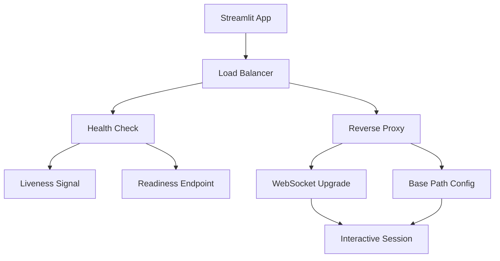

# Streamlit in Production: Health Checks, Probes, and the Reverse-Proxy Contract

## English

When a Streamlit app runs on your laptop, `streamlit run app.py` is the whole story. When it runs behind a load balancer in a cloud environment, a different set of contracts kicks in. The first is the health check: most orchestrators (Kubernetes, ECS, Cloud Run) periodically probe a URL and expect a fast, deterministic response. Streamlit ships a built-in `/_stcore/health` route that returns 200 once the server thread is up, and that is the route the official Kubernetes and Docker tutorials point their probes at. It is a good liveness signal, but it knows nothing about your ScriptRunner's state or whether your database is reachable. A more honest readiness check is therefore a tiny separate endpoint or a `/healthz`-style route served by a small companion process, rather than trying to make the built-in health route double as a dependency probe.

The second contract is the reverse proxy. Streamlit speaks WebSocket for its live channel, and proxies must be configured to upgrade and keep that connection open. Nginx, for example, needs `proxy_http_version 1.1`, `proxy_set_header Upgrade $http_upgrade`, and `proxy_set_header Connection "upgrade"` on the relevant location block; without them the WebSocket handshake fails and the app appears to load but never becomes interactive. Timeouts matter too: an idle WebSocket that a proxy closes after 60 seconds will silently kill a user's session. Raising `proxy_read_timeout` and enabling periodic heartbeats on both sides keeps the connection alive.

The third contract is path and host handling. If your app is served under a subpath (say `/analytics/`), the front-end must know its base path so that asset URLs and the WebSocket URL resolve correctly. Streamlit exposes configuration for this (server.baseUrlPath and related settings), and getting it wrong produces the classic symptom of a page that loads but whose JavaScript fails to connect. Similarly, `server.enableCORS` and `server.enableXsrfProtection` interact with proxy headers; disabling them to "make it work" is a common shortcut that quietly weakens security.

The fourth contract is scaling. Streamlit sessions are pinned to the process that holds their WebSocket, so horizontal scaling requires either sticky sessions at the load balancer or an architecture where each user's session is routed consistently. Autoscaling on CPU is tricky because a single heavy rerun can spike one process while others idle; autoscaling on connection count is often more representative.

None of this is exotic — it is the same contract any stateful WebSocket application faces. But Streamlit hides the web layer so thoroughly that these concerns can feel like surprises. Treating the deployment as a real web service, with explicit health semantics, proxy configuration, and scaling strategy, is what separates a demo from something you can leave running overnight.

## 中文

當 Streamlit app 喺你部 laptop 度行，`streamlit run app.py` 就係全部故事。但當佢喺雲端環境嘅 load balancer 後面行，另一套契約就會生效。第一樣係健康檢查：大部分 orchestrator（Kubernetes、ECS、Cloud Run）都會定期探測一個 URL，期望得到快速、確定嘅回應。Streamlit 內建一條 `/_stcore/health` 路由，只要 server thread 起咗就回 200，官方嘅 Kubernetes 同 Docker 教學都係將探測指向呢條路由。佢係一個良好嘅存活訊號，但佢完全唔知你個 ScriptRunner 狀態如何，亦唔知你個資料庫連唔連得到。所以一個更誠實嘅就緒檢查，通常係一個細細嘅獨立 endpoint，或者由一個小型伴隨 process 提供嘅 `/healthz` 式路由，而唔係夾硬要嗰條內建健康路由兼任依賴探測器。

第二樣契約係反向代理。Streamlit 用 WebSocket 做佢嘅即時通道，代理必須配置成可以升級同保持嗰條連線。例如 Nginx 喺相關嘅 location block 需要 `proxy_http_version 1.1`、`proxy_set_header Upgrade $http_upgrade` 同 `proxy_set_header Connection "upgrade"`；冇咗佢哋，WebSocket 握手會失敗，個 app 睇落好似載入咗但永遠唔會變得可互動。Timeout 都好重要：一條閒置嘅 WebSocket 如果被代理喺 60 秒後關閉，就會靜靜雞殺死用戶嘅 session。調高 `proxy_read_timeout` 同喺兩邊啟用定期心跳，就可以保持連線。

第三樣契約係路徑同主機處理。如果你個 app 喺一個子路徑下提供服務（例如 `/analytics/`），前端必須知道佢嘅 base path，先至可以正確解析靜態資源 URL 同 WebSocket URL。Streamlit 有相關設定（server.baseUrlPath 及相關選項），搞錯就會出現經典症狀：頁面載入到，但 JavaScript 連唔到。同樣，`server.enableCORS` 同 `server.enableXsrfProtection` 會同代理標頭互動；為咗「整到佢行」而停用佢哋，係一個常見捷徑，但會靜靜雞削弱安全性。

第四樣契約係擴展。Streamlit session 綁定喺持有佢 WebSocket 嘅 process 度，所以水平擴展需要喺 load balancer 做 sticky session，或者用一個將每個用戶 session 一致咁路由嘅架構。基於 CPU 嘅自動擴展好棘手，因為一次沉重嘅 rerun 可以令一個 process 飆高而其他閒置；基於連線數量嘅自動擴展通常更有代表性。

呢啲全部都唔算稀奇——任何有狀態嘅 WebSocket 應用都面對同一套契約。但 Streamlit 將 web 層藏得太徹底，令呢啲關注點感覺好似驚喜。將部署當成真正嘅 web 服務看待，有明確嘅健康語義、代理設定同擴展策略，就係 demo 同可以擺過夜運行嘅嘢之間嘅分別。

## Key Takeaway

Running Streamlit in production means honouring the same contracts as any stateful WebSocket service: honest health checks, correct proxy upgrade and timeout settings, base-path configuration, and a scaling strategy that respects session affinity.

## Related Concepts
- Reverse proxy WebSocket upgrade
- Session affinity and horizontal scaling

## Diagram

