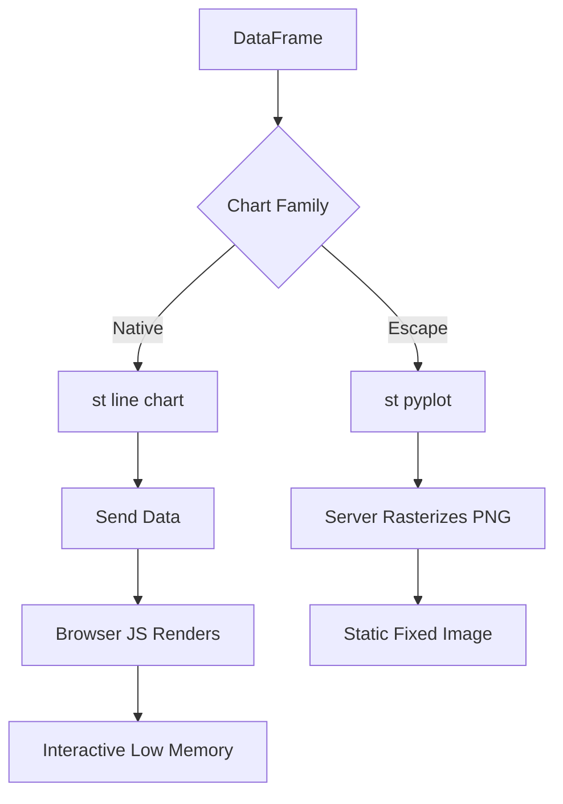

# Streamlit's Built-In Charting Layer: How st.line_chart Differs from st.pyplot

## English

Streamlit offers two very different ways to draw a chart, and understanding the split explains a lot of surprising behaviour. The first family is the native chart elements: st.line_chart, st.bar_chart, st.area_chart, and st.scatter_chart. These accept a pandas DataFrame (or similar columnar data), and Streamlit itself renders them in the browser using a JavaScript charting library. Because the drawing happens client-side, these charts are interactive by default — you can hover to see values, zoom, and pan — and they cost very little server memory, since only the underlying data is sent over the wire, not a rendered image.

The second family is the escape hatches: st.pyplot for matplotlib figures, st.plotly_chart for Plotly, st.altair_chart for Altair/Vega-Lite, and st.vega_lite_chart for a raw Vega-Lite spec. Here the Python library builds the whole figure object on the server. Note that `st.bokeh_chart` used to sit in this list but was removed in Streamlit 1.52.0 — calling it now raises an AttributeError, and the official replacement is the `streamlit-bokeh` custom component. For matplotlib in particular, the figure is rasterised into an image (PNG by default) and that image is shipped to the browser. That means no hover tooltips, no zooming, and a fixed resolution that can look blurry on high-DPI screens unless you tune the DPI and figure size yourself.

A concrete example makes the trade-off clear. Suppose you have a DataFrame of 100,000 rows and call st.line_chart(df). Streamlit sends the data and the browser draws a line. Now suppose you do fig, ax = plt.subplots(); ax.plot(df); st.pyplot(fig). Matplotlib renders 100,000 points into pixels on the server, which is slow and produces a static picture. If you only need a quick look, the native chart is faster and friendlier; if you need precise control over ticks, annotations, or a publication-style layout, matplotlib is the right tool.

There is a subtler point about data volume. Native charts still serialise your DataFrame and send it to the browser, so a million-row line chart is a bad idea — the browser has to hold all those points. The conventional fix is to aggregate or resample first (for example, group by day and take the mean) so the browser receives a manageable number of points. This is a data-shaping decision, not a Streamlit limitation, but it bites people who assume the framework magically downsamples.

Finally, remember that chart elements are output elements, not inputs. They return a value (often the chart object or None), but you cannot read a user's hover position back into Python. If you need the chart to drive interaction — click a point to filter a table — you generally need a library with a callback/event mechanism (Plotly's selection events, for instance) plus Streamlit's component event handling, or a custom component. Knowing which layer you are in prevents a lot of confusion.

## 中文

Streamlit 提供兩種截然不同的畫圖方式，理解這個分野就解釋得通好多令人意外嘅行為。第一類係原生圖表元素：st.line_chart、st.bar_chart、st.area_chart 同 st.scatter_chart。呢啲接受 pandas DataFrame（或者類似嘅欄式數據），而 Streamlit 本身就用 JavaScript 圖表庫喺瀏覽器度渲染。因為繪圖喺客戶端發生，呢啲圖表預設就係互動式——你可以 hover 睇數值、縮放、平移——而且伺服器記憶體成本好低，因為只有底層數據經網絡傳送，唔係一張渲染好嘅圖像。

第二類係逃生門：st.pyplot 用嚟畫 matplotlib 圖、st.plotly_chart 用 Plotly、st.altair_chart 用 Altair/Vega-Lite，st.vega_lite_chart 則直接食一個 Vega-Lite spec。喺呢度，Python 庫喺伺服器度砌成個 figure 物件。要留意 `st.bokeh_chart` 以前都喺呢個名單入面，但已經喺 Streamlit 1.52.0 被移除——而家呼叫佢會直接拋出 AttributeError，官方建議改用 `streamlit-bokeh` 自訂元件。特別係 matplotlib，個 figure 會被柵格化成圖像（預設 PNG），再送去瀏覽器。咁即係冇 hover tooltip、冇得縮放，而且解像度固定，喺高 DPI 螢幕上除非你自己調 DPI 同 figure 尺寸，否則會睇落模糊。

一個具體例子令取捨好清楚。假設你有 100,000 行嘅 DataFrame，叫 st.line_chart(df)。Streamlit 送數據，瀏覽器畫線。而家假設你寫 fig, ax = plt.subplots(); ax.plot(df); st.pyplot(fig)。Matplotlib 喺伺服器度將 100,000 點渲染成像素，慢而且出嚟係靜態圖片。如果你只想快速睇一眼，原生圖表又快又友善；如果你要精確控制刻度、註釋或者出版級排版，matplotlib 就係啱嘅工具。

仲有個更微妙嘅點關於數據量。原生圖表仍然會序列化你個 DataFrame 再送去瀏覽器，所以一百萬行嘅折線圖係壞主意——瀏覽器要承受晒所有點。慣常做法係先聚合或者重採樣（例如按日 group by 再取平均），令瀏覽器收到可控數量嘅點。呢個係數據塑形嘅決定，唔係 Streamlit 嘅限制，但好多人以為框架會神奇地降採樣，結果中招。

最後，記住圖表元素係輸出元素，唔係輸入。佢會回傳一個值（通常係圖表物件或者 None），但你唔可以將用戶嘅 hover 位置讀返入 Python。如果你要圖表驅動互動——例如點擊一點去過濾表格——你通常需要一個有 callback/事件機制嘅庫（例如 Plotly 嘅選取事件）再加 Streamlit 嘅組件事件處理，或者用自訂組件。知道自己身處邊一層，可以避免好多混亂。

## Key Takeaway

Native chart elements render client-side and stay interactive, while library charts like st.pyplot are rendered server-side into static images — pick based on interaction needs and data volume.

## Related Concepts
- pandas DataFrame serialisation
- matplotlib rendering pipeline

## Diagram

