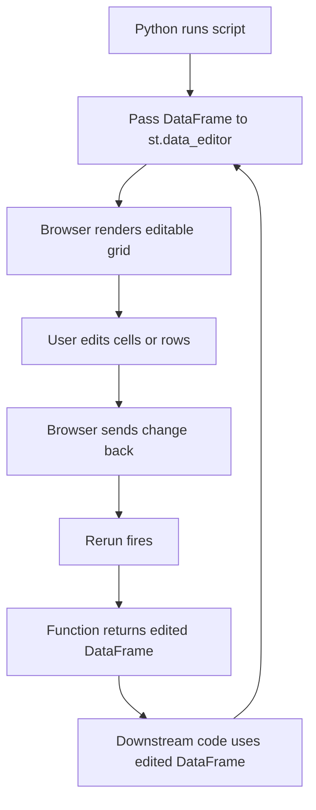

# st.data_editor and the Editable Table: Turning Output Into Two-Way Data

## English

Most Streamlit elements are one-way: Python sends something, the browser shows it. st.data_editor breaks that pattern. You hand it a DataFrame, and it renders an editable grid in the browser where the user can change cell values, add rows, or delete rows (depending on configuration). When a rerun fires, the function returns a new DataFrame containing the user's edits. This is the framework's main answer to the question 'how do I let someone correct my data without writing a whole form?'

The key mental model is that st.data_editor is both an output and an input at once. On the first run, you pass in a DataFrame; Streamlit displays it. When the user edits a cell, the browser sends that change back, a rerun happens, and the function now returns the edited DataFrame. If you write `edited = st.data_editor(df)` and then use `edited` downstream, you are always working with the latest user state. If you ignore the return value and keep using the original `df`, the edits appear to do nothing — a very common beginner bug.

You can control editability per column. The `column_config` argument lets you declare a column as a dropdown (SelectboxColumn), a number with min/max (NumberColumn), a date (DateColumn), a checkbox (CheckboxColumn), or read-only (TextColumn with disabled=True). This matters because free-text editing of a numeric column invites garbage input; a NumberColumn constrains it at the UI level. You can also set `num_rows="dynamic"` to let users add and remove rows, which is useful for small lookup tables but dangerous for anything that must match a fixed schema.

A practical caution: edits live in the browser and the returned DataFrame, not in your original data source. If your app loads data from a database, editing the grid does not write back to the database. You must explicitly take the returned DataFrame and issue an UPDATE, or write it to a file, or feed it into your next computation. This is by design — Streamlit has no opinion about your persistence layer — but it surprises people who expect a spreadsheet-like auto-save.

There is also a performance consideration. Each keystroke or cell commit can trigger a rerun, and if your script does heavy work above the editor, the whole page recomputes. Wrapping the editor inside a form (st.form) batches edits so a rerun only fires when the user clicks submit, which is often the right pattern for bulk editing. And for very large tables, st.data_editor still sends the visible data to the browser, so paginating or filtering before display keeps things responsive.

## 中文

大部分 Streamlit 元素都係單向：Python 送啲嘢，瀏覽器顯示。st.data_editor 打破呢個模式。你俾佢一個 DataFrame，佢喺瀏覽器度渲染一個可編輯嘅表格，用戶可以改儲存格值、加行或者刪行（視乎設定）。當 rerun 觸發，個函數會回傳一個包含用戶修改嘅新 DataFrame。呢個係框架對「我點樣俾人更正我啲數據而唔使寫成個表格」呢條問題嘅主要答案。

關鍵心智模型係：st.data_editor 同時係輸出同輸入。第一次運行，你傳入一個 DataFrame；Streamlit 顯示佢。當用戶改一格，瀏覽器送返個改動，rerun 發生，個函數而家回傳改過嘅 DataFrame。如果你寫 `edited = st.data_editor(df)` 然後下游用 `edited`，你永遠都係處理最新嘅用戶狀態。如果你忽略回傳值、繼續用原本嘅 `df`，啲修改睇落好似冇效——呢個係非常常見嘅新手 bug。

你可以逐欄控制可編輯性。`column_config` 參數俾你將一欄宣告做下拉選單（SelectboxColumn）、有上下限嘅數字（NumberColumn）、日期（DateColumn）、勾選框（CheckboxColumn），或者唯讀（TextColumn 加 disabled=True）。呢點好重要，因為自由文字編輯數字欄會招致垃圾輸入；NumberColumn 喺 UI 層面限制咗。你可以設 `num_rows="dynamic"` 俾用戶加減行，對細型對照表有用，但對於必須符合固定 schema 嘅嘢就好危險。

實際警告：修改住喺瀏覽器同回傳嘅 DataFrame 度，唔喺你原本嘅數據源。如果你個 app 從資料庫載入數據，編輯個表格唔會寫返資料庫。你必須明確攞個回傳 DataFrame 去發 UPDATE、寫入檔案，或者餵入下一個計算。呢個係設計使然——Streamlit 對你嘅持久化層冇意見——但好多人以為會好似試算表咁自動儲存，結果被嚇一跳。

仲有性能考量。每次打鍵或者 commit 一格都可能觸發 rerun，如果你個腳本喺 editor 上面做重活，成本頁都會重算。將 editor 包喺 form（st.form）入面可以批次處理修改，令 rerun 只喺用戶撳提交時先觸發，呢個通常係大量編輯嘅啱模式。而對於超大表格，st.data_editor 仍然會送可見數據去瀏覽器，所以顯示前分頁或者過濾可以保持流暢。

## Key Takeaway

st.data_editor is a two-way element: it displays a DataFrame and returns the user's edits, so you must use the return value and persist it yourself.

## Related Concepts
- st.form batching
- column_config schema

## Diagram

