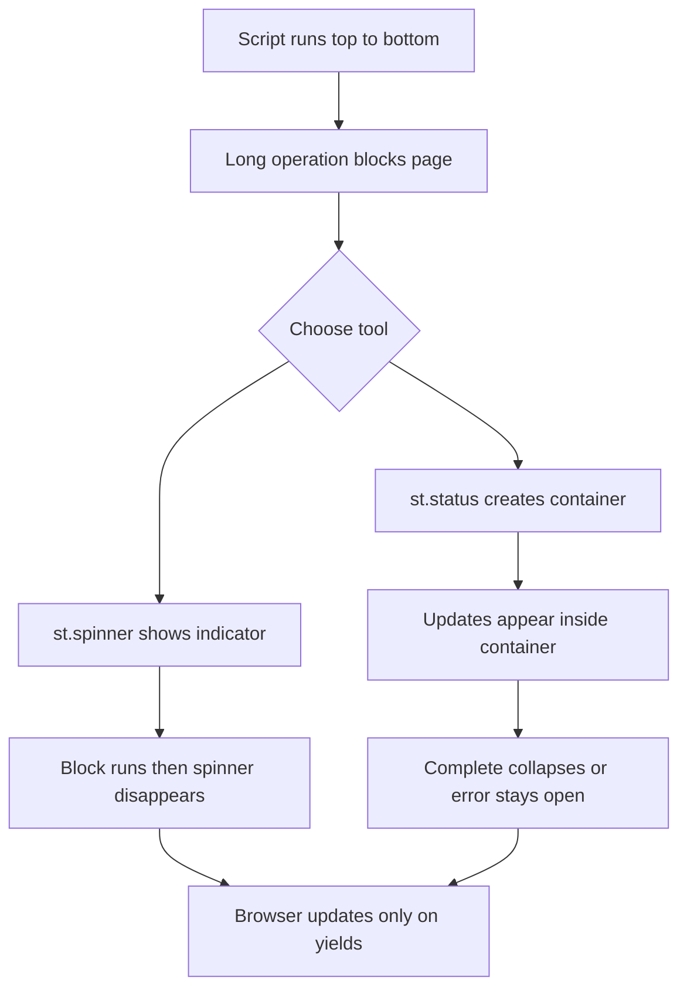

# Streamlit's st.status and st.spinner: Communicating Progress in a Blocking Script

## English

Because a Streamlit script runs top to bottom and blocks while it does so, long operations leave the browser staring at a frozen page. Streamlit gives you two tools to talk to the user during that wait, and they work in different ways. st.spinner is the simple one: a context manager that shows a small spinning indicator and a message while the block runs, then disappears. Use it around a single slow call — a database query, a model inference — so the user knows something is happening rather than assuming the app has crashed.

st.status is the richer tool. It creates a collapsible status container with a label and a state (running, complete, or error). Inside the `with` block you can write updates — st.write, st.progress, text — and those updates appear inside the container as the work proceeds. When the block exits normally, the status flips to complete and collapses; if an exception is raised, it flips to error and stays open. This is ideal for multi-step pipelines: 'Loading data…', 'Cleaning…', 'Training…', 'Done', each step logged inside the same expandable box.

A crucial caveat: these elements update the browser only when the script yields control, which in practice means at certain points during the run. Streamlit flushes updates as the script progresses, so a sequence of st.write calls inside a status block will appear incrementally — but a tight Python loop that never touches Streamlit will not animate. If you want a progress bar to move, you must call st.progress(value) inside the loop; the call itself is what pushes the update out. This is why a pure `for i in range(1000000): pass` shows nothing, while the same loop with an st.progress call every thousand iterations animates smoothly.

There is a cost to frequent updates. Every flush is a message over the WebSocket to the browser, so updating a progress bar on every single iteration of a million-step loop floods the connection and slows the app. The conventional pattern is to update every N iterations, or to compute a percentage and only call st.progress when it changes by a meaningful amount. The same logic applies to st.status: writing a line per item is fine for ten items, wasteful for ten thousand.

Finally, understand what these tools do not do. They do not make the work asynchronous or non-blocking; the script still waits. They do not survive a rerun — a new run starts fresh, so status containers from a previous run are gone. And they are not a substitute for caching: if a step is slow and deterministic, cache it so you only pay the cost once, rather than showing a spinner every time the user changes an unrelated widget.

## 中文

因為 Streamlit 腳本由上到下運行，期間會阻塞，所以長時間操作會令瀏覽器對住一個凍結嘅頁面。Streamlit 俾你兩個工具喺等待期間同用戶溝通，而佢哋運作方式唔同。st.spinner 係簡單嗰個：一個 context manager，喺個 block 運行時顯示一個細細嘅轉圈指示同訊息，完咗就消失。用喺單一慢呼叫周圍——一個資料庫查詢、一次模型推論——令用戶知道有嘢發生緊，唔會以為個 app 死咗。

st.status 係更豐富嘅工具。佢建立一個可摺疊嘅狀態容器，有標籤同狀態（running、complete 或者 error）。喺 `with` block 入面你可以寫更新——st.write、st.progress、文字——而呢啲更新會隨住工作進行喺容器入面出現。當 block 正常結束，狀態轉做 complete 並摺疊；如果拋出異常，就轉做 error 並保持打開。呢個啱晒多步流程：「載入數據…」、「清洗…」、「訓練…」、「完成」，每一步都記錄喺同一個可展開盒入面。

一個關鍵注意點：呢啲元素只會喺腳本讓出控制權時先更新瀏覽器，實際運作上即係喺運行期間某些時點。Streamlit 會隨住腳本推進 flush 更新，所以 status block 入面一連串 st.write 呼叫會逐步出現——但一個從不接觸 Streamlit 嘅緊密 Python 迴圈就唔會動畫。如果你想進度條移動，你必須喺迴圈入面叫 st.progress(value)；係個呼叫本身將更新推出去。呢個就解釋咗點解純粹 `for i in range(1000000): pass` 乜都唔顯示，而同一個迴圈每千次迭代叫一次 st.progress 就順暢動畫。

頻繁更新有代價。每次 flush 都係經 WebSocket 送去瀏覽器嘅訊息，所以喺一百萬步迴圈每一步都更新進度條會淹沒條連線、拖慢個 app。慣常做法係每 N 次迭代更新一次，或者計個百分比、只喺變化有意義時先叫 st.progress。同樣邏輯適用於 st.status：每項寫一行對十項冇問題，對一萬項就浪費。

最後，要明白呢啲工具唔做乜。佢哋唔會令工作變成異步或者非阻塞；腳本仍然要等。佢哋唔會喺 rerun 之後保留——新一次運行由頭開始，上一次嘅 status 容器已經冇咗。而且佢哋唔係 caching 嘅替代品：如果某步又慢又確定性，就 cache 佢令你只付一次代價，而唔係每次用戶改個無關組件都顯示轉圈。

## Key Takeaway

st.spinner and st.status report progress during a blocking run, but updates only flush when Streamlit yields — so loop-based progress needs explicit st.progress calls at a sensible cadence.

## Related Concepts
- WebSocket delta flushing
- st.cache_data for deterministic slow steps

## Diagram

