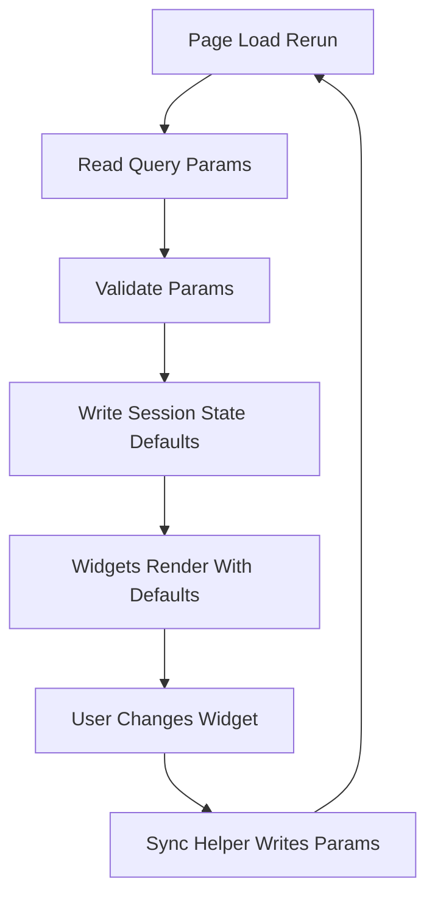

# The Sidebar as a Navigation Router: URLs, Query Params, and Deep Links

## English

Most Streamlit tutorials treat st.sidebar as a place to park filters. But a sidebar plus st.query_params (the modern replacement for the older st.experimental_get_query_params API) turns your app into something that behaves like a real navigable site: users can bookmark a specific view, share a link with a colleague, and hit the browser Back button without losing their place. The trick is to treat the query string as a small, serialisable description of the app's current view — for example, ?tab=summary&region=apac&year=2024 — and to write a small function that reads those params at the top of the script and feeds them into your widget default values.

The subtlety is that this creates a two-way binding you have to maintain by hand. Streamlit does not automatically rewrite the URL when a widget changes; you must call st.query_params[...] = value inside your script (or in a widget callback) whenever a relevant widget changes, and you must also read the params back into the widget's default argument on the next rerun. If you only do one direction, you get the classic bug where the URL says one thing and the screen shows another. A clean pattern is a single 'sync' helper that runs early in the script: read params, validate them, then assign them to session_state keys that your widgets use as their default values.

Deep links matter most in the scenarios people actually use Streamlit for: an analyst sends a link to a dashboard filtered to the exact quarter they were discussing, or a support engineer bookmarks a view of a specific customer's metrics. Without query params, every share is 'open the app and re-click five things'. With them, the app becomes a document you can point at. The same mechanism also lets you drive the app from outside — a Slack bot or an email can link directly to a pre-filtered state.

One caveat: query params are visible in the URL bar and in browser history, so never put secrets, tokens, or personally identifying data in them. They are also strings only, so you will be doing your own type coercion (int(param), param == 'true', and so on) and your own validation, because a user can hand-edit the URL to anything. Treat every param as untrusted input and fall back to a safe default when parsing fails.

Finally, remember that multipage apps already give you a URL per page (the page name becomes part of the path), so query params and multipage navigation compose naturally: the page picks the broad view, and the query string picks the narrow one. Together they give you something close to a conventional web app's routing model, built out of nothing but a sidebar, a few widgets, and a dictionary of strings.

## 中文

大部分 Streamlit 教學都只係將 st.sidebar 當成擺放篩選器嘅地方。但其實一個 sidebar 加埋 st.query_params（用嚟取代舊有 st.experimental_get_query_params API 嘅現代做法），就可以令你嘅應用表現到好似一個真正可以導航嘅網站：用戶可以書籤某個特定檢視、將連結分享俾同事、撳瀏覽器嘅「上一頁」都唔會迷失位置。訣竅係將 query string 當成一個細細哋、可以序列化嘅「目前檢視描述」——例如 ?tab=summary&region=apac&year=2024——然後寫一個細函數，喺腳本開頭讀取呢啲參數，再餵入你嘅組件預設值。

微妙之處在於：呢個係一個雙向綁定，你要自己維護。Streamlit 唔會喺組件改變時自動改寫 URL；你必須喺腳本入面（或者喺組件 callback 入面）呼叫 st.query_params[...] = value，同時亦要喺下一次重跑時將參數讀返入組件嘅預設參數。如果只做單向，就會出現經典 bug：URL 講一套，畫面顯示另一套。乾淨嘅做法係一個「同步」輔助函數，喺腳本早期執行：讀參數、驗證、然後寫入 session_state 嘅 key，俾你嘅組件做預設值。

深層連結最重要嘅場景，正正就係大家真正用 Streamlit 做嘅嘢：分析師將一個已篩選到某一季嘅儀表板連結傳俾同事，或者支援工程師書籤某個客戶嘅指標檢視。冇 query params 嘅話，每次分享都係「開 app 再撳五次」；有咗佢，應用就變成一份可以指向嘅文件。同一個機制亦可以俾你由外部驅動應用——Slack bot 或者電郵可以直接連結到預先篩選好嘅狀態。

一個注意事項：query params 會顯示喺網址列同瀏覽器歷史入面，所以千萬唔好將密鑰、token 或者個人身分資料放進去。佢哋亦只係字串，所以你要自己做型別轉換（int(param)、param == 'true' 之類）同自己驗證，因為用戶可以隨手改 URL 成任何嘢。將每個參數都當成不可信輸入，解析失敗就退回安全預設值。

最後要記住：多頁應用本身已經俾咗每頁一個 URL（頁名會成為路徑一部分），所以 query params 同多頁導航可以自然組合：頁面揀大方向，query string 揀窄範圍。兩者加埋，就得到一個接近傳統 web app 路由模型嘅嘢——而全部只係由一個 sidebar、幾個組件同一個字串字典砌出嚟。

## Key Takeaway

Treat st.query_params as a two-way, hand-maintained binding that turns your sidebar filters into shareable, bookmarkable deep links — and validate every param as untrusted input.

## Related Concepts
- st.query_params
- Multipage navigation

## Diagram

