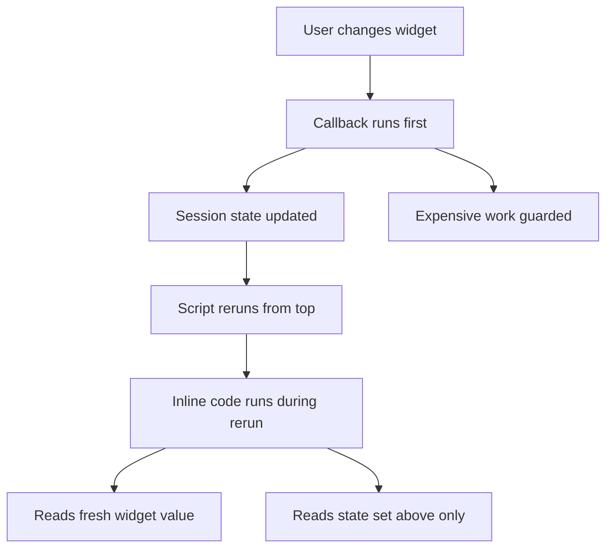

# Callbacks vs Inline Code: Choosing Where Your Logic Lives

## English

Every Streamlit widget has two places your logic can run: inline, in the main script body right after the widget call, or inside an on_change (or on_click) callback that Streamlit fires when the widget's value changes. Beginners almost always use inline code because it reads top-to-bottom, and for simple cases that is fine. But the moment you need to update one piece of state in response to another, or you want to avoid a full rerun doing expensive work with a stale value, the callback form starts to matter — and the difference is not cosmetic, it is about ordering.

Here is the ordering trap in plain terms. When a user changes a widget, Streamlit first runs any registered callback for that widget, and only then reruns the script from the top. Inline code, by contrast, runs during the rerun, which means it sees the new widget value but runs after everything above it in the script has already executed. So if your inline code depends on a value that is set further down the script, it will read last run's value — not this run's. Callbacks sidestep this because they execute before the rerun begins, so they always see the freshest input.

A practical rule: use callbacks when a widget change must update session_state in a way that other parts of the script depend on, especially when the update involves validation, clamping, or clearing dependent state. Use inline code when the logic is purely presentational — filtering a dataframe to display it, formatting a number, choosing which chart to draw. The inline style is easier to read and debug; the callback style is easier to reason about when state has dependencies.

There is a second reason callbacks matter: they let you avoid the 'widget value changed, but my expensive downstream code already started' problem. If a callback can do the cheap bookkeeping — setting a flag, normalising a value, resetting a downstream widget — then the main script body can branch on that flag and skip work it would otherwise do. This is a lightweight alternative to fragments when the expensive part is not itself a widget interaction.

One caution: callbacks run outside the normal script flow, so st.write inside a callback will not appear where you expect, and errors raised there can be harder to trace. Keep callbacks small and boring — set state, validate, clear — and leave the rendering to the main script body. If a callback grows past a handful of lines, that is usually a signal the logic belongs in a helper function that the main script calls, with the callback only doing the state mutation.

## 中文

每個 Streamlit 元件都有兩個地方可以放你嘅邏輯：內聯（inline），即係喺元件呼叫之後、主指令碼主體入面直接寫；或者放喺 on_change（或 on_click）callback 入面，由 Streamlit 喺元件值改變時觸發。新手幾乎一定用內聯寫法，因為由頭到尾讀落去好順，簡單情況亦冇問題。但一旦你需要「因為 A 而更新 B」，或者想避免一次完整重跑用住舊值做昂貴工作，callback 形式就開始重要——而箇中差別唔係裝飾性，係關於執行次序。

用淺白講清楚個次序陷阱：當使用者改動一個元件，Streamlit 會先執行該元件已註冊嘅 callback，然後先至由頭重跑指令碼。相反，內聯程式碼係喺重跑期間執行，即係佢會見到新嘅元件值，但佢係喺指令碼上面所有嘢都執行完之後才跑。所以如果你嘅內聯程式碼依賴一個喺指令碼較後位置設定嘅值，佢會讀到上一次嘅值——唔係今次嘅。Callback 就避開咗呢個問題，因為佢喺重跑開始之前就執行，所以永遠見到最新輸入。

實用規則：當元件改變必須更新 session_state，而指令碼其他部分又依賴嗰個更新（尤其涉及驗證、夾值、清除下游狀態）時，用 callback。當邏輯純粹係展示性——將 dataframe 篩選後顯示、格式化數字、揀畫邊個圖——就用內聯。內聯較易讀易 debug；callback 喺狀態有依賴時較易推理。

Callback 重要嘅第二個原因：佢俾你避開「元件值已變，但我昂貴嘅下游程式碼已經開始跑」嘅問題。如果 callback 可以做便宜嘅簿記——設 flag、正規化數值、重設下游元件——咁主指令碼主體就可以根據 flag 分支，跳過本來要做嘅工作。當昂貴部分本身唔係元件互動時，呢個係 fragment 以外嘅輕量替代方案。

一個告誡：callback 喺正常指令碼流程以外執行，所以喺 callback 入面寫 st.write 唔會喺你預期嘅位置出現，嗰度丟擲嘅錯誤亦較難追蹤。保持 callback 細細哋、沉悶——設狀態、驗證、清除——渲染留返俾主指令碼主體。如果 callback 長過幾行，通常係訊號：邏輯應該搬去一個由主指令碼呼叫嘅輔助函式，callback 只負責改狀態。

## Key Takeaway

Callbacks run before the rerun and always see fresh input; inline code runs during the rerun and can read stale values — so put state-mutating logic in callbacks and keep them small.

## Related Concepts
- on_change callbacks
- Order of execution

## Diagram

