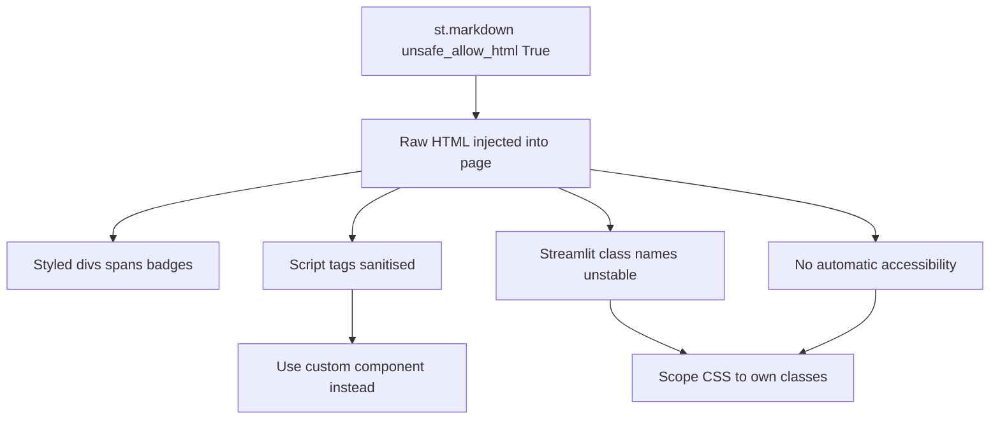

# Streamlit's CSS Escape Hatch: st.markdown with unsafe_allow_html and Its Limits

## English

Streamlit ships with a fairly opinionated look, and theming via config.toml covers colours and fonts. But sometimes you need something the theme system cannot express: a coloured badge, a custom callout box, a small piece of inline styling. The framework's escape hatch is st.markdown(..., unsafe_allow_html=True), which lets you inject raw HTML into the page. It is genuinely useful, and it is also the source of a lot of fragile apps, so it is worth understanding what it actually does and does not do.

The first thing to know is that it is a Markdown renderer with an HTML pass-through, not a full templating engine. You can write things like a div with a style attribute, a span with a background colour, or a small table. What you cannot reliably do is inject <script> tags and expect them to run — Streamlit sanitises and sandboxes the output, and JavaScript injected this way generally will not execute the way it would in a plain HTML page. If you need real interactivity, the supported path is a custom component (a separate package that runs in an iframe), not an inline script tag.

The second thing is the class-name problem. Streamlit's internal DOM structure and CSS class names are not a public API; they change between versions. If you write CSS that targets a specific generated class to restyle a widget, it may work today and break silently after an upgrade. The safer approach is to style only the HTML you inject yourself, by giving your own elements a stable class or id and writing CSS scoped to that. Treat anything that reaches into Streamlit's own markup as a version-coupled hack, and isolate it in one place so you can find it when it breaks.

The third thing is accessibility. Raw HTML you inject is not automatically labelled, focusable, or screen-reader friendly. A coloured div that conveys meaning through colour alone is invisible to a screen reader; a clickable span is not keyboard reachable unless you add the right role and tabindex. If the injected HTML carries information rather than decoration, add proper semantic elements (a real <button>, a 
 with text) and ARIA attributes where needed, or reconsider whether a built-in widget would do the job.

Finally, remember that unsafe_allow_html is disabled by default for a reason: if any part of the HTML string comes from user input, you have an injection risk. Escape or validate anything that originates from a text input, a query param, or an uploaded file before interpolating it into an HTML string. The name of the flag is not a joke — it is a reminder that you are opting out of the framework's default safety, and the responsibility for what goes in is yours.

## 中文

Streamlit 出廠時外觀幾有主見，而透過 config.toml 做主題設定可以覆蓋顏色同字型。但有時你需要一啲主題系統表達唔到嘅嘢：彩色徽章、自訂提示框、一小段內聯樣式。框架嘅逃生門就係 st.markdown(..., unsafe_allow_html=True)，俾你將原始 HTML 注入頁面。呢個真係有用，同時亦係好多脆弱應用嘅源頭，所以值得搞清楚佢實際做啲乜、唔做啲乜。

第一件要知嘅事：佢係一個帶 HTML 直通嘅 Markdown 渲染器，唔係完整模板引擎。你可以寫例如帶 style 屬性嘅 div、有背景色嘅 span、或者一個細表格。你唔可以可靠地注入 <script> 標籤然後期望佢執行——Streamlit 會對輸出做淨化同沙盒隔離，用呢種方式注入嘅 JavaScript 一般唔會好似喺普通 HTML 頁面咁執行。如果你需要真正嘅互動性，支援嘅路徑係自訂組件（一個喺 iframe 入面跑嘅獨立套件），唔係內聯 script 標籤。

第二件事係 class 名稱問題。Streamlit 內部 DOM 結構同 CSS class 名稱唔係公開 API，版本之間會變。如果你寫 CSS 去針對某個自動生成嘅 class 嚟改組件樣式，今日可能得，升級之後就可能無聲無息咁壞。較安全嘅做法係只為你自己注入嘅 HTML 加樣式：俾你自己嘅元素一個穩定嘅 class 或 id，然後寫只針對嗰個範圍嘅 CSS。任何伸手入 Streamlit 自己 markup 嘅嘢，都當成同版本綁死嘅 hack，並且集中喺一個地方，壞嘅時候容易搵返。

第三件事係無障礙。你注入嘅原始 HTML 唔會自動有標籤、焦點或者對螢幕閱讀器友善。一個純靠顏色傳達意思嘅彩色 div，對螢幕閱讀器係隱形嘅；一個可點擊 span 除非你加啱 role 同 tabindex，否則鍵盤去唔到。如果注入嘅 HTML 承載資訊而唔係裝飾，就加返正確嘅語意元素（真正嘅 <button>、有文字嘅 
）同需要嘅 ARIA 屬性，或者重新考慮內置組件係咪已經做得到。

最後要記住：unsafe_allow_html 預設關閉係有原因嘅——如果 HTML 字串任何部分嚟自用戶輸入，你就有注入風險。任何嚟自文字輸入、query param 或者上載檔案嘅內容，喺插入 HTML 字串之前都要轉義或驗證。個 flag 個名唔係講笑——佢提醒你，你係主動放棄框架嘅預設安全，入面放咩係你嘅責任。

## Key Takeaway

unsafe_allow_html lets you inject HTML for styling, but it will not run scripts reliably, it couples you to Streamlit's unstable DOM if you reach into its markup, and it puts the full burden of escaping and accessibility on you.

## Related Concepts
- st.markdown
- Custom components

## Diagram

