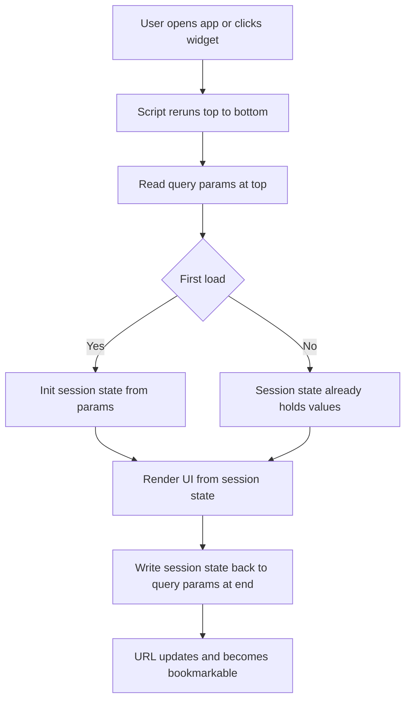

# Streamlit's Query Params API: Making a Rerun-Driven App Bookmarkable

## English

Streamlit apps are normally stateful in a way that is invisible to the browser's address bar: you click a widget, the script reruns, the UI changes, but the URL stays identical. That is fine for a personal dashboard, but it breaks the moment someone wants to share a link that says "show me the chart for region EMEA in Q3." The st.query_params API is the framework's answer. It is a dict-like object that mirrors the browser's query string, so reading st.query_params["region"] gives you whatever the URL says, and assigning to it writes the value back into the address bar without a page reload. Because the query string is part of the URL, the browser's back and forward buttons start to behave sensibly, bookmarks capture the app's state, and pasting a link into a chat window opens the same view on someone else's machine.

The important subtlety is ordering. Query params are read at the top of your script, like any other input, but they are also a widget-like input that can trigger a rerun when they change. A common pattern is to initialise st.session_state from the query params on first load, then push changes in session state back out to the query params at the end of the run. If you do it the other way around — writing to the params early and then reading them later in the same run — you will see the old value, because the write only takes effect on the next rerun. Think of the URL as a second, slower channel of state that the browser owns, not as a variable you can mutate in place.

There is also a size limit worth knowing. Browsers and proxies cap URL length (roughly a few thousand characters in practice), so query params are good for a handful of short identifiers — a region code, a date, a page number, a model name — and bad for serialising a whole dataframe or a long filter list. If you find yourself base64-encoding a JSON blob into a param, that is a signal you want a server-side store keyed by a short ID instead. The params API also only handles strings (or lists of strings), so numeric filters need explicit conversion on read.

A practical pattern for a multi-view app is to treat the query string as the source of truth for navigation: st.query_params["view"] = "detail" when the user clicks into a record, st.query_params.clear() when they go home. Combined with st.session_state for transient things like scroll position or a half-typed filter, this gives you a URL that is stable enough to share and a session that is responsive enough to feel instant. The mental model is that the URL is the app's public face and session state is its private scratchpad — keep them in sync deliberately, not accidentally.

## 中文

Streamlit 應用嘅狀態通常係瀏覽器網址列「睇唔到」嘅：你撳一個組件、腳本重跑、畫面改變，但條 URL 一模一樣。對個人 dashboard 嚟講冇問題，但一有人想 share 一條「幫我睇 EMEA 區第三季嘅圖」嘅連結，就即刻穿煲。st.query_params 就係框架嘅答案。佢係一個類似 dict 嘅物件，鏡像瀏覽器嘅 query string：讀 st.query_params["region"] 就攞到 URL 寫住嘅值；賦值就將值寫返去網址列，唔使 reload 頁面。因為 query string 係 URL 嘅一部分，瀏覽器嘅上一頁／下一頁終於會正常運作，bookmark 會記住應用嘅狀態，將條 link 貼去 chat 度喺人哋部機開都會見到同一個畫面。

最重要嘅微妙位係次序。Query params 同其他輸入一樣，喺腳本頂部讀取，但佢亦係一種「似組件」嘅輸入——一改變就會觸發重跑。常見做法係：首次載入時由 query params 初始化 st.session_state，然後喺 run 嘅尾段將 session state 嘅改動推返去 query params。如果你掉轉做——早段寫入 params、同一 run 後段再讀——你會讀到舊值，因為寫入要等下一次重跑才生效。可以咁理解：URL 係一條由瀏覽器擁有、比較慢嘅第二狀態通道，唔係你可以即場改嘅變數。

仲有個長度限制值得知。瀏覽器同代理都會限制 URL 長度（實際大約幾千字元），所以 query params 適合放幾個短識別碼——區碼、日期、頁碼、模型名——唔適合將成個 dataframe 或者一長串 filter 序列化入去。如果你發現自己要將 JSON blob base64 塞入 param，咁就係訊號：你其實想要一個伺服器端儲存，用短 ID 做 key。另外 params API 只處理字串（或字串 list），數值 filter 讀取時要自己轉型。

多視圖應用嘅實用模式，係將 query string 當成導航嘅真相來源：用戶撳入一筆記錄就 st.query_params["view"] = "detail"，返首頁就 st.query_params.clear()。再配合 st.session_state 處理短暫嘢（捲動位置、打到一半嘅 filter），你就得到一條夠穩定可以 share 嘅 URL，同一個夠爽快嘅 session。心法係：URL 係應用嘅「門面」，session state 係佢嘅「私人草稿紙」——要刻意保持同步，唔好靠撞彩。

## Key Takeaway

st.query_params turns the URL into a shareable, bookmarkable layer of state, but it is a slow, string-only, size-limited channel that must be synced with session state deliberately.

## Related Concepts
- Session state
- Deep linking

## Diagram

