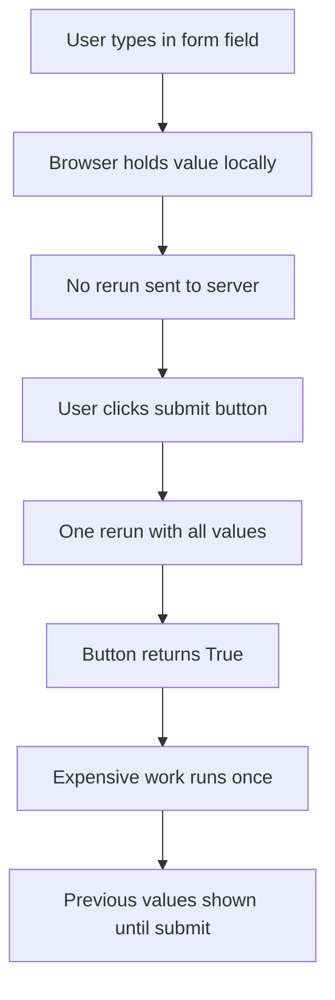

# The st.form Contract: Why Submit Buttons Change When Your Code Runs

## English

Every widget in Streamlit normally fires a rerun the instant it changes — type a character in a text box and the whole script re-executes. That is fine for a slider, but painful for a form with eight fields: the user fills in the first field, the script reruns, and any expensive downstream work (a query, a model call, a chart) runs seven more times before they finish. st.form exists to batch those inputs. Anything placed inside a `with st.form("key"):` block is collected by the browser and only sent to the server when the user clicks the form's submit button (created with st.form_submit_button). Inside a form, widgets behave like plain HTML inputs — they hold their value locally and do not trigger reruns.

The consequence is a change in when your code observes values, and this trips people up constantly. Inside a form, calling st.text_input returns the value from the last submission, not what the user is currently typing. If you write `name = st.text_input("Name")` inside a form and immediately `st.write(name)`, you will see the previous submission until the button is pressed. The submit button returns True only on the run triggered by the click, so the idiomatic pattern is: build the form, capture the button's return value, and only do the expensive work inside `if submitted:`. Everything outside that branch runs on every rerun regardless.

There is also an interaction with validation that is easy to miss. Because widgets inside a form do not rerun, you cannot do live validation as the user types — no "this email looks wrong" hint appearing mid-keystroke. You validate after submission instead, and if validation fails you show st.error inside or just after the form and let the user correct it. This is actually closer to how classic server-rendered forms work, and it is the right mental model: a form is a request, not a stream of events. If you genuinely need live feedback, put that one field outside the form and accept the rerun cost.

Finally, forms compose with the rest of Streamlit's state model in a specific way. Widget keys inside a form still live in st.session_state, but they update only on submit. You cannot nest forms, and you cannot put a form inside a fragment and expect per-field reruns — the fragment boundary and the form boundary both suppress reruns, and the form wins. The practical rule of thumb: if a group of inputs feeds one expensive action and the user benefits from filling them in any order, wrap them in a form; if each input should immediately change what the user sees, leave them bare and lean on caching or fragments to keep the reruns cheap.

## 中文

Streamlit 每個元件平時一改變就即刻觸發重跑——喺文字框打一個字，成個指令碼就會再執行一次。對 slider 冇所謂，但對一個有八個欄位嘅表單就好痛苦：使用者填第一個欄位，指令碼重跑，任何下游嘅貴價工作（查詢、模型呼叫、畫圖）喺佢填完之前已經跑多七次。st.form 就係用嚟將呢啲輸入批次處理。放喺 `with st.form("key"):` 區塊入面嘅嘢，會由瀏覽器收集，只有使用者撳咗表單嘅提交按鈕（用 st.form_submit_button 建立）才送去伺服器。喺 form 入面，元件好似普通 HTML input——值留喺本機，唔會觸發重跑。

後果係「你嘅程式幾時觀察到值」改變咗，而呢點經常令人中招。喺 form 入面叫 st.text_input，回傳嘅係上一次提交嘅值，唔係使用者而家打緊嘅嘢。如果你喺 form 入面寫 `name = st.text_input("Name")` 然後即刻 `st.write(name)`，你會見到上一次提交嘅內容，直到撳咗掣為止。提交按鈕只會喺「撳掣觸發嘅嗰次 run」回傳 True，所以慣用寫法係：建立表單、捕捉按鈕嘅回傳值、只有喺 `if submitted:` 分支入面才做貴價工作。分支以外嘅嘢，每次重跑都會照跑。

仲有個同驗證（validation）嘅互動好易漏。因為 form 入面嘅元件唔會重跑，你冇得做「邊打邊驗證」——唔會有「呢個 email 好似錯咗」嘅提示喺打字的同時彈出。你要喺提交之後才驗證；驗證失敗就喺 form 入面或後面顯示 st.error，等使用者改正。呢個其實更接近傳統伺服器渲染表單嘅做法，亦係正確心法：form 係一個「請求」，唔係一串「事件」。如果你真係要好即時嘅回饋，就將嗰個欄位放出 form 外面，接受重跑嘅成本。

最後，form 同 Streamlit 其餘狀態模型嘅組合有特定規矩。Form 入面嘅元件 key 仍然存在 st.session_state，但只會喺提交時更新。Form 唔可以巢狀，亦唔可以將 form 放入 fragment 然後期望逐欄重跑——fragment 邊界同 form 邊界都會抑制重跑，而 form 贏。實用準則：如果一組輸入餵一個貴價動作、而且使用者鍾意任意次序填，就包成 form；如果每個輸入都應該即刻改變使用者所見，就唔好包，改用 caching 或 fragments 令重跑變便宜。

## Key Takeaway

st.form batches widget values and defers them to a submit click, which means values inside a form reflect the last submission, not the live keystrokes — design your code around that contract.

## Related Concepts
- Rerun model
- Widget return values

## Diagram

