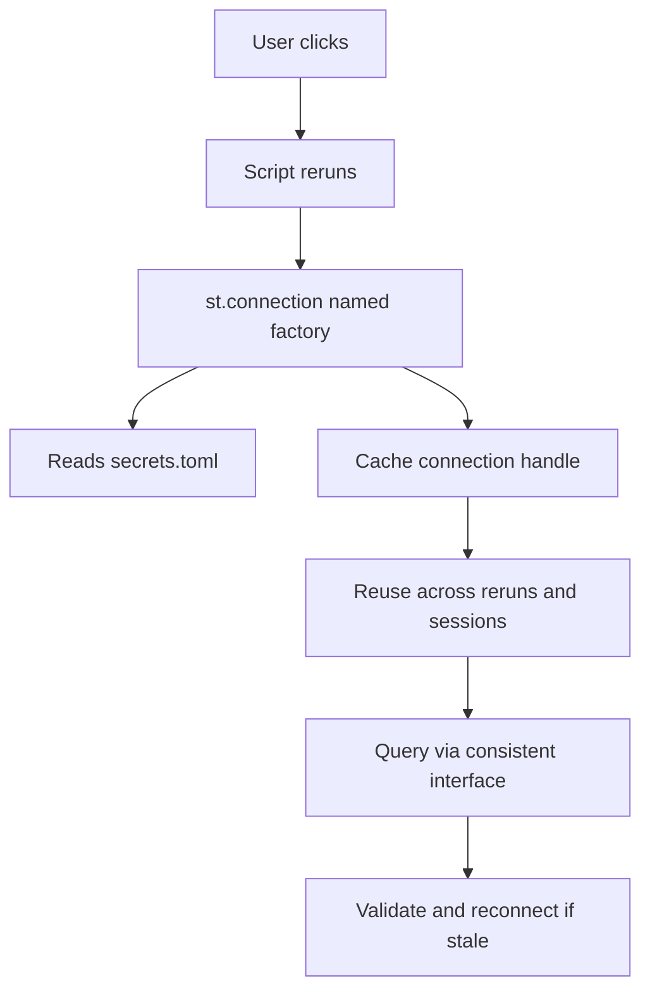

# Streamlit's st.connection: Managing External Database Handles Without Leaking Them

## English

Most Streamlit apps eventually talk to something outside the process — Postgres, Snowflake, BigQuery, an S3 bucket, a REST API. The naive approach is to open a connection at the top of the script, use it, and let it fall out of scope. That works locally and fails in production, because the script reruns on every interaction: you reopen a connection on every click, exhaust the pool, and add hundreds of milliseconds of handshake latency to each rerun. The framework's answer is st.connection, a small abstraction that wraps a database or service handle behind a named, cached factory. You declare it once with a name and a type (for example `st.connection("mydb", type="sql")`), and Streamlit caches the underlying connection object across reruns and across sessions according to the connection's own rules.

The key distinction from st.cache_resource is what st.connection knows about. A raw cache_resource just memoises a function's return value keyed by its arguments — it has no idea that the thing it is caching is a socket with a timeout, a pool size, and a health check. st.connection understands connection lifecycle: it reads configuration from secrets.toml (so credentials never appear in code), it can validate and reconnect when the handle goes stale, and it exposes a consistent interface — `.query()` for SQL connections, or whatever the specific connector implements — so your app code does not depend on the driver's quirks. It also centralises the "where do credentials come from" question, which is the single biggest source of accidental secret leaks in Streamlit apps.

Configuration lives in secrets.toml under a section named after the connection. For a SQL connection you typically provide the dialect, host, port, database, username, and password (or a URL), and st.connection picks them up without any code change between environments. That is the real win: the same app source runs against a local SQLite file in development and a managed Postgres in production, distinguished only by what is in secrets.toml on each machine. The connection name in code is the stable contract; the credentials behind it are deployment-specific.

Two caveats are worth internalising. First, connections are shared across sessions, which is usually what you want — a pool of a few connections serving many users — but it means you must not mutate connection-level state (like a transaction or a session variable) and assume it is yours alone. Do per-request work inside a transaction or a fresh cursor, not on the shared handle. Second, st.connection is not a magic performance fix: it removes handshake cost, but a slow query is still slow, and a query that returns a million rows still costs memory and serialisation time. Pair it with caching of query results (st.cache_data) where the underlying data is stable, and with fragments where only part of the page should rerun. The connection is the plumbing; the caching strategy is the policy.

## 中文

大部分 Streamlit 應用最終都要同 process 以外嘅嘢傾偈——Postgres、Snowflake、BigQuery、S3 bucket、REST API。天真做法係喺腳本頂部開一個連線、用完就由佢離開作用域。本地跑冇事，production 就死：因為每次互動腳本都重跑，你每次撳掣都重新開連線，耗盡連線池，仲要每次重跑都加幾百毫秒 handshake 延遲。框架嘅答案係 st.connection——一個細細嘅抽象層，將資料庫或服務嘅 handle 包喺一個有名字、有緩存嘅工廠後面。你用一個名同一個類型宣告一次（例如 `st.connection("mydb", type="sql")`），Streamlit 就會按連線自己嘅規則，跨重跑、跨 session 緩存嗰個底層連線物件。

同 st.cache_resource 嘅關鍵分別，係 st.connection「識得啲乜」。純 cache_resource 只係按參數記住函數回傳值——佢完全唔知自己緩存緊嘅係一個有 timeout、有 pool size、有健康檢查嘅 socket。st.connection 理解連線生命週期：佢由 secrets.toml 讀設定（所以憑證永遠唔會出現喺程式碼），handle 變 stale 時可以驗證同重連，而且提供一致介面——SQL 連線有 `.query()`，或者各 connector 自己實作嘅嘢——令你嘅應用程式碼唔使依賴 driver 嘅古怪行為。佢亦集中處理「憑證邊度嚟」呢個問題，而呢個正正係 Streamlit 應用意外洩漏 secret 嘅最大源頭。

設定放喺 secrets.toml 一個以連線名命名嘅 section 入面。SQL 連線通常要提供 dialect、host、port、database、username、password（或者一條 URL），st.connection 會自動讀取，環境之間唔使改一行程式碼。呢個就係真正嘅贏面：同一份應用原始碼，開發時對住本地 SQLite 檔，production 對住託管 Postgres，差別只在於每部機 secrets.toml 寫咗乜。程式碼入面嘅連線名係穩定嘅契約；佢背後嘅憑證係部署專屬嘅。

有兩個陷阱要記住。第一，連線係跨 session 共用嘅——通常正合你意，幾條連線服務好多用戶——但即係話你唔可以改連線層面嘅狀態（例如 transaction 或 session variable）然後當佢係你專屬。逐次請求嘅工作要放喺 transaction 或者新 cursor 入面做，唔好喺共用 handle 上面做。第二，st.connection 唔係魔法效能藥：佢慳咗 handshake 成本，但慢查詢仍然慢，回傳一百萬行嘅查詢仍然要食記憶體同序列化時間。資料穩定嘅話，配搭查詢結果緩存（st.cache_data）；只有部分頁面要重跑嘅話，配搭 fragments。連線係水管，緩存策略係政策。

## Key Takeaway

st.connection centralises external service handles behind a named, config-driven, lifecycle-aware cache, so credentials live in secrets.toml and reruns stop paying handshake costs.

## Related Concepts
- st.cache_resource
- Secrets management

## Diagram

