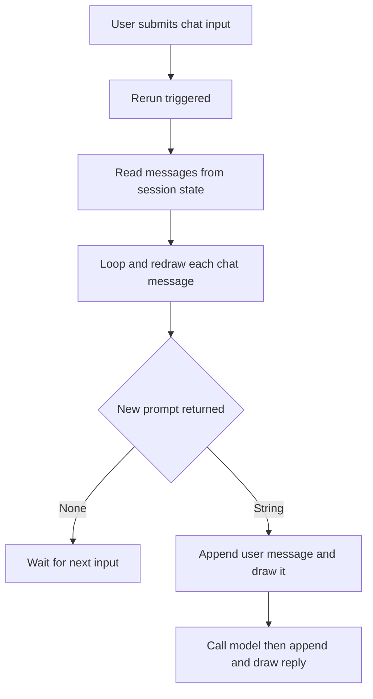

# Streamlit's Chat Elements as a Conversation Loop

## English

Streamlit ships a small family of chat primitives — st.chat_message, st.chat_input, and the st.chat_message container's avatar argument — that are built for conversational UIs rather than for dashboards. The important idea is that these are not magic: st.chat_message("user") returns a container you fill with normal Streamlit calls (st.write, st.markdown, st.image, even st.dataframe), and st.chat_input renders a fixed input box pinned to the bottom of the app that returns a string when the user submits. Because every submission triggers a rerun, the canonical pattern is to append the new message to a list held in st.session_state, then loop over that list and re-draw each message on every rerun. In other words, the 'conversation history' is not stored by Streamlit anywhere — it lives in your session state, and the chat bubble widgets are just styled containers that replay it.

A concrete skeleton shows the shape: initialise st.session_state.messages to an empty list, then for m in st.session_state.messages: with st.chat_message(m['role']): st.markdown(m['content']). After that, prompt = st.chat_input('Say something') returns None on most reruns and a string only when the user actually submits. When it is not None, you append {'role':'user','content':prompt} to the list, draw it immediately inside a with st.chat_message('user') block (so the user sees their message without waiting for the model), call your model, then append and draw the assistant reply. The ordering matters: draw the user bubble before the slow call, otherwise the interface appears frozen.

st.chat_input has real constraints worth knowing. It can only appear once per app and cannot be nested inside st.columns, st.sidebar, or a form — it is designed to sit at page level and pin itself to the bottom of the viewport. If you need a chat box inside a sidebar or column, you build it from st.text_input plus a submit button instead, and you lose the pinned behaviour. The avatar parameter accepts an emoji, a single character, or an image URL, which is how you give each role a distinct icon without writing CSS.

The rerun model interacts with chat in a way that surprises newcomers. Because the whole script re-executes, if you place an expensive model call at module level rather than inside the 'if prompt is not None' branch, it will fire on every keystroke-triggered rerun and every unrelated widget interaction. Chat apps therefore lean heavily on the guard pattern: only call the model when there is genuinely new input. Streaming tokens back into the bubble is possible by writing into a placeholder returned from st.empty() inside the chat_message container and updating it as chunks arrive, which gives the familiar typewriter effect without leaving the script model.

Finally, chat history in session_state is per-session and in memory. It dies when the browser tab closes or the session times out, and it is not shared between users. If you need durable conversation logs you must persist them yourself — to a database, a file, or an external service keyed by a session identifier — and reload them on startup. Treating st.session_state.messages as a cache of the UI, not as the source of truth, keeps the design honest.

## 中文

Streamlit 提供了一小組對話原語——st.chat_message、st.chat_input，以及 st.chat_message 容器的 avatar 參數——它們是為對話式介面而設，而非為儀表板而設。關鍵想法是：這些東西並不神奇。st.chat_message("user") 會回傳一個容器，你用普通的 Streamlit 呼叫（st.write、st.markdown、st.image，甚至 st.dataframe）去填充它；而 st.chat_input 會渲染一個固定在應用底部的輸入框，使用者提交時回傳一個字串。由於每次提交都會觸發重跑，典型的做法是把新訊息附加到存放在 st.session_state 的清單中，然後在每次重跑時逐項重繪。換句話說，「對話歷史」並非由 Streamlit 儲存——它存在你的 session state 裡，而那些對話氣泡只是重播它的樣式化容器。

一個具體的骨架可以展示其形狀：先把 st.session_state.messages 初始化為空清單，然後 for m in st.session_state.messages: with st.chat_message(m['role']): st.markdown(m['content'])。之後，prompt = st.chat_input('說點什麼') 在大多數重跑中回傳 None，只有當使用者真正提交時才回傳字串。當它不是 None 時，你把 {'role':'user','content':prompt} 附加到清單，立即在 with st.chat_message('user') 區塊內繪出它（這樣使用者不必等模型就能看到自己的訊息），呼叫你的模型，然後附加並繪出助理的回覆。順序很重要：先繪出使用者氣泡，再進行慢速呼叫，否則介面看起來會像凍結了。

st.chat_input 有一些值得知道的真實限制。每個應用只能出現一次，而且不能嵌套在 st.columns、st.sidebar 或表單內——它的設計是位於頁面層級並把自己釘在視窗底部。如果你需要在側邊欄或欄位內放聊天框，你要用 st.text_input 加一個提交按鈕自行搭建，並會失去釘底行為。avatar 參數接受一個 emoji、單一字元或圖片 URL，這就是你不寫 CSS 也能為每個角色加上不同圖示的方法。

重跑模型與聊天的互動方式會令新手意外。由於整個腳本會重新執行，如果你把昂貴的模型呼叫放在模組層級而非放在「if prompt is not None」分支內，它就會在每次按鍵觸發的重跑以及每個無關的組件互動時觸發。因此聊天應用大量依賴守衛模式：只有在確實有新輸入時才呼叫模型。把 token 串流回氣泡是可行的：在 chat_message 容器內用 st.empty() 取得一個佔位符，然後隨分塊到達而更新它，就能在不離開腳本模型的情況下得到熟悉的打字機效果。

最後，session_state 中的聊天歷史是逐工作階段的、存在記憶體中的。瀏覽器分頁關閉或工作階段逾時後它就消失，也不會在使用者之間共享。如果你需要持久的對話記錄，你必須自行持久化——存到資料庫、檔案或以外掛工作階段識別碼為鍵的外部服務——並在啟動時重新載入。把 st.session_state.messages 視為介面的快取而非真相來源，設計才誠實。

## Key Takeaway

Streamlit's chat widgets are ordinary containers plus a pinned input, so conversation history is something you store and replay yourself in session_state, not something the framework remembers.

## Related Concepts
- st.session_state
- Rerun model

## Diagram

