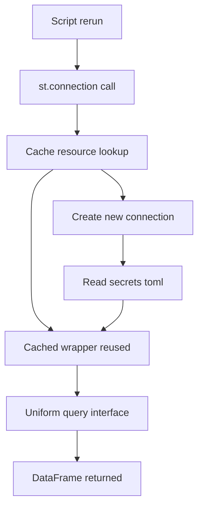

# The st.connection Abstraction and Why Connection Objects Need Care

## English

st.connection is Streamlit's answer to a recurring annoyance: every rerun re-executes your script, so if you naively call a database driver's connect() at module level you either open a new connection on every interaction or leak handles until the process dies. st.connection(name, type=...) returns a cached connection wrapper that Streamlit manages for you, keyed by the name you give it. The wrapper is backed by st.cache_resource semantics — it is created once per process (not per session) and reused across reruns and across users — and it exposes a small, uniform interface: .query() for reads returning a DataFrame, .query() with parameters for parameterised SQL, and type-specific helpers such as .session for SQLAlchemy or .cursor() for DB-API drivers.

The uniform interface is the real selling point. Whether you point it at SQLAlchemy, Snowflake, BigQuery, or a raw DB-API module, your app code calls conn.query('SELECT ...', params={...}) and gets a pandas DataFrame back. That means switching backends is largely a change to .streamlit/secrets.toml and the type argument, not a rewrite of every query call. It also means the credentials never appear in code: st.connection reads its configuration from the [connections.<name>] table in secrets.toml, so the same app runs locally with a dev database and in production with a different one, purely by swapping secrets.

Because the connection is process-wide and cached, it is shared by every concurrent user of your app. That is usually what you want — connection pools are expensive to build — but it has consequences you must reason about. If your driver's connection object is not thread-safe, and Streamlit is serving several sessions, you can get interleaved use of the same handle. Most modern drivers and SQLAlchemy's pool handle this correctly; a hand-rolled raw socket wrapper usually will not. If you need per-session isolation, you must build it yourself, for example by storing a session-specific cursor in st.session_state rather than relying on the cached connection.

A second consequence is that the cache never expires on its own. If the database restarts, or a network partition drops the socket, the cached connection object can go stale and every subsequent query fails until the process is restarted. The mitigation is to call conn.reset() (or the type-specific equivalent) when you detect a failure, and to wrap queries in a try/except that distinguishes 'query is wrong' from 'connection is dead'. Treating the connection as a long-lived resource that can break, rather than as an always-available function, is the mental shift st.connection asks of you.

Finally, remember that st.connection is about the handle, not the data. It does not cache query results — every call to .query() hits the database. If a particular query is expensive and its inputs change rarely, wrap the query function in st.cache_data with explicit parameters, and let st.connection handle the cheaper problem of not rebuilding the connection. Mixing the two layers deliberately — cache_resource for the handle, cache_data for the results — is the pattern that keeps both latency and load under control.

## 中文

st.connection 是 Streamlit 對一個反覆出現的煩惱的回答：每次重跑都會重新執行你的指令碼，所以如果你天真地在模組層級呼叫資料庫驅動的 connect()，你要麼在每次互動時開啟新連線，要麼洩漏控制程式碼直至行程死亡。st.connection(name, type=...) 回傳一個由 Streamlit 代你管理的快取連線包裝器，以你給它的名字為鍵。這個包裝器背後是 st.cache_resource 的語義——每個行程建立一次（而非每個工作階段），並在重跑之間及使用者之間重用——它暴露一個小而統一的介面：.query() 用於讀取並回傳 DataFrame、帶引數的 .query() 用於引數化 SQL，以及型別專屬的輔助方法，例如 SQLAlchemy 的 .session 或 DB-API 驅動的 .cursor()。

統一的介面才是真正的賣點。無論你指向 SQLAlchemy、Snowflake、BigQuery 還是原始 DB-API 模組，你的應用程式碼都呼叫 conn.query('SELECT ...', params={...}) 並取回一個 pandas DataFrame。這意味著切換後端很大程度上只是改 .streamlit/secrets.toml 和 type 引數，而不是重寫每個查詢呼叫。它也意味著憑證永遠不出現在程式碼中：st.connection 從 secrets.toml 的 [connections.<name>] 表讀取設定，所以同一個應用可以在本地用開發資料庫、在生產用另一個，純粹靠替換 secrets 實現。

因為連線是行程級且快取的，它會被應用的每個並行使用者共享。這通常正是你要的——連線池建構起來很昂貴——但它有後果需要你思考。如果你的驅動的連線物件不是執行緒安全的，而 Streamlit 又在服務多個工作階段，你就會得到同一個控制程式碼的交錯使用。大多數現代驅動和 SQLAlchemy 的連線池能正確處理；手寫的原始 socket 包裝通常不能。如果你需要逐工作階段的隔離，你必須自己建立，例如把工作階段專屬的遊標存在 st.session_state 而非依賴快取連線。

第二個後果是快取永遠不會自行過期。如果資料庫重啟，或網路分割斷開 socket，快取的連線物件可能變為過期，之後每個查詢都會失敗，直到行程重啟。緩解方法是在偵測到失敗時呼叫 conn.reset()（或型別專屬的等效方法），並把查詢包在 try/except 中，以區分「查詢寫錯」和「連線已死」。把連線視為可能斷掉的長壽資源，而非永遠可用的函式，就是 st.connection 要求你做的心理轉變。

最後，記住 st.connection 是關於控制程式碼，而非資料。它不快取查詢結果——每次呼叫 .query() 都會打到資料庫。如果某個查詢昂貴而輸入很少改變，把查詢函式用明確引數包在 st.cache_data 中，讓 st.connection 處理「不要重建連線」這個較便宜的問題。刻意混合兩層——控制程式碼用 cache_resource、結果用 cache_data——就是讓延遲和負載都受控的模式。

## Key Takeaway

st.connection caches the database handle process-wide and reads credentials from secrets, but it caches the connection, not the query results, so caching data remains your job.

## Related Concepts
- st.cache_data
- secrets.toml

## Diagram

