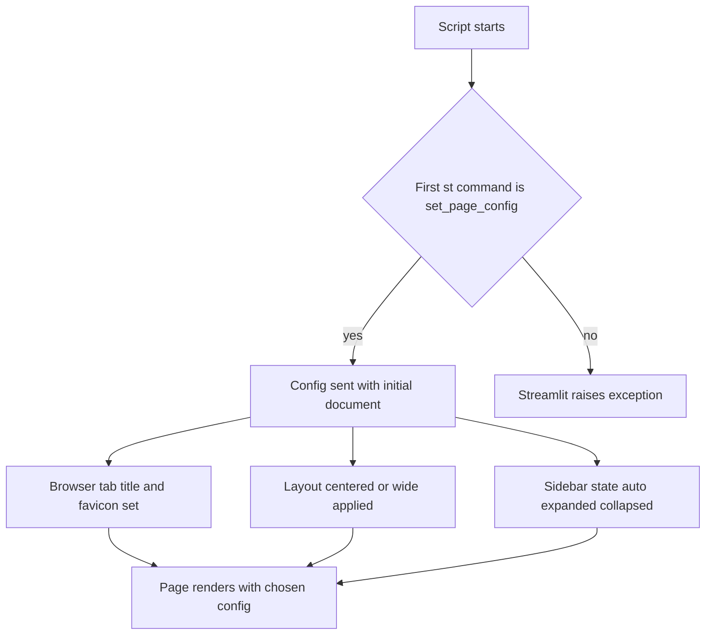

# Customising the Page: set_page_config, Titles, and the Document Head

## English

st.set_page_config is a deceptively small function with a large blast radius: it is the only supported way to change the browser tab title, the favicon, the initial layout width, and the sidebar's initial state. It must be the first Streamlit command executed in your script — before any other st.* call, including st.title or st.write — otherwise Streamlit raises an exception telling you so. The reason is architectural: the page configuration is sent to the browser as part of the initial document, before the script body renders anything, so anything that renders first would already have committed the default configuration.

The parameters are worth knowing precisely. page_title sets the text in the browser tab and in bookmarks. page_icon accepts an emoji (a single character like a chart emoji), a path to an image file, or a URL; Streamlit converts it to a favicon. layout accepts 'centered' (the default, a narrow column) or 'wide' (full viewport width), and the choice materially changes how st.columns and st.dataframe look — wide is usually right for dashboards, centred for prose-like apps. initial_sidebar_state accepts 'auto', 'expanded', or 'collapsed', and controls whether the sidebar is open on first load; 'auto' hides it on narrow screens and shows it on wide ones.

Because set_page_config is per-script, not per-session, it cannot be changed dynamically by a widget. A common mistake is to try to let the user toggle between centred and wide layout with a radio button — you cannot, because the configuration was already sent when the page loaded. If you genuinely need a layout switch, the workaround is to use CSS via st.markdown with unsafe_allow_html, or to accept that a reload is required. Similarly, page_title is not a document.title setter you can call later; it is read once at startup.

There is a related trap with st.title and st.header: these are content, not page metadata. st.title('My App') draws a large heading in the page body, but it does not change the tab title. Newcomers often expect them to be linked and are surprised when the browser tab still says 'Streamlit'. Setting both is normal: call st.set_page_config(page_title='My App', page_icon='📊') first, then st.title('My App') in the body.

Finally, in multipage apps the page configuration is a per-page concern. Each page script can call st.set_page_config with its own title and icon, and the browser tab updates as the user navigates. The main entry script's configuration applies to the default page. This is the mechanism by which a multipage app can present a coherent set of tab titles rather than every page showing the same generic name — and it is one of the few places where the script model's 'everything runs top to bottom' rule is enforced with a hard error rather than a silent surprise.

## 中文

st.set_page_config 是一個看似細小但影響深遠的函數：它是唯一受支援的方式去改變瀏覽器分頁標題、favicon、初始佈局寬度，以及側邊欄的初始狀態。它必須是你的腳本中第一個執行的 Streamlit 指令——在任何其他 st.* 呼叫之前，包括 st.title 或 st.write——否則 Streamlit 會拋出異常提醒你。原因是架構性的：頁面設定是作為初始文件的一部分送到瀏覽器的，在腳本主體渲染任何東西之前，所以任何先渲染的東西都已經提交了預設設定。

這些參數值得準確了解。page_title 設定瀏覽器分頁和書籤中的文字。page_icon 接受一個 emoji（例如圖表 emoji 的單一字元）、圖片檔案路徑或 URL；Streamlit 會把它轉成 favicon。layout 接受 'centered'（預設，窄欄）或 'wide'（全視窗寬度），這個選擇會實質改變 st.columns 和 st.dataframe 的外觀——儀表板通常適合 wide，散文式應用適合 centered。initial_sidebar_state 接受 'auto'、'expanded' 或 'collapsed'，控制側邊欄首次載入時是否開啟；'auto' 在窄螢幕隱藏、在寬螢幕顯示。

因為 set_page_config 是逐腳本而非逐工作階段的，它不能由組件動態改變。一個常見錯誤是想讓使用者用單選按鈕在 centered 和 wide 佈局之間切換——你做不到，因為頁面載入時設定已經送出了。如果你真的需要佈局切換，變通方法是用 st.markdown 加 unsafe_allow_html 寫 CSS，或者接受需要重新載入。同樣地，page_title 不是你可以稍後呼叫的 document.title 設定器；它在啟動時只讀取一次。

還有一個與 st.title 和 st.header 相關的陷阱：這些是內容，不是頁面元資料。st.title('我的應用') 會在頁面主體畫一個大標題，但不會改變分頁標題。新手常以為兩者相連，當瀏覽器分頁仍寫著「Streamlit」時感到意外。兩者都設定是正常的：先呼叫 st.set_page_config(page_title='我的應用', page_icon='📊')，然後在主體呼叫 st.title('我的應用')。

最後，在多頁應用中，頁面設定是逐頁的事。每個頁面腳本都可以呼叫 st.set_page_config 設定自己的標題和圖示，瀏覽器分頁會隨使用者導航而更新。主入口腳本的設定適用於預設頁。這就是多頁應用能呈現一組一致的分頁標題、而非每頁都顯示同一個通用名稱的機制——也是腳本模型「一切由上而下執行」規則少數以硬錯誤而非靜默意外來強制的地方。

## Key Takeaway

st.set_page_config must be the first Streamlit call because page metadata is committed before the script body renders, and it cannot be changed dynamically afterwards.

## Related Concepts
- Multipage apps
- st.markdown with unsafe_allow_html

## Diagram

