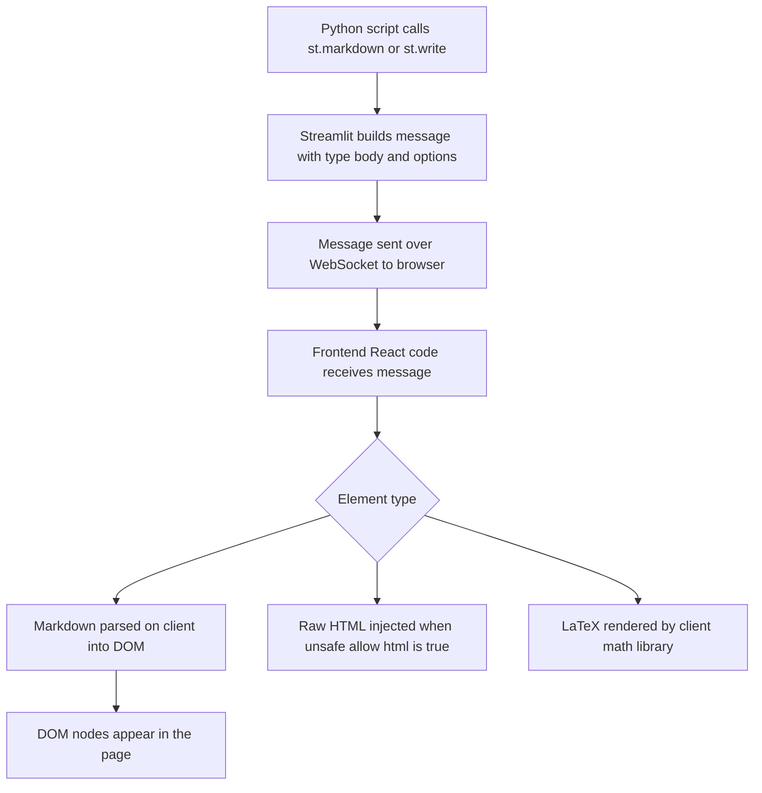

# The HTML and Markdown Rendering Pipeline: How Text Becomes DOM

## English

When you call st.write or st.markdown, nothing is written to a file and nothing is templated on the server in the way a Jinja page would be. Instead Streamlit builds a small message describing the element — its type, its body text, and a handful of options — and ships it over the WebSocket to the browser, where the frontend React code decides how to turn it into DOM. This is why st.markdown supports a useful subset of Markdown but not arbitrary extensions: the Markdown is parsed on the client, not by a Python library you can swap out. Understanding that the browser is the renderer explains a whole class of surprises.

The first consequence is that Markdown and HTML do not mix the way you might hope. If you write a code block inside a string passed to st.markdown, the triple backticks are handled by the client-side parser; if you try to embed raw HTML inside a Markdown fence, it is escaped as text. Conversely, st.markdown with unsafe_allow_html=True is a separate, explicitly opt-in path where the string is injected as HTML rather than parsed as Markdown — mixing the two in one call tends to produce text that looks like neither.

LaTeX is another useful case. st.latex renders a math expression through a math typesetting library on the client, which means the string you pass is not Python-formatted and backslashes are literal. If you build the string with an f-string, remember that Python treats backslash sequences as escapes, so raw strings or doubled backslashes are often necessary. The same applies to st.markdown when it contains inline math delimited by dollar signs.

A second consequence is performance. Every element you emit becomes a message and a DOM node, so a loop that calls st.write a thousand times is not free even though each call looks cheap in Python. The browser has to diff and patch, and Streamlit's frontend keeps element identity stable across reruns so that unchanged elements are not re-created — but the initial burst of a thousand messages still costs. Batching into a single st.markdown with a built list, or using st.dataframe for tabular output, is usually faster than a per-row loop.

Finally, this pipeline is why so much of Streamlit's text API is 'just enough'. There is no plugin system for the Markdown parser, no way to register a custom directive, and no server-side template inheritance. If you need richer formatting, the intended escape hatches are st.html (in recent versions), st.markdown with unsafe_allow_html, or a custom component — each of which trades some safety or portability for control.

## 中文

當你呼叫 st.write 或 st.markdown 時，伺服器並唔會寫出一個檔案，亦唔會好似 Jinja 咁做伺服器端模板。相反，Streamlit 會砌一個細細嘅訊息去描述嗰個元素——包括類型、內容文字同幾個選項——再經 WebSocket 送去瀏覽器，由前端嘅 React 程式決定點樣變成 DOM。呢個就係為何 st.markdown 支援一個有用嘅 Markdown 子集，但唔支援任意擴展：Markdown 係喺客戶端解析，唔係由你可以替換嘅 Python 套件處理。明白「瀏覽器才係渲染者」呢一點，就解釋咗一整類令人意外嘅行為。

第一個後果係 Markdown 同 HTML 唔會好似你想像咁混合。如果你喺傳去 st.markdown 嘅字串入面寫 code block，三重反引號係由客戶端解析器處理；如果你試喺 Markdown 圍欄入面嵌入原始 HTML，佢會被當成文字轉義。反過來講，st.markdown 加 unsafe_allow_html=True 係另一條明確 opt-in 嘅路徑，字串會當成 HTML 注入而唔係當 Markdown 解析——同一個呼叫入面撈埋兩種，出嚟嘅文字通常兩邊都唔似。

LaTeX 係另一個好例子。st.latex 會經客戶端嘅數學排版庫渲染，即係你傳入嘅字串唔會經 Python 格式化，反斜線係字面值。如果你用 f-string 砌字串，要記住 Python 會將反斜線序列當成轉義，所以好多時要用 raw string 或者雙反斜線。st.markdown 入面用美元符號包住嘅行內數學都係同一個道理。

第二個後果係效能。你發出嘅每個元素都會變成一個訊息同一個 DOM 節點，所以一個呼叫 st.write 一千次嘅迴圈，雖然每次喺 Python 睇落好便宜，其實唔係免費。瀏覽器要做 diff 同 patch，而 Streamlit 前端會喺重跑之間保持元素身份穩定，令無變嘅元素唔會被重新建立——但開頭嗰一千個訊息嘅爆發仍然有成本。砌成一個 list 再一次過 st.markdown，或者用 st.dataframe 出表格，通常都快過逐行迴圈。

最後，呢條管道就係點解 Streamlit 嘅文字 API 咁多都係「剛剛夠用」。冇 Markdown 解析器插件系統、冇辦法註冊自訂指令、亦冇伺服器端模板繼承。如果你需要更豐富嘅格式，官方嘅逃生門係 st.html（較新版本）、加 unsafe_allow_html 嘅 st.markdown，或者自訂 component——每一個都係用某啲安全性或可攜性去換控制權。

## Key Takeaway

Streamlit renders text in the browser from small element messages, so Markdown, HTML, and LaTeX each follow separate client-side paths with their own escaping and cost rules.

## Related Concepts
- Client-side rendering
- Markdown parsing

## Diagram

