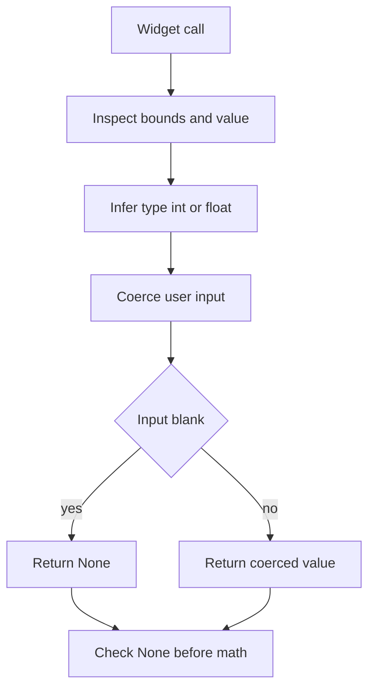

# Number Inputs, Sliders, and the Value Coercion You Did Not Ask For

## English

Streamlit's numeric widgets look trivial — st.slider, st.number_input, st.select_slider — but each one performs type coercion and validation that can quietly change what your function receives. The most important rule is that the widget's type is inferred from the arguments you give it. If you pass integers as min_value and max_value, the slider returns int; if you pass floats, it returns float. Pass 0 and 100 and you get ints; pass 0.0 and 100.0 and you get floats. A slider whose step is 0.1 but whose bounds are integers is a common source of confusing behaviour, because the step does not force the type.

st.number_input is stricter and more surprising. It accepts min_value, max_value, step, and format, and it returns the type of the value you supplied as the initial value or as the bounds. If min_value is 0 and max_value is 10 (both ints), the widget returns an int even if the user types '3.7' — the frontend will reject or round it according to the step. If you need a float, make at least one of the bounds a float, or pass a float as value. Mixing int bounds with a float value is the classic bug where a percentage slider silently truncates.

There is also the empty-state problem. st.number_input can be left blank by the user, and when that happens it returns None, not zero and not the previous value. Code that does arithmetic on the result without a None check will raise a TypeError at exactly the moment a user clears the field to retype a number — a very ordinary interaction. The defensive pattern is to check for None and either skip the computation or substitute a default, and to make that visible in the UI rather than silently using zero.

Sliders add a second wrinkle: the value is clamped to the range, but the range itself is evaluated on every rerun. If you compute max_value from data that changes — say, the maximum of a loaded dataframe — and the user has already set the slider near the old maximum, the new maximum may be lower than the current value. Streamlit handles this by clamping, but the clamped value is what your code sees, and the user may not realise their selection was silently adjusted. Displaying the current value next to the slider, or using session_state to remember the last explicit choice, makes the behaviour legible.

Finally, st.select_slider with a list of options returns one of those options, which may be a string, a date, or a tuple. It is a discrete widget dressed as a continuous one, and the options list must be non-empty and sortable in a way the frontend can render. When options are categorical labels rather than numbers, the slider position is the index, but the value you get back is the label — a distinction worth remembering when you are building a threshold picker over named buckets.

## 中文

Streamlit 嘅數值組件睇落好簡單——st.slider、st.number_input、st.select_slider——但每一個都會做型別轉換同驗證，可以靜靜雞改變你個函數收到嘅嘢。最重要嘅規則係：組件嘅型別由你傳入嘅參數推斷。如果你傳整數做 min_value 同 max_value，滑桿就返回 int；傳浮點數就返回 float。傳 0 同 100 你會拿到 int；傳 0.0 同 100.0 就拿到 float。一個 step 係 0.1 但邊界係整數嘅滑桿，係常見嘅困惑來源，因為 step 唔會強制型別。

st.number_input 更嚴格亦更出人意表。佢接受 min_value、max_value、step 同 format，而返回嘅型別取決於你提供嘅初始值或邊界。如果 min_value 係 0、max_value 係 10（兩個都係 int），就算用戶打「3.7」，組件都會返回 int——前端會根據 step 拒絕或者四捨五入。如果你要 float，就令至少一個邊界係 float，或者將 value 設做 float。整數邊界配浮點初始值，就係百分比滑桿靜靜雞截斷嘅經典 bug。

仲有空狀態問題。用戶可以留空 st.number_input，嗰陣佢返回 None，唔係零亦唔係上一個值。如果程式冇檢查 None 就直接做算術，就會喺用戶清空輸入框準備重新打數字嗰一刻拋出 TypeError——一個極之平常嘅操作。防禦性寫法係檢查 None，然後跳過計算或者代入預設值，並且喺介面上顯示出嚟，而唔係靜靜雞當零用。

滑桿多一層麻煩：數值會被夾到範圍之內，但範圍本身每次重跑都會重新計算。如果你由會變嘅數據計 max_value——例如已載入 dataframe 嘅最大值——而用戶已經將滑桿設到接近舊最大值，新最大值可能低過當前值。Streamlit 會夾返，但你程式見到嘅係夾完之後嘅值，用戶可能唔為意自己嘅選擇被靜靜調整咗。喺滑桿旁邊顯示當前值，或者用 session_state 記住上次明確選擇，會令行為清楚好多。

最後，st.select_slider 配一個選項清單，會返回清單入面其中一個選項，可能係字串、日期或者 tuple。佢係一個扮成連續嘅離散組件，選項清單必須非空，而且要能夠以前端識得渲染嘅方式排序。當選項係分類標籤而唔係數字，滑桿位置係索引，但你拿到嘅值係標籤——當你喺具名區間上面整門檻選擇器時，呢個分別值得記住。

## Key Takeaway

Streamlit numeric widgets infer their return type from the bounds and initial value you pass, and number_input can hand you None — so type coercion and empty states deserve explicit handling.

## Related Concepts
- Type coercion
- Widget validation

## Diagram

