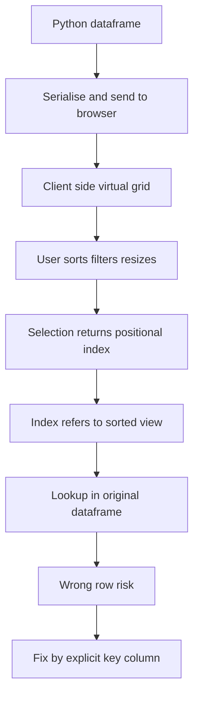

# The st.dataframe Contract: Column Config, Selection, and What Comes Back

## English

st.dataframe looks like a one-liner that shows a table, but it is really a client-side data grid with its own configuration language and its own idea of what a 'selected row' is. The first thing to know is that the dataframe you pass is serialised and sent to the browser, and the browser renders it with its own virtualised grid — meaning sorting, column resizing, and scrolling happen entirely on the client. Your Python code does not see the sorted order unless you ask for it. This is the opposite of st.table, which renders a static HTML table and is intended for small, fixed outputs.

The column_config parameter is where most of the power lives. You can rename columns for display, set a column's format string (for example, a currency or percentage format), choose a number or progress-bar display, and mark columns as editable or hidden. Crucially, these are presentation settings — they change what the user sees, not the dtype of the underlying pandas object. A column formatted as a percentage is still the raw float in your dataframe; if you later compute on it, you are computing on the unformatted value. Mixing up display format with data transformation is a frequent source of 'the chart does not match the table' confusion.

Selection is the other half of the contract. When you enable row or column selection, st.dataframe returns a selection object describing which rows the user picked, typically as positional indices into the dataframe you passed. Those indices refer to the view at the time of selection, which may be sorted or filtered by the user in the browser. If your dataframe is sorted client-side and you use the returned index to look up a row in your original, unsorted dataframe, you can get the wrong row. The safe pattern is to make the index explicit — set a meaningful index or include an ID column — and map selections back through that key rather than through position.

There is also an important distinction between st.dataframe and st.data_editor. The former is read-only unless you opt into editing; the latter is explicitly two-way and returns the edited dataframe on rerun. With the editor, the returned object reflects the user's edits, but the edits are only as good as your column configuration: an editable numeric column with a format string may round or reject input in ways the user does not expect. Validating edited data on the Python side, rather than trusting the grid, is the reliable approach.

Finally, size matters. Because the whole dataframe is serialised and sent, a million-row table is a million rows over the wire and into the browser's memory, even if only twenty are visible. Paginating or filtering server-side before calling st.dataframe keeps the payload small; the grid's virtualisation helps rendering but does not reduce transfer. For large data, showing an aggregate plus a download button is often more honest than pretending the browser can hold the full table.

## 中文

st.dataframe 睇落係一行搞掂嘅表格顯示，但佢其實係一個客戶端資料網格，有自己嘅設定語言，亦有自己對「已選行」嘅定義。第一樣要知嘅係：你傳入嘅 dataframe 會被序列化送去瀏覽器，由瀏覽器用自己嘅虛擬化網格渲染——即係排序、調欄寬、捲動全部喺客戶端發生。你嘅 Python 程式睇唔到排序後嘅次序，除非你主動要求。呢點同 st.table 剛剛相反，後者渲染靜態 HTML 表格，係為細小、固定嘅輸出而設。

column_config 引數就係大部分威力所在。你可以改顯示欄名、設定某欄嘅格式字串（例如貨幣或者百分比）、揀數字或者進度條顯示、將欄設做可編輯或者隱藏。關鍵係：呢啲全部係展示設定——改變使用者見到嘅嘢，唔會改變底層 pandas 物件嘅 dtype。格式化成百分比嘅欄，喺你 dataframe 入面仍然係原始 float；如果你之後喺上面做計算，你計嘅係未格式化嘅值。將顯示格式同資料轉換撈亂，就係「圖表同表格對唔上」呢類困惑嘅常見來源。

選擇功能係合約嘅另一半。當你啟用行或欄選擇，st.dataframe 會返回一個描述使用者揀咗邊啲行嘅選擇物件，通常係你傳入 dataframe 嘅位置索引。呢啲索引指嘅係選擇嗰一刻嘅檢視，而使用者可能喺瀏覽器入面排過序或者篩選過。如果你嘅 dataframe 喺客戶端排咗序，而你用返回嘅索引去查原始未排序 dataframe，就可能攞錯行。安全做法係令索引明確——設定有意義嘅 index 或者加一個 ID 欄——再經嗰個 key 對映返選擇，而唔係靠位置。

仲有 st.dataframe 同 st.data_editor 嘅重要分別。前者除非你選擇啟用編輯，否則係唯讀；後者明確係雙向，重跑時返回編輯後嘅 dataframe。用編輯器時，返回物件反映使用者嘅修改，但修改嘅質素取決於你嘅欄設定：一個可編輯嘅數值欄配格式字串，可能以使用者意料之外嘅方式四捨五入或者拒絕輸入。喺 Python 端驗證編輯後嘅資料，而唔係信任網格，係可靠嘅做法。

最後，大小好重要。因為成個 dataframe 都會被序列化送出，一百萬行嘅表就係一百萬行過網路、入瀏覽器記憶體，即使只有二十行睇得見。喺呼叫 st.dataframe 之前喺伺服器端分頁或者篩選，可以令 payload 保持細小；網格嘅虛擬化幫到渲染，但唔會減少傳輸。面對大資料，顯示彙總加一個下載按鈕，通常比假裝瀏覽器載得曬成張表更誠實。

## Key Takeaway

st.dataframe is a client-side grid whose column_config is presentation-only and whose selection indices refer to the user's current view, so map selections through explicit keys and keep payloads small.

## Related Concepts
- Column configuration
- Row selection

## Diagram

