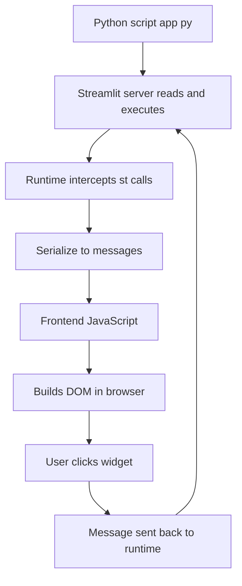

# Streamlit's Script-to-App Bridge: Why Your Python Source Is Not What the Browser Sees

## English

When you run `streamlit run app.py`, the browser never receives your Python file. Streamlit's server reads the script, executes it in a special runtime, and translates every Streamlit function call into a serialized message that the frontend JavaScript interprets as a DOM instruction. This indirection is the single most important fact for reasoning about Streamlit behaviour, because it explains why you cannot `return` HTML from `st.write`, why `print()` goes to the terminal rather than the page, and why the browser has no direct access to your variables.

Think of the script as a recipe and the browser as a diner. The recipe says 'add a button labelled Go'. Streamlit's runtime executes the recipe, sees the `st.button` call, and sends a structured message to the browser that says 'render a button widget with this key and this label'. The browser builds the button, and when it is clicked, sends a message back. Your Python never talks to the browser directly; every interaction is a round-trip through the runtime's message queue.

The practical consequence is that anything you want the user to see must go through a Streamlit primitive or an embedded HTML block. `print('hello')` writes to stdout, which appears in the terminal where `streamlit run` is executing, not the browser. `logging.info(...)` similarly goes to the server log. If you want text on the page, you must call `st.write`, `st.text`, `st.markdown`, or another display function. This is not a limitation but a design choice that keeps the mental model simple: display is a function call, not a side effect.

Another consequence concerns what happens to the objects you create. A pandas DataFrame that you pass to `st.dataframe` is serialized into a format the frontend can render, but the browser does not hold a live reference to your DataFrame. If you mutate it later in the same script run, the display does not update automatically; you must call `st.dataframe` again, which sends a new message. This is why Streamlit apps often feel like a series of snapshots rather than a live reactive system.

Understanding the bridge also clarifies debugging. When something looks wrong in the browser, the first question is not 'why is my HTML broken' but 'what message did my script send?'. The Streamlit terminal often prints the actual exception with a traceback; the browser shows a red error box with a truncated message. Reading the server log is frequently faster than inspecting the page, because the truth lives in the Python process, not in the rendered DOM.

## 中文

當你執行 `streamlit run app.py` 時，瀏覽器從來都收唔到你個 Python 檔案。Streamlit 嘅伺服器會讀取腳本，喺一個特殊嘅執行環境入面執行佢，然後將每個 Streamlit 函數呼叫翻譯成一條序列化訊息，前端嘅 JavaScript 再將呢啲訊息解讀成 DOM 指令。呢層間接係理解 Streamlit 行為最重要嘅事實，因為佢解釋咗點解你唔可以喺 `st.write` 度 return HTML、點解 `print()` 會去咗終端機而唔係頁面、同埋點解瀏覽器根本冇直接存取你嘅變數。

你可以想像腳本係一份食譜，瀏覽器係食客。食譜寫住「加一個寫住 Go 嘅掣」。Streamlit 嘅執行環境執行呢份食譜，見到 `st.button` 呼叫，就發一條結構化訊息去瀏覽器，話「用呢個 key 同呢個標籤去畫一個按鈕組件」。瀏覽器負責起個掣，用戶撳落去，瀏覽器就發訊息返嚟。你嘅 Python 從來唔會直接同瀏覽器傾偈；每一次互動都係經執行環境嘅訊息隊列來回一趟。

實際後果就係：任何你想用戶見到嘅嘢，都必須經 Streamlit 原語或者嵌入嘅 HTML 區塊先得。`print('hello')` 會寫去 stdout，即係出現喺執行 `streamlit run` 嘅終端機，唔係瀏覽器。`logging.info(...)` 同樣會去咗伺服器日誌。如果你想頁面有字，就要呼叫 `st.write`、`st.text`、`st.markdown` 或者其他顯示函數。呢個唔係限制，而係一個設計選擇，令心智模型保持簡單：顯示係一個函數呼叫，唔係副作用。

另一個後果關於你建立嘅物件。你傳俾 `st.dataframe` 嘅 pandas DataFrame 會被序列化成前端畫得到嘅格式，但瀏覽器並冇持有一個活嘅引用去你個 DataFrame。如果你喺同一次腳本執行入面之後改咗佢，顯示唔會自動更新；你要再呼叫一次 `st.dataframe`，先會發一條新訊息。呢個就係點解 Streamlit 應用好多時感覺似一連串快照，而唔係一個活嘅反應式系統。

理解呢層橋樑亦都釐清咗除錯嘅思路。當瀏覽器顯示有問題，第一個問題唔係「我啲 HTML 點解爛咗」，而係「我個腳本發咗咩訊息出去」。Streamlit 終端機好多時會印出真正嘅例外同 traceback；瀏覽器就只會顯示一個紅色錯誤框，訊息被截短。睇伺服器日誌通常快過檢查頁面，因為真相喺 Python 程序度，唔喺渲染出嚟嘅 DOM 度。

## Key Takeaway

Your Python script never touches the browser directly; every Streamlit call becomes a serialized message rendered by the frontend, so debugging means reading the server side first.

## Related Concepts
- Streamlit's Wire Protocol
- The HTML and Markdown Rendering Pipeline

## Diagram

