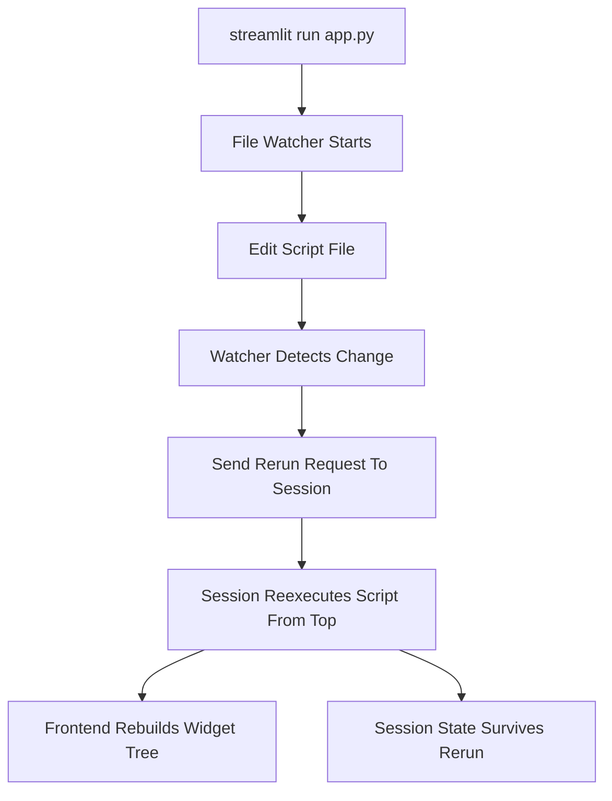

# The Streamlit Development Loop: File Watcher, Rerun Trigger, and the Source of Truth

## English

One of Streamlit's most distinctive features is the auto-rerun loop: you save a file, and the browser updates. Understanding the mechanics of this loop makes you dramatically more effective at debugging, because it tells you exactly when your code is re-executed and what state survives across reruns. The loop has three participants: the file watcher, the runtime's rerun trigger, and the session that owns the browser connection.

When you launch `streamlit run app.py`, the server starts a file watcher (by default based on polling or an inotify-style mechanism, depending on the platform) that monitors the script and any local modules it imports. When a change is detected, the server does not simply restart the process; it sends a rerun request to each connected session. The session then re-executes the script from the top. This is why you do not need to refresh the browser manually, and also why you sometimes see the app flash briefly: the frontend clears the old widget tree and rebuilds it as new messages arrive.

Crucially, session state (`st.session_state`) survives a file-change rerun, because the session object lives in the server process and is not destroyed by the rerun. This is a double-edged sword. On one hand, it means you can edit code and keep your test inputs. On the other, it means a bug caused by stale state can survive a code fix, because the old value is still in `st.session_state`. If you find yourself confused about why a change did not take effect, a hard refresh (which creates a new session) is often the fastest diagnostic.

The watcher also has practical limits. It watches files that are imported as Python modules, but it does not watch data files, configuration files loaded manually, or environment variables. If your app reads `data.csv` and you edit that file, Streamlit will not rerun automatically; you must trigger a rerun by touching the script or interacting with a widget. Similarly, if you change a value in `.streamlit/secrets.toml`, the running process keeps the old value until it restarts. This is a common source of confusion in development and a reason to keep a mental map of what the watcher actually covers.

Finally, the loop interacts with caching in a subtle way. Cached functions are keyed by their arguments and the function body, so editing the function body typically invalidates the cache and forces recomputation on the next rerun. But editing a helper function that the cached function calls may not invalidate the cache if the hashing does not reach into that helper. When in doubt, use the 'Clear cache' option in the app menu, or add a version argument to your cached function that you bump manually when its dependencies change. Treat the dev loop as a convenience, not as a guarantee that every change is picked up.

## 中文

Streamlit 其中一個最標誌性嘅功能就係自動重跑迴圈：你儲存檔案，瀏覽器就更新。理解呢個迴圈嘅機制會令你除錯嘅效率大幅提升，因為佢清楚話俾你聽你嘅程式碼幾時會重新執行，同埋咩狀態會喺重跑之間保留落嚟。呢個迴圈有三個參與者：檔案監察器、執行環境嘅重跑觸發器、同埋擁有瀏覽器連線嘅 session。

當你啟動 `streamlit run app.py`，伺服器會開一個檔案監察器（預設可能係輪詢或者 inotify 類機制，視乎平臺），監察指令碼同埋佢 import 嘅本地模組。偵測到改動時，伺服器唔會簡單咁重啟程式；佢會向每個已連線嘅 session 發一個重跑請求。個 session 就由頭再執行一次指令碼。呢個就係點解你唔需要手動重新整理瀏覽器，亦都係點解你有時會見到個應用閃一閃：前端會清走舊嘅元件樹，隨住新訊息到達再重建。

關鍵係，session state（`st.session_state`）喺檔案改動觸發嘅重跑之後仍然存在，因為 session 物件住喺伺服器程式度，唔會因為重跑而被摧毀。呢個係雙刃劍。一方面，你可以改程式碼而保留你嘅測試輸入。另一方面，即係話一個由過期狀態引起嘅 bug 可以喺你修好程式碼之後仍然存在，因為舊值仲喺 `st.session_state` 度。如果你發現自己唔明點解改動冇生效，強制重新整理（會建立新 session）通常係最快嘅診斷方法。

個監察器亦有實際限制。佢會監察以 Python 模組形式 import 嘅檔案，但唔會監察資料檔、手動載入嘅設定檔、或者環境變數。如果你個應用讀 `data.csv` 而你去改咗嗰個檔，Streamlit 唔會自動重跑；你要透過 touch 指令碼或者同元件互動去觸發重跑。同樣，如果你改咗 `.streamlit/secrets.toml` 入面嘅值，執行緊嘅程式會保留舊值直到重啟。呢個係開發時常見嘅混淆來源，亦係點解你要喺腦入面畫清楚個監察器實際覆蓋咩。

最後，呢個迴圈同快取嘅互動都好微妙。快取函式係以佢嘅引數同函式體作為 key，所以改函式體通常會令快取失效，下次重跑就會重新計算。但如果你改嘅係一個被快取函式呼叫嘅輔助函式，快取可能唔會失效，因為雜湊計算未必會深入到嗰個輔助函式。有疑問嘅時候，用應用選單入面嘅「Clear cache」選項，或者喺快取函式加一個版本引數，喺依賴改變時手動遞增。將開發迴圈當成方便工具，唔好當成佢保證每一個改動都會被捕捉到。

## Key Takeaway

The dev loop reruns your script but keeps session state alive, so stale state can mask code fixes; know what the watcher covers and when to force a fresh session.

## Related Concepts
- Auto-Refresh Workflow
- Session State Persists Data Across Widget Interactions

## Diagram

