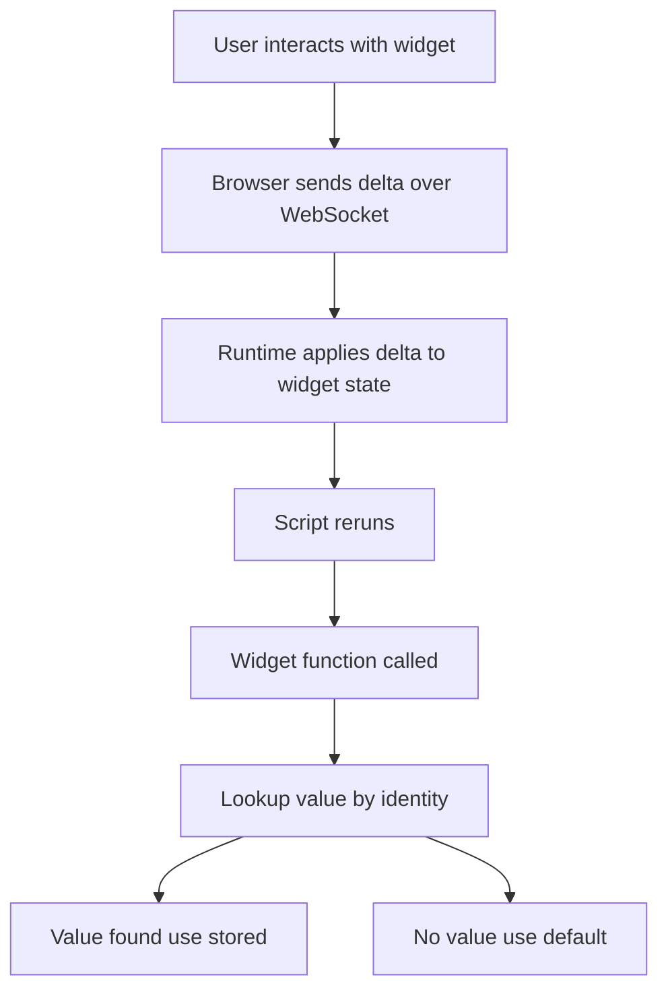

# Streamlit's Frontend Widget Contract: What the Browser Actually Sends Back

## English

When a user clicks a button, drags a slider, or types into a text input in a Streamlit app, the browser does not send a full form submission or an HTTP request with a body. Instead, it sends a small structured message over an existing WebSocket connection that identifies the widget and its new value. Understanding this contract is essential for reasoning about what your Python code actually receives, and it explains several behaviours that seem surprising at first.

Each widget has an identity made of several parts: its type (button, slider, text input), its key if you provided one, and a hash of its parameters and position in the script. This identity is how Streamlit matches the incoming value to the right widget on the next rerun. If you change a widget's parameters between reruns, its identity can change, which means the value the user entered may be discarded. This is the root cause of the classic 'my text input resets when I change the slider' bug: the text input's identity changed because its label or default value changed, so Streamlit treats it as a brand-new widget with no prior value.

What the browser sends back is not the full widget state but a delta: which widget changed and what its new value is. Streamlit's runtime applies this delta to the session's widget state, then triggers a rerun. During the rerun, when your script calls `st.slider(...)`, the runtime looks up the stored value by identity and returns it. If no stored value exists (first run, or identity changed), it uses the default you passed. This is why the return value of a widget function is a snapshot, not a live reference: it reflects the state at the start of the current run.

Several behaviours follow from this contract. First, widget return values are only valid within the current script run; storing them in a module-level variable and expecting them to update later will not work, because the script run is a finite execution. Second, callbacks fire before the main script body on the next rerun, which is why `on_change` callbacks can mutate `st.session_state` and have those mutations visible in the subsequent script execution. Third, if you call a widget function with the same identity but different default value, the stored value wins; the default only applies when no value exists. This is why changing a default in code often appears to do nothing for users who already interacted with the widget.

A final implication is about validation. Because the browser sends only the new value and Streamlit trusts it (within the constraints of the widget type), you cannot rely on client-side validation for security. A slider constrained to 1-10 will send values in that range from the browser, but a malicious client could send other values. Server-side validation of widget return values is not paranoia; it is the correct mental model for a framework where the browser is a rendering surface, not a trusted computation partner.

## 中文

當用戶喺 Streamlit 應用撳掣、拉滑桿、或者喺文字輸入框打字，瀏覽器並唔會送一個完整嘅表單提交或者帶 body 嘅 HTTP 請求。佢會經現有嘅 WebSocket 連線送一條細細嘅結構化訊息，識別嗰個組件同埋佢嘅新值。理解呢個契約對於推理你嘅 Python 程式碼實際收到咩係必要嘅，亦都解釋咗幾個初初睇落好出奇嘅行為。

每個組件都有一個由幾部分組成嘅身份：佢嘅類型（按鈕、滑桿、文字輸入）、你提供嘅 key（如果有）、同埋佢嘅參數同腳本位置嘅雜湊。呢個身份就係 Streamlit 喺下次重跑時點樣將收到嘅值配對到正確組件嘅方法。如果你喺重跑之間改咗組件嘅參數，佢嘅身份可能會變，即係話用戶輸入嘅值可能會被丟棄。呢個就係經典「我改滑桿之後文字輸入就重置」bug 嘅根源：文字輸入嘅身份因為佢嘅標籤或者預設值變咗而改變，所以 Streamlit 當佢係一個全新、冇之前值嘅組件。

瀏覽器送返嚟嘅唔係完整組件狀態，而係一個 delta：邊個組件變咗、佢嘅新值係咩。Streamlit 嘅執行環境會將呢個 delta 套用到 session 嘅組件狀態，然後觸發重跑。重跑期間，當你個腳本呼叫 `st.slider(...)`，執行環境會用身份查返儲存咗嘅值並回傳。如果冇儲存值（首次執行，或者身份變咗），就用你傳嘅預設值。呢個就係點解組件函數嘅回傳值係一個快照，唔係一個活嘅引用：佢反映嘅係當前呢次執行開始時嘅狀態。

幾個行為都係由呢個契約衍生出嚟。第一，組件回傳值只喺當前腳本執行入面有效；將佢哋存入模組層級變數然後期望佢哋之後會更新係唔work嘅，因為腳本執行係一次有限嘅執行。第二，回呼函數喺下次重跑時會喺主腳本主體之前執行，所以 `on_change` 回呼可以改 `st.session_state`，而嗰啲改動喺隨後嘅腳本執行會見到。第三，如果你用同一個身份但唔同嘅預設值去呼叫組件函數，儲存咗嘅值會贏；預設值只喺冇值存在時適用。呢個就係點解喺程式碼改預設值，對於已經同個組件互動過嘅用戶嚟講，好多時好似完全冇用。

最後一個含意關於驗證。因為瀏覽器只係送新值，而 Streamlit（喺組件類型嘅限制範圍內）信任佢，你唔可以倚賴客戶端驗證嚟做保安。一個限制喺 1 到 10 嘅滑桿會由瀏覽器送範圍內嘅值，但惡意客戶端可以送其他值。喺伺服器端驗證組件回傳值唔係偏執；對於一個瀏覽器只係渲染表面、唔係可信運算夥伴嘅框架嚟講，呢個先係正確嘅心智模型。

## Key Takeaway

Widgets are identified by type, key, and parameter hash, and the browser sends only value deltas, so changing parameters can silently discard user input and server-side validation is mandatory.

## Related Concepts
- The Widget Identity System
- Widget Keys, Callbacks, and the Order-of-Execution Trap

## Diagram

