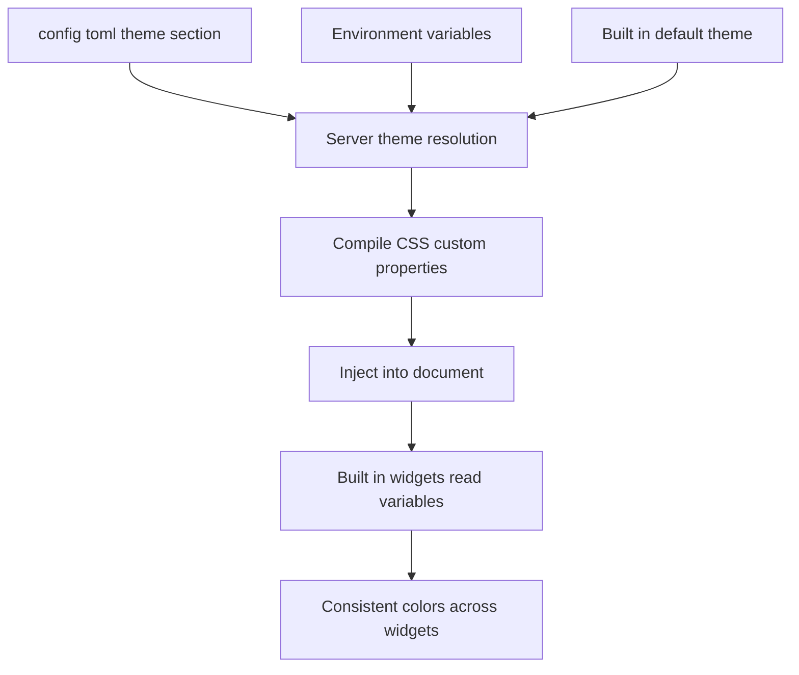

# Streamlit's Theme System: Config, the Theme Editor, and How CSS Variables Flow

## English

Streamlit's look is not hard-coded in Python. It is driven by a theme layer that resolves colours, fonts, and border radius from three sources in priority order: a runtime config (set in `.streamlit/config.toml` under a `[theme]` section, with environment variables and CLI flags able to override it), and the built-in default theme. The well-known keys include `primaryColor`, `backgroundColor`, `secondaryBackgroundColor`, `textColor`, `fontFaces`, and `base` (which selects the light or dark default palette). Because these are resolved on the server and pushed to the browser as part of the app's initial config, changing them requires a rerun — which is why editing the theme in the in-app settings menu triggers one.

The clever part is that the frontend does not paint colours directly from your config. Instead, the server's theme resolution compiles your choices into a set of CSS custom properties (CSS variables) that are injected into the document. Every built-in widget — buttons, sliders, dataframe headers, the sidebar — reads from those variables rather than from literal hex codes. That is why setting `primaryColor` recolours the slider thumb, the focus ring, and the active tab all at once, without any per-widget code. It also means you can override individual variables in your own `st.markdown(..., unsafe_allow_html=True)` block if you know the variable name, though that is fragile across versions.

A concrete example: if your brand colour is a deep teal, you set `primaryColor = "#0f766e"` in `config.toml`. Streamlit computes a contrasting text colour for elements drawn on top of that primary colour, so a button label stays legible. If you instead inject raw CSS to force a background on a button, you fight the theme layer and will likely break hover and focus states. The supported path is the config key; the escape hatch is CSS variables; raw selectors are the last resort.

The theme also interacts with the `base` setting. Choosing `base = "dark"` swaps the entire default palette, and your `primaryColor` is applied on top of it. This is why a theme that looks great in light mode can have unreadable secondary backgrounds in dark mode: `secondaryBackgroundColor` defaults to a different value in each base. Always test both.

Finally, note that theming is per-app, not per-user. There is no built-in per-session theme switch unless you implement one yourself (for example, by writing a config value and forcing a rerun, or by injecting CSS variables conditionally). Understanding that the theme is a server-resolved config pushed to the client explains both its power — one setting recolours everything — and its limits — it is not a live, per-client stylesheet you can mutate freely.

## 中文

Streamlit 嘅外觀唔係硬編碼喺 Python 入面。佢由一個主題層驅動，按優先次序從幾個來源解析顏色、字體同圓角：執行時配置（喺 `.streamlit/config.toml` 嘅 `[theme]` 段落設定，環境變數同 CLI 參數亦可以覆寫），以及內建預設主題。常見嘅鍵包括 `primaryColor`、`backgroundColor`、`secondaryBackgroundColor`、`textColor`、`fontFaces` 同 `base`（用嚟揀淺色或深色嘅預設調色板）。因為呢啲嘢喺伺服器端解析，再作為應用初始配置嘅一部分推去瀏覽器，所以改動佢哋需要一次重跑——呢個就係喺應用內設定選單改主題會觸發重跑嘅原因。

巧妙嘅地方係：前端唔係直接用你嘅配置去塗顏色。相反，伺服器嘅主題解析會將你嘅選擇編譯成一組注入文件嘅 CSS 自訂屬性（CSS 變數）。每個內建組件——按鈕、滑桿、dataframe 表頭、側邊欄——都係讀呢啲變數，而唔係讀字面嘅十六進制色碼。所以設定 `primaryColor` 會一次過為滑桿拇指、焦點環同作用中分頁重新上色，完全唔需要逐個組件寫代碼。呢個亦意味住，如果你知道你所用版本嘅變數名，你可以喺自己嘅 `st.markdown(..., unsafe_allow_html=True)` 區塊入面覆寫個別變數，不過咁樣跨版本會好脆弱。

一個具體例子：假設你嘅品牌色係深青綠，你喺 `config.toml` 設 `primaryColor = "#0f766e"`。Streamlit 會為畫喺呢個主色上面嘅元素計算一個對比文字色，令按鈕標籤保持易讀。如果你反而注入原始 CSS 去強制按鈕背景，你就係同主題層對抗，好可能整壞 hover 同 focus 狀態。受支援嘅路徑係配置鍵；逃生門係 CSS 變數；原始選擇器係最後手段。

主題亦同 `base` 設定互動。揀 `base = "dark"` 會換走成個預設調色板，而你嘅 `primaryColor` 會疊喺上面。呢個就係點解一個喺淺色模式好靚嘅主題，喺深色模式可能會有睇唔清嘅次要背景：`secondaryBackgroundColor` 喺每個 base 嘅預設值都唔同。兩邊都要測。

最後要留意，主題係按應用計，唔係按用戶計。除非你自己實作（例如寫入配置值再強制重跑，或者有條件咁注入 CSS 變數），否則冇內建嘅逐 session 主題切換。明白主題係一個伺服器解析、推去客戶端嘅配置，就解釋咗佢既強大——一個設定為全部重新上色——亦解釋咗佢嘅限制——佢唔係一個你可以任意改嘅即時、逐客戶端樣式表。

## Key Takeaway

Streamlit theming is a server-side config that compiles into CSS variables consumed by every built-in widget, so prefer config keys over raw CSS.

## Related Concepts
- CSS custom properties
- config.toml

## Diagram

