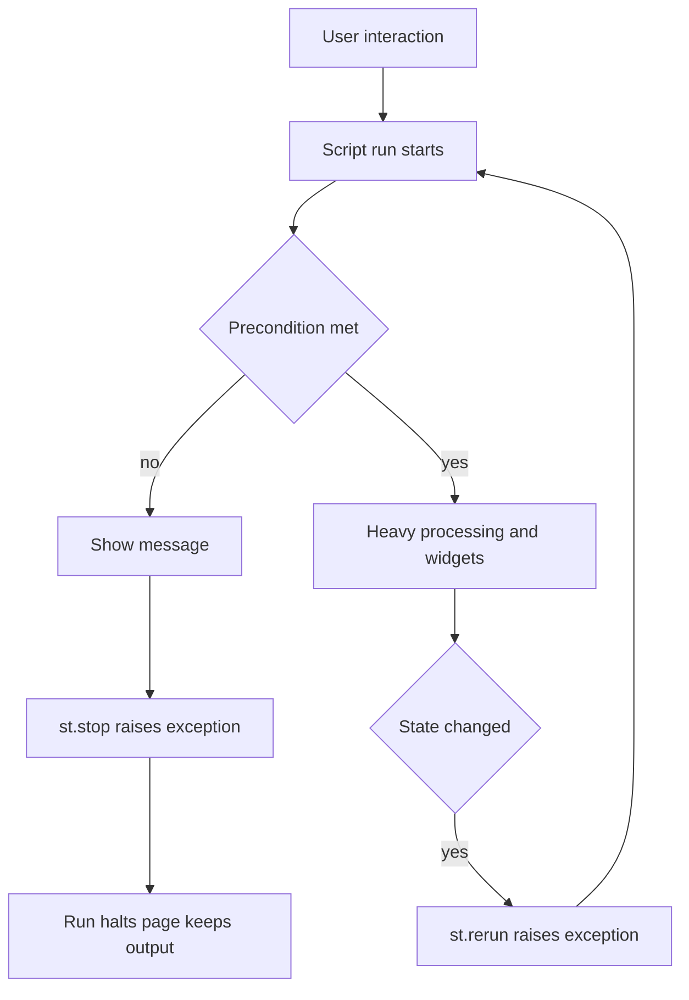

# st.rerun, st.stop, and the Control-Flow Primitives That Interrupt a Script

## English

Streamlit exposes a small set of control-flow functions that do something unusual: they do not return normally. `st.rerun()` raises an internal exception that unwinds the current script and tells the server to schedule a fresh run immediately. `st.stop()` raises a different exception that halts the current run without scheduling a new one, so the page keeps whatever was rendered above the call. Because both work by raising exceptions, any code after them in the same function does not execute — and if you wrap the call in a broad `try/except Exception`, you will swallow the signal and break the behaviour. This is a real trap: catching `Exception` around a block that calls `st.rerun()` can turn a clean restart into a confusing half-rendered page.

The practical use of `st.stop()` is guarding the rest of a script behind a precondition. A common pattern is: render a file uploader, check whether a file exists, and if not, show a message and call `st.stop()`. Everything below — the heavy dataframe processing, the charts — is skipped for that run, and the user sees a clean prompt instead of a crash. Without `st.stop()`, you would need to wrap the entire rest of the script in an `if` block, which nests deeply and is easy to get wrong when the script grows.

`st.rerun()` is for when you have changed state and want the UI to reflect it now, within the same interaction. Imagine a "reset filters" button: it clears several `st.session_state` keys and then calls `st.rerun()` so that the widgets re-initialise from their defaults on the next run. Without the rerun, the current run continues with the old widget values already rendered, and the user sees stale UI until they touch something else. The rerun forces the widget identity system to re-read the new defaults.

There is a subtlety about when a rerun is redundant. If your code changes a widget's value via a key and the widget has already been rendered this run, the displayed value may not update until the next run — which is exactly the scenario `st.rerun()` solves. Conversely, calling `st.rerun()` unconditionally at the top of a script creates an infinite loop: every run schedules another run. Only call it in response to an event (a button press, a callback) and only when state has actually changed.

A related primitive is `st.switch_page()` for multipage apps, which navigates to another page and triggers a rerun there. All three — `rerun`, `stop`, `switch_page` — are control-flow signals masquerading as function calls. Treating them as ordinary functions that "do something and return" is the single most common source of confusing behaviour in Streamlit apps.

## 中文

Streamlit 提供一小組控制流函數，佢哋做嘅嘢幾特別：佢哋唔會正常返回。`st.rerun()` 會拋出一個內部異常，展開當前腳本，並叫伺服器即刻排一次全新嘅運行。`st.stop()` 會拋出另一個異常，中止當前運行但唔排新運行，所以頁面會保留喺呼叫位置之上已經渲染咗嘅嘢。因為兩者都係靠拋異常嚟運作，所以同一個函數入面喺佢哋之後嘅代碼唔會執行——而如果你將個呼叫包喺一個寬泛嘅 `try/except Exception` 入面，你就會吞咗個訊號，搞壞行為。呢個係一個真實陷阱：喺一個會呼叫 `st.rerun()` 嘅區塊周圍捕捉 `Exception`，可以將一次乾淨嘅重啟變成一個令人困惑、渲染到一半嘅頁面。

`st.stop()` 嘅實際用途，係將腳本其餘部分守喺一個前置條件後面。常見模式係：渲染一個檔案上載器，檢查檔案存唔存在，如果冇，就顯示訊息並呼叫 `st.stop()`。下面所有嘢——繁重嘅 dataframe 處理、圖表——喺嗰次運行都會被跳過，用戶見到乾淨嘅提示而唔係崩潰。冇 `st.stop()` 嘅話，你就要將成個腳本其餘部分包喺一個 `if` 區塊入面，噉樣會嵌套得好深，而且腳本一大就好容易出錯。

`st.rerun()` 係用喺你已經改咗狀態、想 UI 喺同一次互動之內即刻反映嘅時候。想像一個「重設篩選」按鈕：佢清除幾個 `st.session_state` 鍵，然後呼叫 `st.rerun()`，令組件喺下一次運行由預設值重新初始化。冇呢次重跑嘅話，當前運行會繼續用已經渲染咗嘅舊組件值，用戶會見到過時嘅 UI，直到佢再掂其他嘢為止。重跑會強制組件身份系統重新讀取新嘅預設值。

關於幾時重跑係多餘嘅，有個微妙之處。如果你嘅代碼透過一個鍵改咗某個組件嘅值，而嗰個組件喺今次運行已經渲染咗，顯示嘅值可能要等到下一次運行先更新——而呢個正正就係 `st.rerun()` 解決嘅情境。相反，喺腳本頂部無條件呼叫 `st.rerun()` 會造成無限迴圈：每次運行都排多一次運行。只喺回應事件（按鈕按下、回呼）時呼叫佢，而且只喺狀態真係變咗嘅時候先呼叫。

一個相關嘅原語係用於多頁應用嘅 `st.switch_page()`，佢會導航去另一個頁面並喺嗰度觸發重跑。三者——`rerun`、`stop`、`switch_page`——都係扮成函數呼叫嘅控制流訊號。將佢哋當成「做啲嘢然後返回」嘅普通函數，係 Streamlit 應用入面最常見嘅困惑來源。

## Key Takeaway

st.rerun and st.stop work by raising exceptions, so never swallow them in a broad except clause and only call rerun in response to a real state change.

## Related Concepts
- exception-based control flow
- st.session_state

## Diagram

