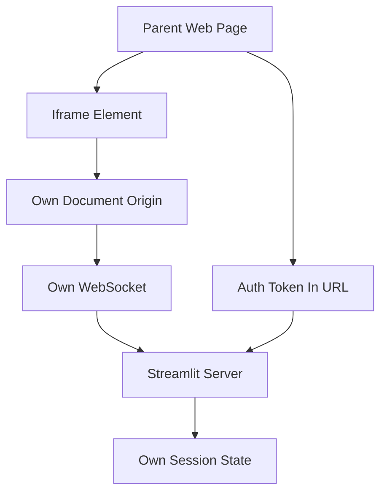

# Embedding, iframes, and Running Streamlit Inside Another Web Page

## English

Streamlit serves a full single-page application, and its frontend talks to the server over a WebSocket. That architecture has direct consequences when you try to embed it: you cannot simply drop a `<script>` tag into an existing HTML page and expect it to work. The usual approach is an iframe — point an `<iframe src="https://your-app.example.com">` at the running app. The iframe gets its own document, its own WebSocket, and its own session, which is exactly what Streamlit expects. This is the mechanism behind the `?embed=true` query parameter many deployments use to hide the Streamlit chrome (menu, footer) for a cleaner embedded view.

Embedding via iframe is straightforward but has real constraints. First, cookies and session state live inside the iframe's origin, so if your parent page is on a different domain, the two cannot share authentication unless you design for it (for example, by passing a token in the URL and validating it server-side). Second, the WebSocket connection must survive any proxies between the browser and the Streamlit server; a reverse proxy that strips the `Upgrade` header will break the app inside the iframe even though the parent page loads fine. Third, iframe height is fixed by CSS — Streamlit does not automatically resize the parent frame, so you either pick a generous fixed height or write a small `postMessage` bridge that reports the content height.

A subtler issue is that each iframe is a separate session from Streamlit's point of view. If a user has the app open in a full tab and also embedded in a dashboard, those are two sessions with two `st.session_state` dictionaries. They do not share data. This is fine for stateless dashboards but surprising if you assumed a logged-in user maps to one session everywhere. The session is tied to the browser connection, not to a user identity.

For authentication, the common pattern is to terminate auth at a reverse proxy or an identity-aware proxy in front of Streamlit, and let the proxy inject a header identifying the user. Streamlit itself does not ship a full auth system; community components exist, but they add a dependency and their own trust model. If you go that route, understand that the app's Python code runs on the server and can read whatever headers the proxy passes, so the proxy must strip any client-supplied version of those headers to prevent spoofing.

Finally, consider whether embedding is the right call at all. If the goal is to show one chart inside a larger product, a Streamlit iframe is heavy: it loads the whole frontend bundle and opens a persistent WebSocket. For a single visualisation, exporting the chart or calling a small API may be lighter. Embedding makes sense when you genuinely want the interactive, rerun-driven app experience inside another shell.

## 中文

Streamlit 提供一個完整嘅單頁應用，而佢嘅前端透過 WebSocket 同伺服器通訊。呢個架構喺你嘗試嵌入佢嗰陣有直接後果：你唔可以單純喺現有 HTML 頁面丟一個 `<script>` 標籤入去就期望佢work。常見做法係用 iframe——將 `<iframe src="https://your-app.example.com">` 指向執行緊嘅應用。個 iframe 有自己嘅檔案、自己嘅 WebSocket、自己嘅 session，正正就係 Streamlit 期望嘅嘢。好多部署用嘅 `?embed=true` 查詢引數就係靠呢個機制，喺嵌入檢視入面隱藏 Streamlit 嘅外框（選單、頁尾）。

透過 iframe 嵌入好直接，但有真實限制。第一，cookie 同 session 狀態住喺 iframe 嘅來源（origin）入面，所以如果你嘅父頁面喺另一個網域，兩者唔可以共享認證，除非你特意設計（例如喺 URL 傳一個 token 並喺伺服器端驗證）。第二，WebSocket 連線必須喺瀏覽器同 Streamlit 伺服器之間任何代理都存活到；一個剝走 `Upgrade` 標頭嘅反向代理會令 iframe 入面嘅應用壞掉，即使父頁面載入正常。第三，iframe 高度由 CSS 固定——Streamlit 唔會自動調整父框架大小，所以你要揀一個夠大嘅固定高度，或者寫一個細細嘅 `postMessage` 橋樑去報告內容高度。

一個更微妙嘅問題係：從 Streamlit 嘅角度睇，每個 iframe 都係一個獨立 session。如果使用者喺一個完整分頁開住個應用，又喺一個儀錶板嵌入佢，噉就係兩個 session、兩個 `st.session_state` 字典。佢哋唔共享資料。對無狀態儀錶板嚟講冇問題，但如果你以為一個登入使用者喺所有地方都對應一個 session，就會好意外。Session 係綁喺瀏覽器連線，唔係綁喺使用者身份。

至於認證，常見模式係喺 Streamlit 前面嘅反向代理或者身份感知代理度終止認證，再讓代理注入一個識別使用者嘅標頭。Streamlit 本身唔附帶完整認證系統；有社群元件存在，但佢哋加咗一個依賴同自己嘅信任模型。如果你走嗰條路，要明白應用嘅 Python 程式碼喺伺服器執行，可以讀到代理傳嘅任何標頭，所以代理必須剝走任何客戶端提供嘅同名標頭，以防偽造。

最後，要考慮嵌入係咪正確選擇。如果目標係喺一個更大產品入面顯示一個圖表，Streamlit iframe 好重：佢載入成個前端 bundle 並開一條持久 WebSocket。單一視覺化嘅話，匯出圖表或者呼叫一個細 API 可能更輕。當你真係想喺另一個外殼入面有互動、由重跑驅動嘅應用體驗時，嵌入先至合理。

## Key Takeaway

Embedding Streamlit means an iframe with its own WebSocket and session, so plan for auth pass-through, proxy WebSocket support, and fixed sizing.

## Related Concepts
- reverse proxy WebSocket upgrade
- iframe same-origin policy

## Diagram

