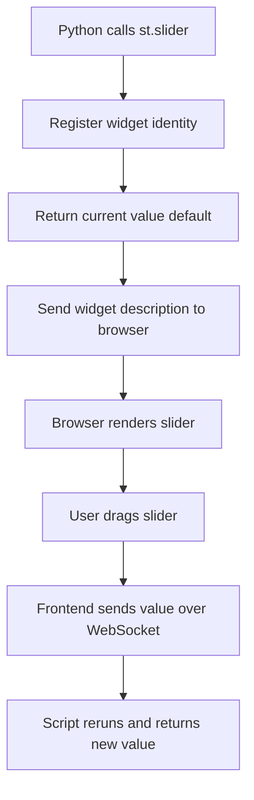

# Streamlit's Widget State Lifecycle: From Browser Event to Python Variable

## English

Every interactive widget in Streamlit passes through a lifecycle that is easy to overlook: creation, registration, serialization to the browser, user interaction, and value return on the next rerun. When you call st.slider('x', 0, 10), the function does not block waiting for input. Instead it registers a widget with an internal identity (derived from its type, label, parameters, and key), sends a description of that widget to the frontend, and returns its current value immediately — which on the first run is the default. The browser renders the slider, and when the user drags it, the frontend sends a message back over the WebSocket with the new value attached to that widget identity. That message triggers a full script rerun, and this time st.slider returns the new value.

The key insight is that the widget's value lives on the server, in the session's widget state store, not in the browser. The browser is a view: it displays what the server tells it and reports user actions. If you refresh the page, the widget state is typically reset because a new session begins. If the server restarts, all widget values vanish. This is why you cannot rely on a widget retaining a value across deployments, and why session_state is the durable place to store things that must survive reruns (though not restarts).

Widget identity deserves attention because it determines whether Streamlit treats two calls as the same widget or as two different ones. Two st.slider('x', 0, 10) calls in the same script run are not the same widget — they are distinguished by position in the script, label, and parameters. If you conditionally render widgets inside an if block, the widget's position in the script tree can change, causing Streamlit to see a 'new' widget and reset its value. Assigning an explicit key='my_slider' stabilizes identity so the value persists even when surrounding code branches change.

Another subtlety is the order of value delivery. When a user interacts with a widget, the rerun begins with the new value already available to that widget's function call. But any code that ran before the widget call in the previous run has already executed with the old value. This is why you sometimes see stale values in prints or logs: the script is re-executing top to bottom, and the widget's new value only exists from the moment its st.* call is reached. Callbacks exist to bridge this gap by running code immediately when the widget changes, before the rerun.

Finally, consider programmatic updates. If you set st.session_state['my_slider'] = 5 from code, the widget next render will show 5 — but only if the widget has a key and Streamlit's internal state allows the override. There are documented constraints here (you generally cannot set a widget's state after it has been instantiated in the same run), which is why the recommended pattern is to set state before the widget call or use callbacks. Understanding the full lifecycle — register, render, interact, deliver, rerun — turns mysterious resets and stale reads into predictable behavior.

## 中文

Streamlit 裡面每一個互動元件都經過一個容易被忽略的生命週期：建立、註冊、序列化到瀏覽器、使用者互動、以及下一次重跑時回傳數值。當你呼叫 st.slider('x', 0, 10)，這個函式並唔會停低等輸入。佢會用一個內部身份（由型別、標籤、引數同 key 推匯出嚟）註冊一個元件，將元件嘅描述送去前端，然後即刻回傳佢當前嘅值——第一次執行時就係預設值。瀏覽器負責渲染滑桿，使用者拖動時，前端會經 WebSocket 送一個訊息返嚟，將新數值繫結去嗰個元件身份。呢個訊息會觸發完整嘅指令碼重跑，而呢次 st.slider 就會回傳新值。

關鍵洞見係：元件嘅值住喺伺服器度，喺 session 嘅 widget state store 裡面，唔係喺瀏覽器。瀏覽器只係一個檢視：佢顯示伺服器叫佢顯示嘅嘢，並回報使用者動作。如果你重新整理頁面，元件狀態通常會重設，因為開咗一個新 session。如果伺服器重啟，所有元件值都會消失。呢個就係點解你唔可以倚賴元件喺部署之間保留數值，亦係點解 session_state 係存放必須跨重跑存活（但唔跨重啟）嘅嘢嘅持久位置。

元件身份值得留意，因為佢決定咗 Streamlit 會唔會當兩次呼叫係同一個元件。同一個指令碼執行入面兩次 st.slider('x', 0, 10) 唔係同一個元件——佢哋由指令碼入面嘅位置、標籤同引數區分。如果你喺 if 區塊入面有條件咁渲染元件，元件喺指令碼樹入面嘅位置可能會變，令 Streamlit 當佢係「新」元件並重設數值。指定明確嘅 key='my_slider' 可以穩定身份，令數值即使周圍嘅程式碼分支改變都得以保留。

另一個微妙之處係數值送達嘅次序。當使用者同元件互動，重跑開始時嗰個元件嘅函式呼叫已經有新值可用。但係喺上一次執行入面，喺元件呼叫之前跑過嘅任何程式碼，已經用舊值執行咗。呢個就係點解你有時會喺 print 或 log 見到過時數值：指令碼由上至下重新執行，元件嘅新值只會喺執行到佢嘅 st.* 呼叫嗰一刻先存在。callback 就係用嚟填補呢個空隙，喺元件改變時、重跑之前即刻執行程式碼。

最後，考慮程式化更新。如果你喺程式碼入面設定 st.session_state['my_slider'] = 5，元件下次渲染會顯示 5——但前提係元件有 key 而且 Streamlit 內部狀態允許呢個覆寫。呢度有明文嘅限制（通常你唔可以喺同一次執行入面、元件例項化之後再設定佢嘅狀態），所以建議嘅模式係喺元件呼叫之前設定狀態，或者用 callback。理解成個生命週期——註冊、渲染、互動、送達、重跑——就可以將神秘嘅重設同過時讀取變成可預測嘅行為。

## Key Takeaway

A widget's value lives on the server and is delivered to your Python code only when the script re-executes past that widget's call, so identity, keys, and execution order all determine what you actually see.

## Related Concepts
- Widget identity and key stability
- Callbacks versus inline code

## Diagram

