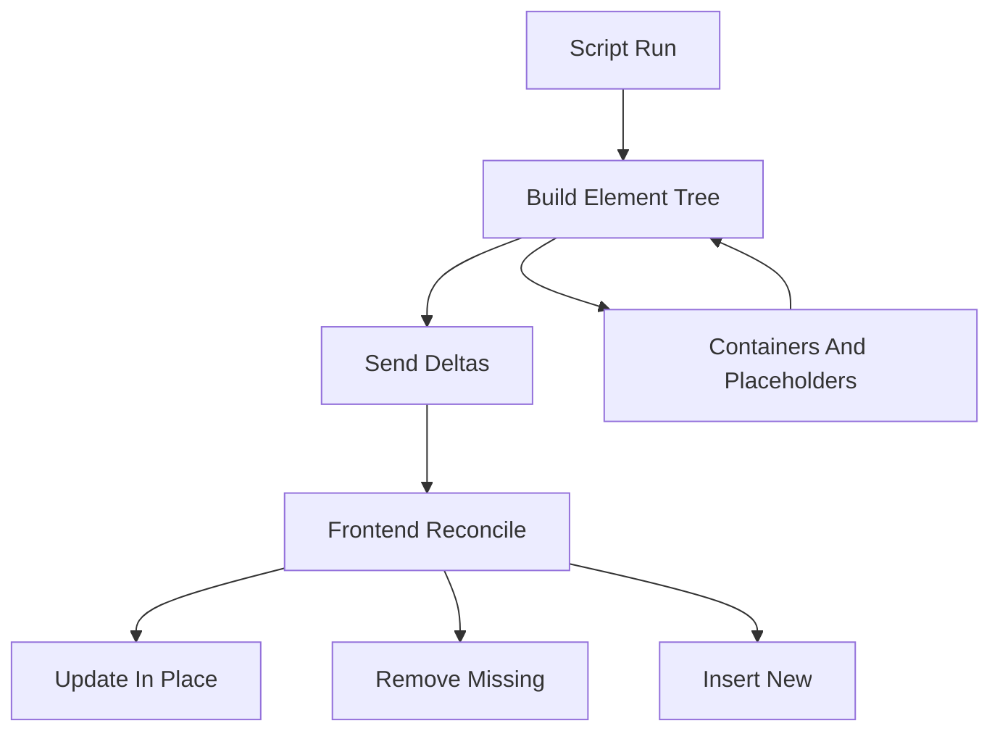

# The Element Tree: How Streamlit Decides What to Draw, Move, and Erase

## English

When you call st.write, st.dataframe, or st.line_chart, Streamlit is not writing HTML into a page. It is building a tree of elements — a data structure describing what should exist on screen — and sending incremental updates (deltas) to the frontend. Each run of your script produces a fresh element tree, and the frontend reconciles the new tree against the old one. Elements that match (same type, same position, same identity) are updated in place; elements that disappeared are removed; new elements are inserted. This is why an st.empty() placeholder can be filled later: it reserves a slot in the tree that a subsequent call can target.

The tree has structure. Containers like st.container, st.columns, st.expander, and st.sidebar are nodes with children. When you write with st.sidebar.write(...), you are adding a child to the sidebar node. When you use a context manager (with st.container(): ...), everything inside becomes children of that container. This hierarchy matters because reconciliation operates on it: if a container's contents change shape between runs, the frontend must figure out which children to keep and which to replace. Stable structure produces smooth updates; wildly varying structure produces flicker or full re-renders of subtrees.

Placeholders and containers are the mechanism behind progress displays. st.empty() returns a handle to a slot; calling placeholder.write('step 1') and later placeholder.write('step 2') replaces the content of that same slot. Similarly, a container can be filled incrementally: create it once, then append output to it across a long-running loop. This is how you build a live log view in a script that otherwise blocks until done. The element tree is not a static snapshot — it is a mutable structure that your code holds references into.

The reconciliation model explains several surprising behaviors. If you have a chart inside an if branch and the branch stops executing, the chart disappears on the next run — because the new element tree has no node for it. If you reorder two st.write calls, the frontend sees the same two elements in different positions and may treat them as replacements rather than moves, which is generally invisible but can matter for stateful widgets. Widgets, in particular, are keyed by identity, so moving a widget in the script can cause its value to reset even though the widget 'looks the same'.

Understanding the element tree also clarifies performance. Sending a large dataframe is not free: Streamlit serializes it (often to Arrow) and ships it to the browser, and the browser must render it. A tree with a hundred small elements costs more in reconciliation overhead than a tree with three composite ones. When an app feels sluggish, the question is often not 'is my Python slow?' but 'how big and how volatile is my element tree?' Reducing the number of elements, keeping structure stable across runs, and using placeholders instead of re-emitting everything are the practical levers.

## 中文

當你呼叫 st.write、st.dataframe 或 st.line_chart，Streamlit 並唔係將 HTML 寫入頁面。佢係建立一棵元素樹——一個描述螢幕上應該有咩嘅資料結構——然後送增量更新（deltas）去前端。你腳本每次執行都會產生一棵新嘅元素樹，前端就將新樹同舊樹對帳。吻合嘅元素（同類型、同位置、同身份）會就地更新；消失咗嘅元素會被移除；新元素會被插入。呢個就係點解 st.empty() 佔位符可以之後再填充：佢喺樹入面預留咗一個槽，之後嘅呼叫可以針對佢。

元素樹有結構。st.container、st.columns、st.expander 同 st.sidebar 呢類容器係有子節點嘅節點。當你寫 st.sidebar.write(...)，你係加一個子節點去 sidebar 節點。當你用 context manager（with st.container(): ...），入面所有嘢都會成為嗰個容器嘅子節點。呢個層級關係好重要，因為對帳就係喺呢個層級上運作：如果容器嘅內容喺兩次執行之間形狀改變，前端就要判斷邊啲子節點保留、邊啲替換。穩定嘅結構會產生順暢嘅更新；劇烈變化嘅結構會產生閃爍或者整個子樹重新渲染。

佔位符同容器係進度顯示背後嘅機制。st.empty() 回傳一個槽嘅把手；呼叫 placeholder.write('step 1') 然後 placeholder.write('step 2') 會替換同一個槽嘅內容。同樣，容器可以逐步填充：建立一次，然後喺長時間迴圈入面將輸出追加去佢度。呢個就係喺一個原本會阻塞到完成嘅腳本入面建立即時 log 視圖嘅方法。元素樹唔係靜態快照——佢係一個可變結構，你嘅程式碼持有指向佢嘅引用。

對帳模型解釋咗幾個令人意外嘅行為。如果你喺 if 分支入面有個圖表，而個分支唔再執行，下次執行個圖表就會消失——因為新嘅元素樹冇佢嘅節點。如果你調換兩個 st.write 呼叫嘅次序，前端會見到同樣兩個元素喺唔同位置，可能會當佢哋係替換而唔係移動，一般睇唔出，但對有狀態組件就可能重要。組件尤其係按身份做 key，所以喺腳本入面移動一個組件，即使佢「睇落一樣」，都可能令佢嘅值重設。

理解元素樹亦都釐清咗效能問題。傳送一個大型 dataframe 唔係免費：Streamlit 會序列化佢（通常用 Arrow）送去瀏覽器，瀏覽器要渲染。一棵有一百個細元素嘅樹，對帳開銷會比一棵有三個複合元素嘅樹更高。當應用程式感覺遲鈍，問題往往唔係「我嘅 Python 慢唔慢？」而係「我棵元素樹有幾大、幾咁易變？」減少元素數量、令結構跨執行保持穩定、用佔位符而唔係每次都重新發出所有嘢，係實際可用嘅槓桿。

## Key Takeaway

Streamlit does not paint a page — it builds a fresh element tree each run and lets the frontend reconcile it, so structure stability and tree size directly shape both correctness and performance.

## Related Concepts
- Element tree reconciliation
- st.empty and placeholder handles

## Diagram

