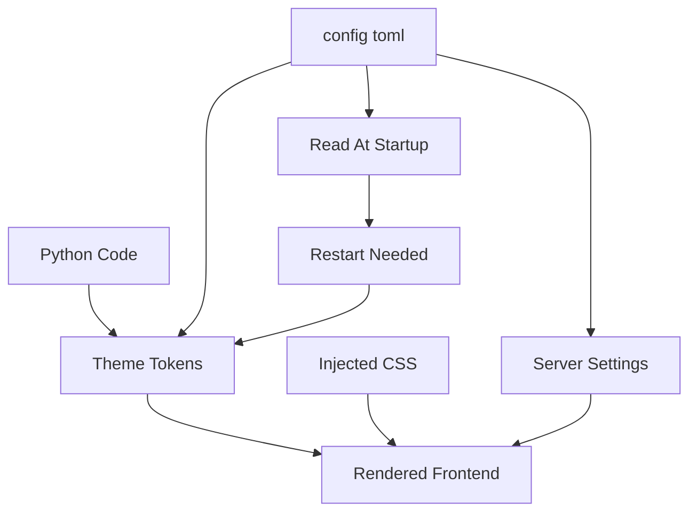

# Theming, Config, and the Browser Contract: Where Your App's Look Actually Comes From

## English

A Streamlit app's appearance is not determined by your Python code alone. It is the product of three layers: the built-in theme (colors, fonts, base spacing), the configuration file (.streamlit/config.toml), and any CSS you inject via st.markdown(..., unsafe_allow_html=True). Understanding which layer wins where prevents hours of fighting the framework. The theme layer exposes a set of design tokens — primaryColor, backgroundColor, secondaryBackgroundColor, textColor, font — that the frontend consumes to style every built-in widget. Change primaryColor and every slider, button, and checkbox updates consistently. This is the sanctioned way to brand an app.

The config file is where you set those tokens persistently. A [theme] section in .streamlit/config.toml with values like primaryColor = "#FF4B4B" applies to every session. The same file also controls server behavior (port, headless mode, CORS), browser behavior (gatherUsageStats), and client settings. Crucially, config.toml is read at startup, so changes require a restart — unlike your Python script, which reruns automatically. This asymmetry trips people up: they edit a theme value, see nothing change, and assume it is broken, when in fact the server has not reloaded the config.

The third layer, injected CSS, is powerful but fragile. Streamlit's rendered HTML uses internal class names and structural markup that are not part of a public API and can change between versions. A CSS rule targeting a specific wrapper div may work today and silently stop matching after an upgrade. For this reason, injected CSS is best reserved for cosmetic touches — adjusting spacing, hiding a specific element by its stable data-testid if one exists, or styling custom HTML you control — rather than for wholesale redesigns. The framework's own theme system is the durable path.

There is also a per-session dimension. Users can open the app's settings menu and switch between light and dark themes, or pick a custom theme, and that choice is stored client-side. Your theme config sets the default, but the user can override it. If your app's readability depends on a specific background color (for example, a chart with a transparent background), you should either design for both themes or pin the appearance explicitly. Testing in both light and dark modes is a practical habit that catches contrast problems early.

Finally, the browser contract extends beyond pixels. Streamlit sends a document with a title, favicon, and layout mode (centered or wide) controlled by st.set_page_config. It also sends metadata that affects sharing and embedding. When you embed a Streamlit app in an iframe or behind a reverse proxy, the base URL and asset paths matter, and misconfiguration shows up as missing styles or broken websocket connections rather than Python errors. Treating appearance as a layered contract — theme tokens, config, injected CSS, and page metadata — makes branding predictable instead of a guessing game.

## 中文

一個 Streamlit 應用程式嘅外觀唔係單靠你嘅 Python 程式碼決定。佢係三層嘅產物：內建主題（顏色、字體、基礎間距）、配置檔（.streamlit/config.toml），以及你透過 st.markdown(..., unsafe_allow_html=True) 注入嘅任何 CSS。理解邊一層喺邊度勝出，可以避免花幾個鐘同框架搏鬥。主題層暴露一組設計 token——primaryColor、backgroundColor、secondaryBackgroundColor、textColor、font——前端用佢哋去為每個內建組件設定樣式。改 primaryColor，每個滑桿、按鈕同勾選框都會一致更新。呢個係為應用程式建立品牌形象嘅正規方法。

配置檔就係你持久設定呢啲 token 嘅地方。喺 .streamlit/config.toml 嘅 [theme] 區段設定 primaryColor = "#FF4B4B" 之類嘅值，會套用到每個 session。同一個檔案亦控制伺服器行為（port、headless 模式、CORS）、瀏覽器行為（gatherUsageStats）同客戶端設定。關鍵係，config.toml 喺啟動時讀取，所以改動需要重啟——唔似你嘅 Python 腳本會自動重跑。呢個唔對稱經常令人中招：改咗主題值，見唔到任何變化，就以為壞咗，其實係伺服器未重新載入配置。

第三層，注入 CSS，功能強大但脆弱。Streamlit 渲染出嚟嘅 HTML 用內部 class 名同結構標記，佢哋唔屬於公開 API，版本之間可能會變。一條針對特定 wrapper div 嘅 CSS 規則可能今日有效，升級之後就靜靜雞唔再吻合。因此，注入 CSS 最好留俾外觀微調——調整間距、用穩定嘅 data-testid（如有）隱藏特定元素，或者為你自己控制嘅自訂 HTML 設定樣式——而唔係用嚟大規模重新設計。框架自己嘅主題系統先係持久嘅路徑。

仲有一個 per-session 嘅維度。用戶可以打開應用程式嘅設定選單，喺淺色同深色主題之間切換，或者揀自訂主題，而呢個選擇會存喺客戶端。你嘅主題配置設定預設值，但用戶可以覆寫。如果你應用程式嘅可讀性依賴特定背景色（例如透明背景嘅圖表），你應該為兩個主題設計，或者明確固定外觀。喺淺色同深色模式下都測試，係一個實際習慣，可以及早發現對比度問題。

最後，瀏覽器契約唔止於像素。Streamlit 會送一份文件，包含由 st.set_page_config 控制嘅標題、favicon 同佈局模式（置中或寬版）。佢亦會送影響分享同嵌入嘅中繼資料。當你將 Streamlit 應用程式嵌入 iframe 或者放喺反向代理後面，base URL 同資源路徑就好重要，配置錯誤會以樣式缺失或者 websocket 連線中斷嘅形式出現，而唔係 Python 錯誤。將外觀視為一個分層契約——主題 token、配置、注入 CSS 同頁面中繼資料——就可以令品牌化變得可預測，而唔係靠估。

## Key Takeaway

What your Streamlit app looks like is decided by a layered contract of theme tokens, startup-read config, injected CSS, and page metadata — and knowing which layer owns which decision is what makes branding reliable.

## Related Concepts
- Theme tokens and config.toml
- set_page_config and document metadata

## Diagram

