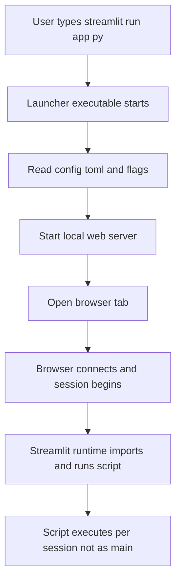

# The Command-Line Surface: What `streamlit run` Actually Does

## English

Most people meet Streamlit through a single command: `streamlit run app.py`. It looks like magic, but it is really a small launcher program that reads a configuration file, starts a local web server, and then opens a browser tab pointing at it. The command is not your Python interpreter — it is a separate executable that installs alongside the `streamlit` package. That distinction matters: when you run `streamlit run app.py`, your script is not executed the way `python app.py` would execute it. Instead, the launcher boots a server process, and your script only runs later, when a browser connects and a session begins. This is why `if __name__ == "__main__":` blocks that call `input()` or expect command-line arguments often behave strangely — the script is being imported and executed by Streamlit's runtime, not by a plain Python process you control.

The launcher accepts a number of flags that are worth knowing. `--server.port` changes the port (default 8501). `--server.address` binds to a specific network interface — useful when you want to serve on `0.0.0.0` inside a container rather than only `localhost`. `--server.headless true` stops the automatic browser-opening behaviour, which is essential in Docker images and CI pipelines where there is no desktop. `--browser.gatherUsageStats false` disables the anonymous telemetry ping on startup. Each flag corresponds to a key in the `[server]` or `[browser]` section of a `config.toml` file, so anything you can pass on the command line you can also persist in configuration. Precedence runs from command-line flags (highest) down through environment variables, project config, global config, and finally built-in defaults.

There is also a lesser-known behaviour: `streamlit run` can take multiple script paths or even a URL in some versions, and it supports a `--` separator so that arguments after it are passed to your script rather than to Streamlit itself. Those arguments arrive in `sys.argv`, which means you can build small CLI-style toggles into an app without writing a separate entry point. The command also prints a local URL and a network URL on startup; the network URL is the one other machines on your LAN can reach, and it only works if the bind address is not restricted to loopback.

When the launcher starts, it also spawns a file watcher (unless disabled), which is what powers the save-and-rerun workflow. That watcher is part of the same process tree, so killing the parent process cleans up the child. If you ever find a port already in use, the usual culprit is a previous `streamlit run` that was backgrounded rather than stopped cleanly — the launcher does not always release the socket immediately. Understanding this layer turns `streamlit run` from an incantation into a predictable tool: it is a supervisor that starts a server, points a browser at it, and hands your script to a runtime that will call it repeatedly.

Finally, knowing the launcher exists explains a common beginner confusion. People sometimes try to `import` their app module from a test or a notebook and expect it to render. It will not — importing the module just executes the top-level code in whatever Python process did the import, with no server, no session, and no browser. To exercise an app programmatically you need the dedicated testing harness, and to see it as a web page you need the launcher. The command is the boundary between 'a Python file' and 'a running application'.

## 中文

大部分人認識 Streamlit 都係由一句命令開始：`streamlit run app.py`。睇落好似魔法，但實際上佢只係一個細細嘅啟動器程式，會讀取設定檔、啟動本機網頁伺服器，然後開一個瀏覽器分頁指去嗰度。呢個命令唔係你嘅 Python 解譯器——佢係同 `streamlit` 套件一齊安裝嘅獨立執行檔。呢個分別好重要：當你行 `streamlit run app.py`，你嘅腳本唔會好似 `python app.py` 咁被執行。相反，啟動器會開一個伺服器進程，你嘅腳本要等到瀏覽器連上、session 開始之後先會跑。呢個就解釋咗點解 `if __name__ == "__main__":` 入面呼叫 `input()` 或者期望命令行參數嘅程式碼，行為往往好古怪——腳本係被 Streamlit 嘅 runtime 匯入同執行，而唔係由你控制嘅普通 Python 進程。

啟動器接受好多值得認識嘅旗標。`--server.port` 改端口（預設 8501）。`--server.address` 綁定特定網絡介面——當你想喺容器入面 serve 喺 `0.0.0.0` 而唔止 `localhost` 時好有用。`--server.headless true` 會停止自動開瀏覽器嘅行為，喺 Docker image 同 CI pipeline 呢啲冇桌面嘅環境係必需。`--browser.gatherUsageStats false` 會關閉啟動時嘅匿名遙測 ping。每個旗標都對應 `config.toml` 入面 `[server]` 或 `[browser]` 段嘅一個 key，所以命令行可以傳嘅嘢，你都可以持久化喺設定檔。優先次序由命令行旗標（最高）落去環境變數、專案設定、全域設定，最後係內建預設值。

仲有個少人知嘅行為：`streamlit run` 喺某啲版本可以接受多個腳本路徑甚至一個 URL，而且支援 `--` 分隔符，令 `--` 之後嘅參數傳去你嘅腳本而唔係 Streamlit 本身。呢啲參數會出現喺 `sys.argv`，即係你可以喺 app 入面建立小型 CLI 式開關，唔使寫另一個入口點。命令啟動時亦會印出本機 URL 同網絡 URL；網絡 URL 係同一個 LAN 上其他機可以連到嘅，而佢只會喺綁定地址唔限於 loopback 時先有效。

啟動器啟動時亦會開一個檔案監察器（除非停用），呢個就係「儲存即重跑」工作流嘅動力來源。個監察器係同一個進程樹嘅一部分，所以殺死父進程會清理埋子進程。如果你發現端口已被佔用，通常罪魁禍首係之前一個被放到背景而冇乾淨停止嘅 `streamlit run`——啟動器唔一定即刻釋放 socket。理解呢一層，`streamlit run` 就由一句咒語變成可預測嘅工具：佢係一個監督者，負責啟動伺服器、叫瀏覽器指過去，然後將你嘅腳本交俾一個會反覆呼叫佢嘅 runtime。

最後，知道啟動器存在，就解釋咗一個常見嘅新手困惑。有人會嘗試由測試或者 notebook `import` 自己嘅 app 模組，期望佢會渲染。佢唔會——匯入模組只係喺做匯入嗰個 Python 進程入面執行頂層程式碼，冇伺服器、冇 session、冇瀏覽器。要程式化咁測試 app，你需要專用嘅測試工具；要見到佢做網頁，你需要啟動器。呢句命令就係「一個 Python 檔案」同「一個運行中嘅應用」之間嘅界線。

## Key Takeaway

`streamlit run` is a launcher that starts a server and hands your script to a runtime, not a Python interpreter running your file directly.

## Related Concepts
- Streamlit's Runtime Environment: The ASGI Server, Threads, and the ScriptRunner
- The Streamlit Development Loop: File Watcher, Rerun Trigger, and the Source of Truth

## Diagram

