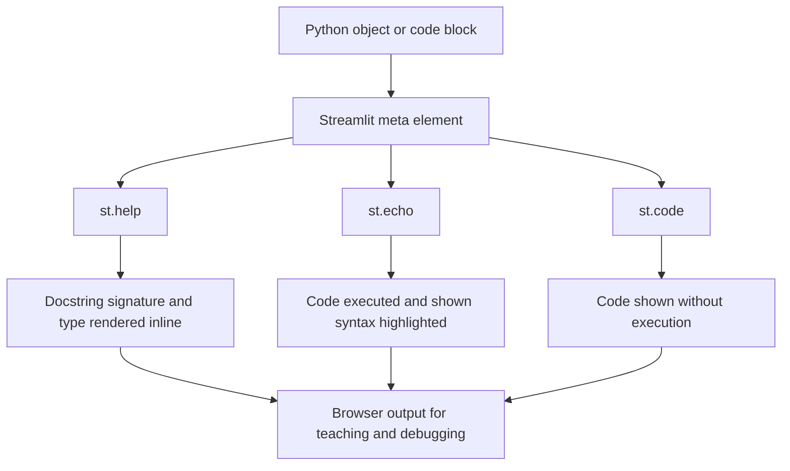

# The st.help, st.echo, and st.code Trio for Teaching and Debugging

## English

Streamlit ships a small family of 'meta' elements that render information about your own code rather than about your data. They are easy to overlook because they do not look like features — they look like debugging leftovers — but they are genuinely useful for building internal tools, tutorials, and notebooks-in-disguise. The three worth knowing are `st.help`, `st.echo`, and `st.code`. Each takes something you already have in Python and turns it into a rendered block in the browser, and each has a subtle behaviour that is worth understanding before you rely on it.

`st.help(obj)` renders the docstring, signature, and type of any Python object — a function, a class, a module, a dataframe. It is the Streamlit equivalent of calling `help()` in a REPL, except the output appears inline in the app. This is useful when you are building an exploratory tool where users pick a function from a dropdown and want to see what it does. It also works on Streamlit's own elements, so `st.help(st.dataframe)` will show you the keyword arguments and docstring for that widget. The catch: `st.help` renders whatever `inspect` can find, and for objects defined interactively or in a notebook cell, the source may be unavailable, so the output can be sparse. For library objects it is reliable; for user code it depends on whether the source file is on disk.

`st.echo()` is a context manager that both executes the code inside it and displays that code in the app as a syntax-highlighted block. It is designed for tutorials and demos: you write the code once, and it appears both as the thing that runs and as the thing the reader sees. By default the code is shown after it executes; you can pass `code_location="above"` to show it first, which reads better in teaching material. The subtlety is that `st.echo` uses the source of the calling frame, so code typed interactively or generated dynamically may not display correctly — the same limitation as `inspect.getsource`. It is also a rerun-sensitive element: on every rerun the code block is regenerated, which is fine but means it participates in the element tree like any other output.

`st.code(body, language=...)` is the simpler primitive: it renders a string as a formatted code block with optional syntax highlighting and an optional line-number gutter. Unlike `st.echo`, it does not execute anything — you hand it a string, it renders it. That makes it the right tool when you want to display a snippet from a file, a config, or a query without running it. It is also what `st.echo` uses under the hood, which is why the two look identical in the browser. A common pattern is to combine them: use `st.echo` for the live example and `st.code` for the 'here is the full file' version.

A fourth element in the same family is `st.json`, which renders a Python dict or list as an expandable JSON tree. It is not a debugger, but it is the fastest way to inspect a nested response from an API or a config object without writing a custom renderer. Together these four elements form a small 'developer surface' inside your app: they let you expose the machinery of your own code to the people using it, which is often exactly what an internal analytics tool or a teaching notebook needs. The risk is that they are easy to leave in production — `st.echo` and `st.help` can leak implementation details or docstrings that were never meant for end users, so treat them like any other debug output and gate them behind a flag or a role check.

## 中文

Streamlit 內建一小撮「元」元素，佢哋渲染嘅係關於你自己程式碼嘅資訊，而唔係你嘅數據。呢啲元素好容易被人忽略，因為佢哋睇落唔似功能——似係除錯剩落嘅嘢——但佢哋對於建立內部工具、教學材料同「偽裝成 app 嘅 notebook」真係好有用。值得認識嘅有三個：`st.help`、`st.echo` 同 `st.code`。每個都接收你喺 Python 已經有嘅嘢，然後喺瀏覽器變成一個渲染區塊，而每個都有一個微妙行為，值得你依賴之前先理解清楚。

`st.help(obj)` 會渲染任何 Python 物件嘅 docstring、簽名同型別——函數、類別、模組、dataframe 都得。佢係 Streamlit 版嘅 REPL `help()`，只不過輸出直接出現喺 app 入面。當你建立探索式工具，用家由下拉選單揀一個函數然後想睇佢做乜，呢個就好有用。佢亦適用於 Streamlit 自己嘅元素，所以 `st.help(st.dataframe)` 會顯示嗰個 widget 嘅關鍵字參數同 docstring。陷阱係：`st.help` 渲染嘅係 `inspect` 搵到嘅嘢，而對於互動式定義或者 notebook cell 入面定義嘅物件，原始碼可能攞唔到，所以輸出會好稀疏。對函式庫物件佢好可靠；對用家程式碼就要睇原始檔有冇喺磁碟上面。

`st.echo()` 係一個 context manager，佢會執行入面嘅程式碼，同時喺 app 入面以語法高亮區塊顯示嗰段程式碼。佢係為教學同示範而設：你寫一次程式碼，佢就同時以「會執行嘅嘢」同「讀者見到嘅嘢」出現。預設係執行完先顯示程式碼；你可以傳 `code_location="above"` 令佢先顯示，喺教學材料入面讀起上嚟順啲。微妙之處係 `st.echo` 用呼叫 frame 嘅原始碼，所以互動式輸入或者動態生成嘅程式碼可能顯示唔正確——同 `inspect.getsource` 一樣嘅限制。佢亦係對重跑敏感嘅元素：每次重跑程式碼區塊都會重新生成，冇問題，但即係佢同其他輸出元素一樣參與元素樹。

`st.code(body, language=...)` 係更簡單嘅原語：佢將一個字串渲染成格式化程式碼區塊，可以加語法高亮同行號欄。同 `st.echo` 唔同，佢唔會執行任何嘢——你俾佢一個字串，佢就渲染。所以當你想顯示檔案、設定或者查詢入面嘅片段而唔想執行佢，佢就係正確工具。佢亦係 `st.echo` 底層用嘅嘢，所以兩者喺瀏覽器睇落一模一樣。常見模式係結合兩者：用 `st.echo` 做即時示範，用 `st.code` 做「呢度係完整檔案」版本。

同一個家族仲有第四個元素 `st.json`，佢會將 Python dict 或 list 渲染成可展開嘅 JSON 樹。佢唔係除錯器，但係檢查 API 巢狀回應或者設定物件最快嘅方法，唔使寫自訂渲染器。呢四個元素合起來就係你 app 入面一小塊「開發者介面」：佢哋令你可以將自己程式碼嘅機制暴露俾用家，而呢個往往正正係內部數據分析工具或者教學 notebook 需要嘅嘢。風險係佢哋好容易留喺生產環境——`st.echo` 同 `st.help` 可能洩漏本來唔係俾終端用家睇嘅實作細節或者 docstring，所以要當佢哋係一般除錯輸出咁處理，用旗標或者角色檢查擋住佢哋。

## Key Takeaway

st.help, st.echo, st.code, and st.json form a developer surface that exposes your own code inside the app, but they are easy to leak into production.

## Related Concepts
- Choosing the Right Display Primitive: st.write vs st.markdown vs st.dataframe
- The HTML and Markdown Rendering Pipeline: How Text Becomes DOM

## Diagram

