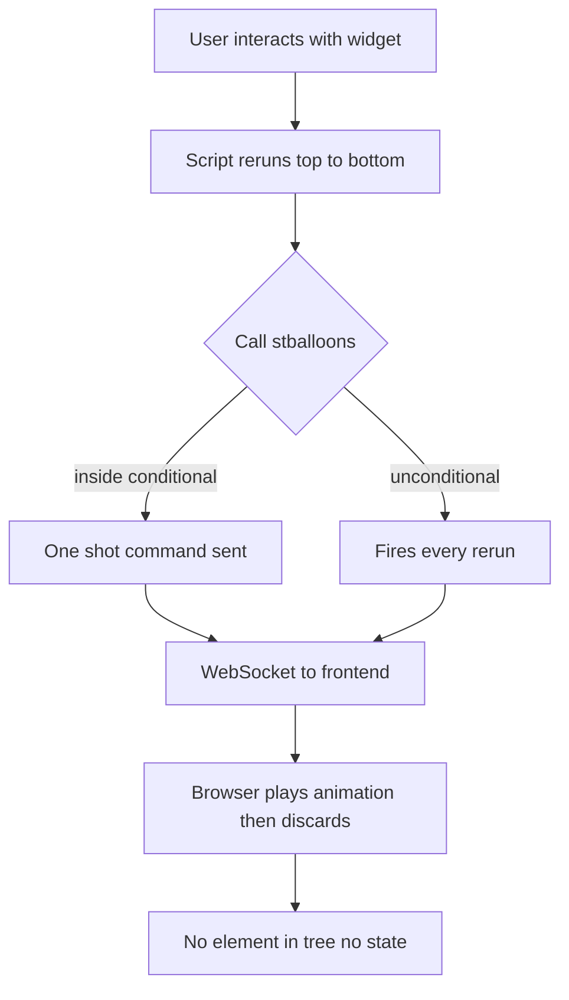

# The st.balloons Frontier: Ephemeral Animation and the Cost of Delight

## English

Streamlit has a small set of 'delight' elements — `st.balloons()` and `st.snow()` — that trigger a full-screen animation in the browser. They are the most obviously playful part of the framework, and they are also a useful lens for understanding how Streamlit separates 'state that lives in Python' from 'effects that live in the browser.' Understanding that separation is more instructive than the animations themselves, and it explains a class of bugs that surprise people who treat Streamlit like a normal frontend framework.

When you call `st.balloons()`, you are not drawing balloons in Python. You are sending a one-shot command over the WebSocket to the frontend, which plays a CSS/JavaScript animation and then discards it. There is no corresponding element in the element tree that persists across reruns — the balloons are not a widget, they have no return value, and they do not appear in `st.session_state`. If you call `st.balloons()` at the top of your script, it will fire on every single rerun, which means every slider drag or text input will produce another burst. This is why the element is usually placed inside a conditional branch: 'if the user just submitted the form, celebrate; otherwise, do nothing.' The animation is an effect triggered by a transition, not a piece of UI that lives in the page.

This is the same pattern as `st.toast`, `st.success`, and `st.error` — they are transient notifications that the frontend displays and then forgets. The distinction between 'an element that persists in the tree' (a dataframe, a chart, a text block) and 'an event that fires once' (a toast, a balloon burst, a rerun request) is one of the most important mental models in Streamlit. Persistent elements are re-sent on every rerun and reconciled by the frontend; transient effects are sent as one-off messages and are not reconciled. If you find yourself wanting an animation to 'stay', you actually want a persistent element — an image, an emoji in `st.markdown`, or a styled container — not a balloon call.

The practical cost is worth naming. A full-screen particle animation is not free: it occupies the main thread of the browser for a short period and can cause jank on low-powered devices, especially if triggered repeatedly. In a shared dashboard used by dozens of people, a stray `st.balloons()` on every rerun can turn into a surprisingly effective denial-of-service against the frontend. The same is true of `st.snow()`, which is seasonal but equally one-shot. Treat these calls like any other side effect: gate them behind a condition, keep them out of loops, and never place them at module top level in an app that reruns frequently.

There is a design lesson here that generalises beyond balloons. Streamlit's model is 'Python decides what the page contains; the browser renders it.' Effects that do not fit that model — animations, focus changes, scroll positions, clipboard writes — are necessarily escape hatches, and they behave differently from the rest of the framework. The balloons are a friendly reminder that not everything in a web app is a value you can store and read back. Some things are just events, and events are consumed, not remembered. Once you internalise that, the rest of Streamlit's element model — persistent elements, transient notifications, and one-shot commands — falls into place.

## 中文

Streamlit 有一小撮「令人開心」嘅元素——`st.balloons()` 同 `st.snow()`——會喺瀏覽器觸發全螢幕動畫。佢哋係框架最明顯玩味嘅部分，亦係一個好好嘅切入點，去理解 Streamlit 點樣區分「住喺 Python 嘅狀態」同「住喺瀏覽器嘅效果」。理解呢個區分比動畫本身更有教育意義，而佢亦解釋咗一類會令「當 Streamlit 係普通前端框架」嘅人驚訝嘅 bug。

當你呼叫 `st.balloons()`，你唔係喺 Python 畫波波。你係經 WebSocket 送一個一次性命令去前端，前端播放一段 CSS/JavaScript 動畫然後丟棄佢。元素樹入面冇一個對應嘅元素會跨重跑持續存在——波波唔係 widget，冇回傳值，亦唔會出現喺 `st.session_state`。如果你喺腳本頂部呼叫 `st.balloons()`，佢會喺每次重跑都觸發，即係每次拖 slider 或者打字輸入都會再爆一次。所以呢個元素通常放喺條件分支入面：「如果用戶啱啱提交咗表單，慶祝；否則乜都唔做。」動畫係由狀態轉換觸發嘅效果，唔係住喺頁面入面嘅 UI 元件。

呢個同 `st.toast`、`st.success`、`st.error` 係同一個模式——佢哋係前端顯示完就忘記嘅短暫通知。「持續存在於元素樹嘅元素」（dataframe、圖表、文字區塊）同「只觸發一次嘅事件」（toast、波波爆發、重跑請求）之間嘅區分，係 Streamlit 最重要嘅心智模型之一。持續元素每次重跑都會重新送出，由前端協調；短暫效果係一次性訊息送出，唔會被協調。如果你發現自己想動畫「留住」，你其實想要一個持續元素——一張圖、`st.markdown` 入面一個 emoji、或者一個有樣式嘅容器——而唔係呼叫波波。

實際成本值得講清楚。全螢幕粒子動畫唔係免費：佢會短暫佔用瀏覽器主執行緒，喺低效能裝置上面可能造成卡頓，尤其係反覆觸發嘅時候。喺一個幾十人共用嘅儀表板入面，一個走漏嘅 `st.balloons()` 喺每次重跑都觸發，可以變成對前端幾有效嘅阻斷服務攻擊。`st.snow()` 一樣，雖然有季節性但同樣係一次性。將呢啲呼叫當一般副作用處理：用條件擋住、唔好放喺迴圈入面、喺頻繁重跑嘅 app 入面永遠唔好放喺模組頂層。

呢度有個設計教訓可以推廣到波波以外。Streamlit 嘅模型係「Python 決定頁面有咩；瀏覽器負責渲染」。唔符合呢個模型嘅效果——動畫、焦點轉移、捲動位置、寫剪貼簿——必然係逃生門，行為同框架其餘部分唔同。波波就係一個友善提醒：網頁 app 入面唔係所有嘢都係一個你可以儲存同讀返嘅值。有啲嘢純粹係事件，而事件係被消耗，唔係被記住。一旦你內化咗呢點，Streamlit 其餘嘅元素模型——持續元素、短暫通知、一次性命令——就會全部歸位。

## Key Takeaway

st.balloons and st.snow are one-shot browser effects, not persistent elements, so they must be gated behind conditions or they fire on every rerun.

## Related Concepts
- The Element Tree: How Streamlit Decides What to Draw, Move, and Erase
- Streamlit's st.status and st.spinner: Communicating Progress in a Blocking Script

## Diagram

