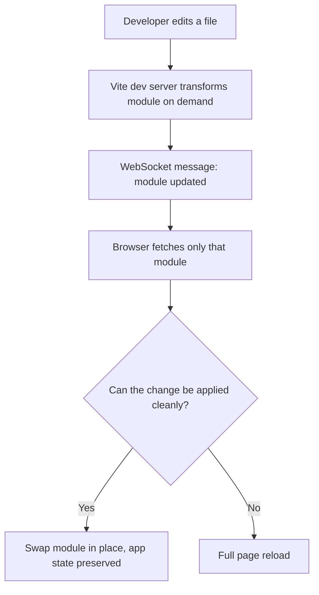

# The Vite Dev Server: Native ESM and Hot Module Replacement

### English

Vite (pronounced "veet", French for "fast") is a build tool for front-end projects, and it is easiest to understand by contrasting it with the older tool it replaced, webpack. A traditional bundler works like a delivery truck: before you can view anything, it reads your entire project, resolves every import, and concatenates everything into one or more large bundles. For a small app that is fine, but the cost grows with the size of the project, so a tiny change to one file can mean a multi-second wait.

Vite splits the job into two phases. In development it does not bundle at all. When you run `vite`, it starts a small HTTP server and transforms each file on demand, then serves it to the browser over native ES modules (ESM is the browser's standard `import`/`export` syntax). The browser itself requests exactly the modules the page needs, so startup is near-instant no matter how big the project is. It also pre-bundles your third-party dependencies with esbuild into a single optimised file, which avoids the "hundreds of tiny requests" problem that native ESM would otherwise cause.

The second half of the story is Hot Module Replacement (HMR). Normally, changing a file forces a full page reload, which throws away application state. HMR is a protocol where Vite tells the browser "this module changed" over a WebSocket, and the browser fetches just that module and swaps it into the running application — React state, scroll position, and form data all survive. Only when a change cannot be applied cleanly does Vite fall back to a full reload.

The mental model: in dev, Vite is a smart file server plus a live-update channel; in production, it is a conventional bundler that produces optimised static assets.

### 中文

Vite（讀音近似「vit」，法語即「快」）係前端專案嘅構建工具，最易理解嘅方法係同佢取代嘅舊工具 webpack 比較。傳統 bundler 好似一部送貨車：喺你睇到任何嘢之前，要讀完整個專案、解析所有 import，再將所有檔案合併成一個或幾個大 bundle。細細個 app 冇問題，但成本隨專案規模增長，改一個檔案都可能要等幾秒。

Vite 將工作分成兩階段。開發時完全唔做 bundling：執行 `vite` 之後，會啟動一個細 HTTP 伺服器，用原生 ES module（ESM 就係瀏覽器標準嘅 `import`／`export` 語法）按需轉換每個檔案並送到瀏覽器。瀏覽器自己只會攞頁面實際需要嘅模組，所以無論專案幾大，啟動都近乎即時。同時佢會用 esbuild 將第三方依賴預先打包成一個優化檔案，避免原生 ESM 造成「幾百個細請求」嘅問題。

另一半故事係 Hot Module Replacement（HMR）。一般情況下改檔案會令成頁重新載入，應用狀態就冇咗。HMR 係一個協議：Vite 透過 WebSocket 話畀瀏覽器「呢個模組改咗」，瀏覽器只攞返嗰個模組換入執行中嘅應用，React state、捲動位置同表單資料全部保留；只有喺改動無法乾淨套用時，Vite 先退回做完整 reload。

最簡單嘅心智模型係：開發時 Vite 係一個聰明嘅檔案伺服器加一條即時更新通道；生產時 Vite 就係傳統 bundler，產出最佳化嘅靜態資源。

## Key Takeaway
In development Vite skips bundling entirely — it serves native ES modules on demand and swaps changed modules into the running app over HMR, so both startup and edit-to-see-it times stay near-instant.

## Related Concepts
- Native ES modules in the browser
- WebSocket-based HMR protocol
- esbuild dependency pre-bundling
- Vite dev server and middleware mode

## Diagram

