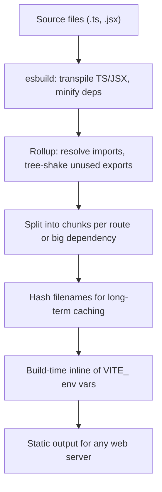

# From Dev to Prod: Vite's Build Pipeline, Rollup, and Environment Variables

### English

The development server is only half of Vite. When you run `vite build`, Vite switches into a production build, and this side of the tool works much like a classic bundler — but with a modern twist. The twist is that Vite delegates to Rollup for production bundling, while using esbuild for the fast pre-processing work (TypeScript-to-JavaScript transformation, JSX compilation, minification of dependencies). Rollup is a JavaScript bundler that produces output optimised for tree shaking, which is the process of removing code that is never actually used.

Tree shaking works because ES modules are statically analysable: the bundler can see exactly which named exports are imported and which are not, and drop the rest. It works best with pure, side-effect-free modules, which is why modern libraries publish ESM builds. Vite then runs the output through several stages: it splits your code into chunks (separate files for separate routes or large dependencies), generates hashed filenames for long-term browser caching, and injects a small runtime that knows how to load those chunks on demand. The result is static files — HTML, JavaScript, CSS, and assets — that any plain web server can host.

A second production concern is environment variables. Vite only exposes variables prefixed with `VITE_` to client code, through the special `import.meta.env` object, and it inlines them at build time rather than reading them at runtime. That means `import.meta.env.VITE_API_URL` becomes a literal string inside the bundle. Two consequences follow: anything in a `VITE_` variable is public (never put a secret key there, because anyone can read it in the shipped JavaScript), and different environments need different builds — typically one build per environment, with the variables supplied at build time.

Configuration lives in `vite.config.js`, usually exporting an object with a `plugins` array, a `resolve.alias` map for path shortcuts, and a `build` section for output options such as `outDir` and `sourcemap`.

### 中文

開發伺服器只係 Vite 的一半。執行 `vite build` 之後，Vite 進入生產構建，呢一邊同傳統 bundler 好似，但有個現代化嘅小 twist：Vite 係用 esbuild 做快速前處理（TypeScript 轉 JavaScript、JSX 編譯、依賴壓縮），而生產打包則交畀 Rollup。Rollup 係一個以 tree shaking 為核心嘅 JavaScript bundler，tree shaking 就係將實際冇用到的程式碼剷走。

Tree shaking 之所以可行，係因為 ES module 可以靜態分析：bundler 見到具體 import 咗邊啲具名匯出，就可以將其餘丟棄。佢對純函數、無副作用嘅模組效果最好，所以現代函式庫都會提供 ESM 版本。之後 Vite 會做幾個階段：將程式碼切成多個 chunk（例如按路由或大型依賴分割）、產生帶 hash 嘅檔名以便長期快取、再注入一小段 runtime 負責按需載入 chunk。最終輸出係 HTML、JavaScript、CSS 同資源等靜態檔案，任何普通網頁伺服器都可以直接託管。

第二個生產議題係環境變數。Vite 只會將 `VITE_` 前綴嘅變數暴露畀前端程式碼，通過特殊嘅 `import.meta.env` 物件取得，並且係構建時內聯，而唔係執行時讀取。即係話 `import.meta.env.VITE_API_URL` 會變成 bundle 入面嘅一個字面值。呢有兩個後果：`VITE_` 變數內嘅嘢全部公開（千萬唔好放密鑰，因為任何人都可以喺出咗嘅 JavaScript 入面睇到）；而唔同環境需要唔同嘅構建，通常係每個環境構建一次，構建時先提供對應變數。

設定寫喺 `vite.config.js`，通常匯出一個物件，入面有 `plugins` 陣列、`resolve.alias` 路徑別名對照，同埋 `build` 段嘅輸出選項（例如 `outDir`、`sourcemap`）。

## Key Takeaway
Vite's production build uses esbuild for fast transforms and Rollup for tree-shaken, chunked output, while `VITE_`-prefixed variables are inlined at build time and are therefore public, not secret.

## Related Concepts
- Tree shaking and side-effect-free modules
- Code splitting and content-hashed filenames
- `import.meta.env` and `VITE_` prefix convention
- `vite.config.js` and the plugin array

## Diagram

