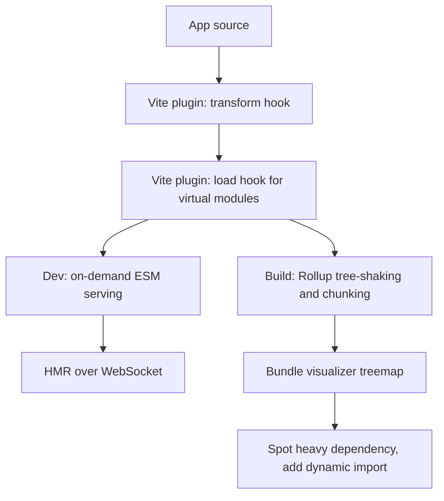

# Vite Plugins, Monorepos, SSR, and Performance Tuning

### English

A Vite plugin is an object with a few well-known hooks that let you extend the tool's behaviour at specific points in its lifecycle: `config` (adjust configuration before it is used), `configResolved` (react to the final resolved config), `transform` (rewrite source code, for example compiling a non-standard file type), `load` (provide the contents of a file Vite did not find on disk), and `buildStart` / `buildEnd`. Because both the dev server and the build pipeline run these hooks, a plugin written once works in both modes. Popular examples include `@vitejs/plugin-react` (Fast Refresh and JSX handling) and `vite-plugin-svgr` (importing SVG files as React components). Many teams also write small in-house plugins to inject build metadata, enforce a lint rule, or virtualise a module.

Beyond single apps, Vite is often used inside a monorepo — one repository containing several packages. The `resolve.alias` and `resolve.dedupe` options let you point imports at a shared source package rather than a stale built copy, and `optimizeDeps` can force a dependency to be pre-bundled. Server-side rendering (SSR) is also supported: Vite can run the same modules in Node to produce HTML first, then hydrate them in the browser. SSR complicates things because code must not touch `window` at import time, and browser-only libraries need to be dynamically imported or stubbed.

Performance tuning usually comes down to three levers. First, dependency pre-bundling: convert heavy CommonJS dependencies into ESM chunks so the browser makes fewer requests. Second, code splitting: use dynamic `import()` for routes or heavy widgets so the initial bundle only contains what the first screen needs. Third, bundle analysis: tools like `rollup-plugin-visualizer` produce a treemap of what is actually inside the output, which is the only reliable way to spot an accidental 300 kB dependency. Build with `sourcemap: true` and inspect the result in the browser's Network panel to see exactly which chunk took longest.

The general principle: Vite's defaults are good for most projects, so optimise by measuring the bundle rather than by guessing.

### 中文

Vite plugin 係一個帶住幾個知名 hook 嘅物件，可以喺生命週期嘅特定位置擴展工具行為：`config`（喺設定被使用前調整佢）、`configResolved`（對最終解析後嘅設定做反應）、`transform`（改寫原始碼，例如編譯非標準檔案類型）、`load`（提供 Vite 喺磁碟搵唔到嘅檔案內容），以及 `buildStart` / `buildEnd`。由於開發伺服器同構建流程都會行呢啲 hook，一個插件寫一次就可以兩邊通用。常見例子有 `@vitejs/plugin-react`（Fast Refresh 同 JSX 處理）同 `vite-plugin-svgr`（將 SVG 檔案當作 React component 匯入）。好多團隊亦會自己寫小型內部插件，注入構建資訊、強制執行 lint 規則，或者提供虛擬模組。

除咗單一應用，Vite 亦經常出現喺 monorepo（一個 repo 包含多個 package）入面。`resolve.alias` 同 `resolve.dedupe` 可以令 import 指向共享原始碼 package，而唔係過時嘅構建副本；`optimizeDeps` 可以強制某個依賴做預先打包。伺服器端渲染（SSR）亦受支援：Vite 可以在 Node 入面執行同一批模組先生成 HTML，再喺瀏覽器度 hydrate。SSR 會複雜化，因為程式碼唔可以喺 import 階段掂 `window`，而只限瀏覽器嘅函式庫需要動態 import 或者用 stub 代替。

效能調校通常靠三個掣：依賴預先打包，將笨重嘅 CommonJS 依賴轉做 ESM chunk，令瀏覽器少啲請求；程式碼分割，用動態 `import()` 載入路由或者大型 widget，令初始 bundle 只包含首屏需要嘅內容；同埋 bundle 分析，`rollup-plugin-visualizer` 會產生一個樹狀圖顯示輸出入面實際有咩，通常係發現意外咗 300 kB 依賴嘅唯一可靠方法。開啟 `sourcemap: true`，再喺瀏覽器 Network 面板睇邊個 chunk 最慢就一目了然。

一般原則：Vite 嘅預設對大部分專案已經好好，所以應該用數據量度 bundle，而唔係靠估。

## Key Takeaway
Vite plugins hook into both dev and build lifecycles, and the biggest performance wins come from pre-bundling dependencies, splitting routes with dynamic import, and measuring the bundle before optimising.

## Related Concepts
- Plugin hooks: config, resolveId, load, transform
- Monorepo aliasing and `optimizeDeps`
- SSR, hydration, and `ssr.noExternal`
- Bundle analysis with rollup-plugin-visualizer

## Diagram

