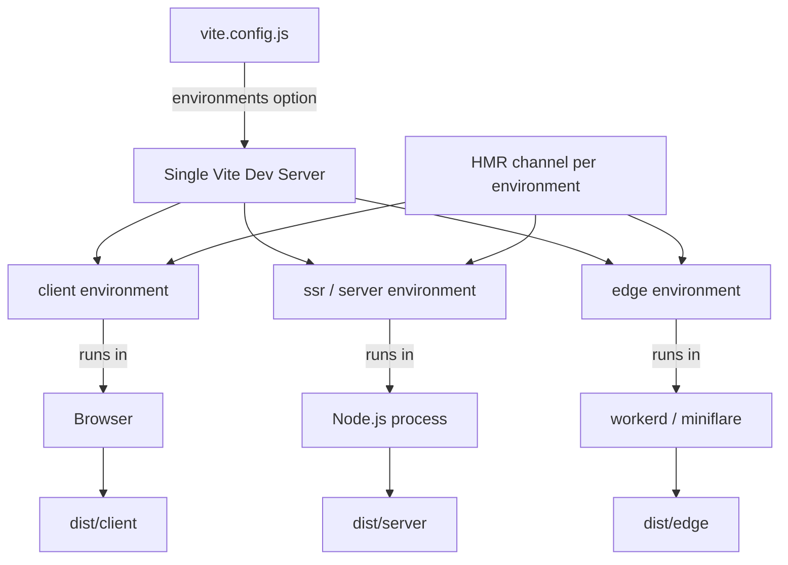

# The Vite Environment API: One Dev Server, Many Runtimes

### English

Vite 5 and earlier had exactly two implicit environments: `client` (the browser) and, optionally, `ssr` (Node.js). That model breaks down as soon as your app runs in more than two places — a browser plus a Node server plus an edge runtime (Cloudflare Workers, Deno Deploy, Vercel Edge) plus maybe a queue consumer. Vite 6 formalised this into the **Environment API**, which became the central abstraction in Vite 6 and 7.

An *environment* is a named target where your code executes. Each environment has its own configuration, its own module graph, its own build output directory, and — during dev — its own way of running the code. The `client` environment runs in the browser; the `ssr` environment runs in the same Node process as the dev server by default; a custom `edge` environment can run in `workerd`. A single Vite dev server can now run all of them concurrently, which is the big practical win: you no longer need separate dev processes and separate ports for each target.

Configuration is expressed through the `environments` option, and top-level options act as inherited defaults:

```js
import { defineConfig } from 'vite'

export default defineConfig({
  build: { sourcemap: false },          // inherited by all environments
  environments: {
    client: { build: { outDir: 'dist/client' } },
    server: { build: { outDir: 'dist/server' } },
    edge: {
      resolve: { noExternal: true },     // bundle everything, including deps
      build: { outDir: 'dist/edge' },
    },
  },
})
```

Each environment exposes `define`, `resolve`, `optimizeDeps`, `consumer`, `dev` and `build` options. Note the `consumer: 'client' | 'server'` field: it tells Vite whether the output will be consumed by a browser or by a server runtime, which changes decisions like whether to inline assets or how to treat `process.env`.

Vite 7 kept these APIs **experimental** rather than stabilising them, because framework authors still needed to give feedback. Vite 7 added a `buildApp` hook so that plugins can coordinate the building of several environments — which matters when a client build and a server build must share a manifest.

Two practical notes. First, `client` and an environment named `ssr` always exist during dev, which keeps `server.ssrLoadModule(url)` and `server.moduleGraph` working. During build, `client` is always present, while `ssr` only appears if you configure `environments.ssr` (or the legacy `build.ssr`). The legacy top-level `ssr` key is on the deprecation path. Second, frameworks are free to name their server environment anything — `server`, `edge`, `rsc` — so don't hard-code `ssr` in your own tooling if you want to work with several frameworks.

The reason this matters for a student is that it reframes "build" from a single output directory into "one output per environment". When a bug only reproduces on the edge runtime, you can reproduce it locally against the exact runtime, instead of guessing. Runtime providers implement this by returning a custom environment from the `vite-environment-provider` package:

```js
import { customEnvironment } from 'vite-environment-provider'

export default {
  environments: {
    ssr: customEnvironment({ build: { outDir: 'dist/ssr' } }),
  },
}
```

That is exactly how the Cloudflare Vite plugin runs your server code inside `workerd` (and locally inside miniflare) during development.

### 中文

Vite 5 同之前嘅版本只有兩個隱含嘅 environment（環境）：`client`（瀏覽器）同可選嘅 `ssr`（Node.js）。但係一旦你嘅應用跑喺超過兩個地方，呢個模型就撐唔住 —— 瀏覽器、Node 伺服器、邊緣運行環境（Cloudflare Workers、Deno Deploy、Vercel Edge），可能仲有 queue consumer。Vite 6 將呢啲概念正式化為 **Environment API**，並且喺 Vite 6 同 7 成為核心抽象層。

所謂 *environment*，就係一段代碼實際執行嘅一個具名目標。每個 environment 有自己嘅設定、自己嘅 module graph、自己嘅 build 輸出目錄，而且喺開發階段有自己嘅代碼運行方式。`client` 喺瀏覽器行；`ssr` 預設喺同 Vite dev server 相同嘅 Node process 入面行；自訂嘅 `edge` environment 可以喺 `workerd` 入面行。Vite 6 開始，**單一** dev server 可以同時運行以上所有 environment —— 呢個係最實際嘅收益：你唔再需要為每個目標開獨立 process、独立 port。

設定方式係 `environments` 選項，而頂層選項會作為繼承嘅預設值：

```js
import { defineConfig } from 'vite'

export default defineConfig({
  build: { sourcemap: false },          // 所有 environment 繼承
  environments: {
    client: { build: { outDir: 'dist/client' } },
    server: { build: { outDir: 'dist/server' } },
    edge: {
      resolve: { noExternal: true },     // 全部打包埋，連依賴都包
      build: { outDir: 'dist/edge' },
    },
  },
})
```

每個 environment 有 `define`、`resolve`、`optimizeDeps`、`consumer`、`dev`、`build` 幾組選項。留意 `consumer: 'client' | 'server'`：佢話俾 Vite 知輸出係俾瀏覽器定係俾伺服器運行環境使用，會影響例如資源要唔要內嵌、`process.env` 點處理等決定。

Vite 7 冇將呢啲 API 穩定（stabilize），反而維持 experimental 狀態，因為框架作者仲需要提供回饋。Vite 7 新增咗 `buildApp` hook，等插件可以協調多個 environment 嘅 build —— 當 client build 同 server build 需要共用一份 manifest 呢個功能好重要。

有兩個實務提醒。第一，開發階段 `client` 同名為 `ssr` 嘅 environment 一定存在，令 `server.ssrLoadModule(url)` 同 `server.moduleGraph` 繼續可用。build 階段就唔同：`client` 一定存在，`ssr` 只有喺你設定咗 `environments.ssr`（或者舊式嘅 `build.ssr`）先會出現，而頂層嘅 `ssr` 舊 key 已經喺淘汰路上。第二，框架可以自己命名伺服器 environment（例如 `server`、`edge`、`rsc`），所以如果你想兼容多個框架，就唔好喺自己嘅工具入面寫死 `ssr`。

呢個概念對學生嚟講最重要嘅意義係：佢將「build」由「產生一個輸出目錄」重新定義為「每個 environment 一份輸出」。當一個 bug 只喺 edge runtime 出現，你可以直接對住真正嘅 runtime 喺本地重現，而唔使靠估。運行環境供應商就係透過 `vite-environment-provider` 呢個 package 回傳自訂 environment 嚟實現：

```js
import { customEnvironment } from 'vite-environment-provider'

export default {
  environments: {
    ssr: customEnvironment({ build: { outDir: 'dist/ssr' } }),
  },
}
```

Cloudflare Vite plugin 就係用呢個方法，喺開發階段將你嘅伺服器代碼放入 `workerd`（本地就係 miniflare）入面運行。

## Key Takeaway
The Environment API turns "build" into "one build per target runtime", letting a single Vite dev server run browser, Node, and edge code side by side against their real runtimes.

## Related Concepts
- Module Graph and Transform Pipeline
- Custom Environment Providers
- SSR and Edge Runtimes
- Plugin buildApp Hook

## Diagram

