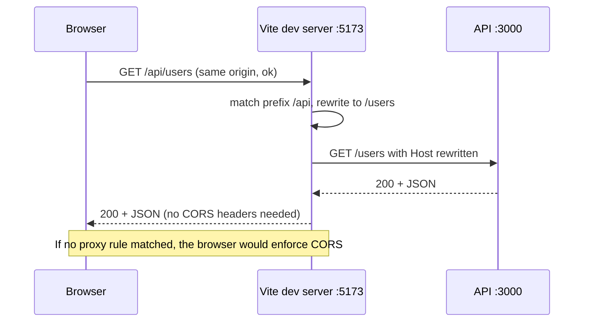

# The Vite Dev Server as a Proxy: Talking to a Real Backend

### English

A Vite app in development has a problem that production does not: you have two servers. The Vite dev server serves your front-end on `http://localhost:5173`, and your API runs somewhere else — `http://localhost:3000` — on a different port. Different port means different **origin**, and the browser's **same-origin policy** blocks the front-end from reading the API response. The symptom is confusing: the request is sent, the server replies 200, and the browser still throws `CORS error: Access-Control-Allow-Origin header is missing`. The API is fine; the browser is refusing to hand the data to the page.

There are two ways to fix it. The first is to teach the API to emit `Access-Control-Allow-Origin` headers (usually via CORS middleware). The second is to make the browser see only one origin, by having the dev server **proxy** API requests to the backend. The proxy approach is generally preferable in development because it removes CORS from the equation entirely and it mirrors production, where a reverse proxy (nginx, an ALB, a CDN) usually routes `/api` to the backend for exactly the same reason.

Vite exposes this through `server.proxy`. The configuration is a map of path prefixes to targets:

```js
import { defineConfig } from 'vite'

export default defineConfig({
  server: {
    proxy: {
      // string shorthand: /foo -> http://localhost:4567/foo
      '/foo': 'http://localhost:4567',

      // full options
      '/api': {
        target: 'http://localhost:3000',
        changeOrigin: true,
        rewrite: (path) => path.replace(/^\/api/, ''),
      },

      // regex key
      '^/fallback/.*': {
        target: 'http://localhost:4567',
        changeOrigin: true,
        rewrite: (path) => path.replace(/^\/fallback/, ''),
      },
    },
  },
})
```

Three details deserve attention. **Keys are path prefixes** matched against the request path, and a key beginning with `^` is treated as a regular expression. **`rewrite`** transforms the path before it is forwarded; it is almost always needed, because the dev server received `/api/users` and the backend expects `/users`. **`changeOrigin: true`** rewrites the `Host` header of the forwarded request to the target's hostname, which many backends need because they use the Host header to build absolute URLs or to pick a virtual host.

Vite 6 and later build this on `http-proxy-3`. Two related options are worth knowing. `secure: false` disables TLS certificate verification for the target, which you need when the backend uses a self-signed certificate in development. `ws: true` enables WebSocket proxying, required for anything using socket.io or a live-reload channel:

```js
'/socket.io': {
  target: 'ws://localhost:3001',
  ws: true,
}
```

There is a subtlety worth flagging: **Vite does not check the `Origin` header before proxying WebSocket requests**, and the `rewriteWsOrigin` option rewrites the origin to the target's, which bypasses the target's own origin check. Treat this as a development-only convenience and never enable it in a production-facing configuration.

One rule catches people out: if a request matches any proxy rule, **Vite does not transform it**. That is what you want for API calls, but it also means you cannot rely on Vite's HTML fallback or asset handling for those paths. And if you use a non-relative `base`, you must prefix every proxy key with that `base`, otherwise the proxy never matches.

For anything more involved than path rewriting — custom headers, request logging, or transforming the response — use the `configure` hook to get at the underlying proxy instance and attach event listeners:

```js
'/api': {
  target: 'http://localhost:3000',
  changeOrigin: true,
  configure: (proxy) => {
    proxy.on('proxyReq', (proxyReq, req) => {
      console.log('→', req.method, req.url)
    })
  },
}
```

The larger lesson is that the dev server is not just a bundler with a watcher attached. It is a complete HTTP server with a middleware stack, and proxying is one of the most useful things it does for you.

### 中文

開發環境下嘅 Vite 應用有一個生產環境唔存在嘅問題：你有兩個伺服器。Vite dev server 喺 `http://localhost:5173` 服務前端，而 API 跑喺另一個地方 —— `http://localhost:3000` —— port 唔同就代表 **origin** 唔同，而瀏覽器嘅 **same-origin policy**（同源政策）會擋住前端讀取 API 回應。症狀幾令人困惑：請求送咗出去，伺服器回 200，但瀏覽器照樣拋出 `CORS error: Access-Control-Allow-Origin header is missing`。API 本身冇問題，係瀏覽器唔肯將資料交畀頁面。

有兩個修法。第一，係教 API 送出 `Access-Control-Allow-Origin` 標頭（通常用 CORS 中介層）。第二，係令瀏覽器只見到一個 origin —— 由 dev server **代理** API 請求去後端。開發階段通常後者更合適，因為佢完全移走 CORS 呢個變數，而且貼近生產環境：生產環境通常都有反向代理（nginx、ALB、CDN）將 `/api` 路由去後端，原因一模一樣。

Vite 透過 `server.proxy` 提供呢個功能，設定係一張「路徑前綴 → 目標」嘅映射表：

```js
import { defineConfig } from 'vite'

export default defineConfig({
  server: {
    proxy: {
      // 字串簡寫：/foo -> http://localhost:4567/foo
      '/foo': 'http://localhost:4567',

      // 完整選項
      '/api': {
        target: 'http://localhost:3000',
        changeOrigin: true,
        rewrite: (path) => path.replace(/^\/api/, ''),
      },

      // 正則表達式 key
      '^/fallback/.*': {
        target: 'http://localhost:4567',
        changeOrigin: true,
        rewrite: (path) => path.replace(/^\/fallback/, ''),
      },
    },
  },
})
```

有三個細節要留意。**Key 係路徑前綴**，用嚟比對請求路徑；如果以 `^` 開頭就當成正則表達式。**`rewrite`** 會喺轉發之前改寫路徑 —— 幾乎一定需要，因為 dev server 收到嘅係 `/api/users`，但後端期望嘅係 `/users`。**`changeOrigin: true`** 會將轉發請求嘅 `Host` 標頭改成目標主機名，好多後端需要呢個，因為佢哋會用 Host 標頭組裝絕對 URL 或者揀 virtual host。

Vite 6 之後底層用 `http-proxy-3`。有兩個相關選項值得知。`secure: false` 會關閉對目標 TLS 憑證嘅驗證，開發時後端用自簽憑證就一定要加。`ws: true` 開啟 WebSocket 代理，任何用 socket.io 或者即時更新頻道嘅場景都需要：

```js
'/socket.io': {
  target: 'ws://localhost:3001',
  ws: true,
}
```

有一個細節要特別提：Vite **唔會**喺代理 WebSocket 請求之前檢查 `Origin` 標頭，而 `rewriteWsOrigin` 會將 origin 改寫成目標嘅，等於繞過咗目標自己嘅 origin 檢查。當作開發期便利功能看待，千祈唔好喺面向生產嘅設定入面開啟。

仲有一條規則好多人會中招：只要請求符合任何一條代理規則，**Vite 就唔會再轉換佢**。對 API 呼叫嚟講正合適，但亦代表你唔可以再依賴 Vite 嘅 HTML fallback 或者資源處理。另外如果你用咗非相對路徑嘅 `base`，就一定要為每條代理 key 加上該 `base`，否則永遠匹配唔到。

如果要做嘅比改路徑更複雜 —— 自訂標頭、記錄請求、改寫回應 —— 可以用 `configure` hook 攞到底層 proxy 實例並掛上事件監聽器：

```js
'/api': {
  target: 'http://localhost:3000',
  changeOrigin: true,
  configure: (proxy) => {
    proxy.on('proxyReq', (proxyReq, req) => {
      console.log('→', req.method, req.url)
    })
  },
}
```

更深一層嘅領悟係：dev server 唔只係「個打包器加個檔案監察」。佢係一個完整嘅 HTTP 伺服器，有自己嘅中介層堆疊，而代理就係佢最有用嘅能力之一。

## Key Takeaway
`server.proxy` collapses the front-end and API into a single origin in development, which removes CORS entirely and mirrors how a production reverse proxy routes traffic.

## Related Concepts
- Same-Origin Policy and CORS
- Reverse Proxying
- Path Rewriting and changeOrigin
- WebSocket Proxying

## Diagram

