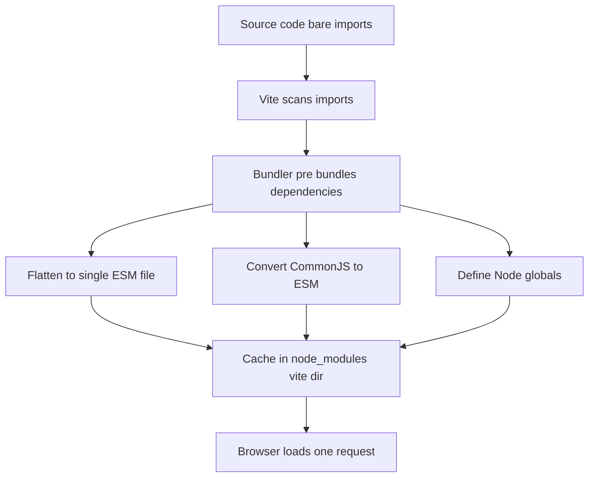

# Dependency Pre-Bundling: How Vite Collapses Hundreds of Module Requests into One

## English

When you import a package like lodash-es, the browser would normally have to fetch hundreds of tiny module files, one request per import statement. That is death by a thousand round-trips: even on a fast local connection, each HTTP request carries latency overhead, and browsers cap the number of parallel connections per host. Vite solves this with dependency pre-bundling. On first server start, it crawls your source for bare imports (imports that name a package rather than a relative path, e.g. `import { debounce } from 'lodash-es'`), then bundles each dependency into a single ES module file. Those files are written to the cache directory — `node_modules/.vite` by default, configurable via the `cacheDir` option — so the work happens once and is reused until your lockfile or config changes.

The tool doing the bundling has changed over Vite's lifetime, and that is worth tracking because the docs for different major versions describe different things. Up to Vite 7, pre-bundling was performed by esbuild, the Go-based bundler Vite originally adopted for speed. Vite 8, released in March 2026, replaced that dual-bundler setup entirely: it ships with Rolldown, a Rust-based bundler from the VoidZero team, as its single unified bundler, with Oxc handling the compiler side. The official dependency pre-bundling documentation now states plainly that "the pre-bundling is performed with Rolldown, so it's typically very fast." Production builds moved the same way — Rollup's job was absorbed into Rolldown. A compatibility layer in Vite 8 auto-converts existing `esbuild` and `rollupOptions` configuration to their Rolldown and Oxc equivalents, so most projects upgrade without config changes.

Pre-bundling also fixes a subtler problem: compatibility. Many npm packages ship as CommonJS (the older `require()` module format), which browsers cannot execute natively. The pre-bundling step converts those CommonJS modules into ESM so the dev server can serve them directly. It also handles packages that rely on `process.env.NODE_ENV` or other Node globals by defining them at bundle time. Without this step, importing a CommonJS library in dev would simply fail in the browser.

There is a second reason: request count. Imagine a library split into 600 internal files. Without pre-bundling the browser issues 600 requests; with it, one. This matters most for large UI frameworks and utility libraries where deep internal imports are common. The optimization is purely a development-time concern — the official docs note that "dependency pre-bundling only applies in development mode" — so production builds are unaffected by it and are tree-shaken and chunked by the production bundler regardless.

You will occasionally need to intervene. If you add a new dependency while the dev server is running, Vite detects the new bare import and re-runs pre-bundling automatically, sometimes triggering a full page reload. If a linked monorepo package changes often, you can exclude it from pre-bundling via the `optimizeDeps.exclude` option so edits are picked up live; conversely `optimizeDeps.include` forces a dependency to be pre-bundled even when Vite cannot detect it statically (for example, imports constructed dynamically at runtime). Monorepo packages that are not resolved from `node_modules` are automatically treated as source code and are not pre-bundled at all — but that requires the linked package to be exported as ESM, otherwise you add it to `optimizeDeps.include`.

A useful mental model: pre-bundling is a cache warm-up that trades a few seconds once for thousands of saved requests afterward. It is the reason Vite's dev server feels instant even in projects with heavy dependency trees, and it is a different mechanism from the on-demand ESM loading of your own source files, which Vite serves unbundled and transforms per-request.

## 中文

當你 import 像 lodash-es 這類套件時，瀏覽器原本要逐一抓取數百個細小的模組檔案，每個 import 語句就是一個請求。這正是「一千次往返」的致命傷：即使在本機快速連線下，每個 HTTP 請求都帶有延遲開銷，而瀏覽器對同一主機的並行連線數亦有上限。Vite 用「依賴預打包」（dependency pre-bundling）解決此問題。伺服器首次啟動時，它會爬取原始碼中的裸匯入（bare import，即指名套件而非相對路徑的 import，例如 `import { debounce } from 'lodash-es'`），然後把每個依賴打包成單一 ES 模組檔案。這些檔案會寫入快取目錄（預設為 `node_modules/.vite`，可用 `cacheDir` 選項設定），所以工作只做一次，直到你的 lockfile 或設定改變才重做。

負責打包的工具在 Vite 的演進過程中換過一次，這點值得留意，因為不同主版本的官方文件描述的是不同的做法。直到 Vite 7 為止，預打包由 esbuild 負責，也就是 Vite 最初為了速度而採用的那個以 Go 語言編寫的打包器。2026 年 3 月發佈的 Vite 8 則徹底取代了原本「雙打包器」架構：它直接內建 Rolldown——VoidZero 團隊以 Rust 語言編寫的打包器——作為單一統一的打包器，並由 Oxc 負責編譯那一端。官方「依賴預打包」文件現時明確寫道：「預打包由 Rolldown 執行，所以通常非常快。」生產建置也走同一條路——Rollup 的工作被併入 Rolldown。Vite 8 內設相容層，會自動把既有的 `esbuild` 與 `rollupOptions` 設定轉換成對應的 Rolldown 與 Oxc 寫法，所以多數專案升級時毋須改設定。

預打包還解決一個更隱蔽的問題：相容性。許多 npm 套件以 CommonJS（較舊的 `require()` 模組格式）形式發佈，瀏覽器無法原生執行。預打包這一步會把這些 CommonJS 模組轉成 ESM，讓開發伺服器可直接供應。它亦會處理依賴 `process.env.NODE_ENV` 或其他 Node 全域變數的套件，在打包時將之定義好。沒有這一步，在開發環境 import 一個 CommonJS 函式庫會在瀏覽器中直接失敗。

第二個理由是請求數量。試想一個函式庫內部拆成 600 個檔案：沒有預打包，瀏覽器要發 600 個請求；有了它，只需一個。這對大型 UI 框架與工具函式庫（深層內部 import 很常見）影響最大。此優化純粹是開發階段的事——官方文件註明「依賴預打包只適用於開發模式」——所以生產建置完全不受其影響，仍然由生產打包器負責 tree-shaking 與分塊。

你偶爾需要介入。若在開發伺服器運行時新增依賴，Vite 會偵測到新的裸匯入並自動重跑預打包，有時會觸發整頁重新載入。若某個連結的 monorepo 套件經常改動，你可以用 `optimizeDeps.exclude` 選項將它排除在預打包之外，讓編輯即時生效；相反地，`optimizeDeps.include` 可強制某依賴預打包，即使 Vite 無法靜態偵測到它（例如在執行時動態建構的 import）。至於 monorepo 內並非從 `node_modules` 解析的套件，Vite 會自動當作原始碼處理，完全不做預打包——但這要求該連結套件以 ESM 匯出，否則就要把它加入 `optimizeDeps.include`。

一個好用的心智模型：預打包是一次「快取預熱」，用一次性的幾秒換取之後省下的數千個請求。這正是 Vite 開發伺服器即使面對龐大依賴樹仍感覺即時的原因；它與你自己原始碼的按需 ESM 載入是不同機制——後者由 Vite 不打包地供應，並逐個請求轉換。

## Key Takeaway

Vite pre-bundles dependencies once into cached ESM files, fixing CommonJS compatibility and collapsing hundreds of module requests into one — using esbuild up to Vite 7 and Rolldown from Vite 8 onward.

## Related Concepts
- Rolldown and Oxc
- CommonJS vs ES Modules

## Diagram

