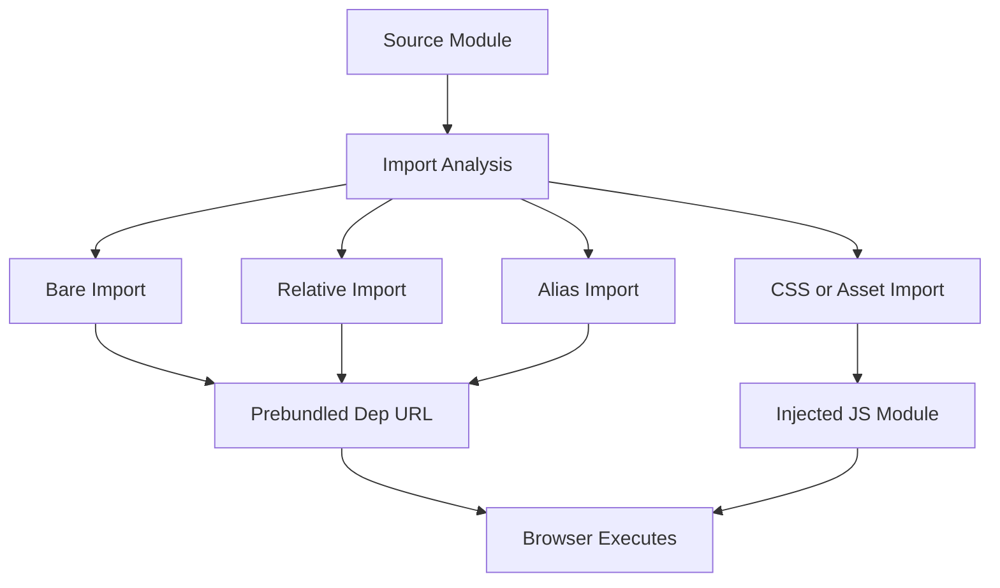

# Import Analysis and URL Rewriting: The Hidden Transform Behind Every Import

## English

Vite's dev server does not just hand files to the browser unchanged. Every JavaScript module that passes through it goes through an import analysis step, a source-to-source transform that parses your code, finds every import and export statement, and rewrites the specifiers so the browser can resolve them. This is the quiet machinery that makes bare imports, aliases, and even CSS imports work in dev without a bundler.

Consider what the browser actually understands. A native ES module import must be a valid URL or a relative path beginning with `./` or `../`. So `import { createApp } from 'vue'` is illegal in the browser: it has no idea where 'vue' lives. Vite rewrites it to something like `/node_modules/.vite/deps/vue.js?v=abc123`, pointing at the pre-bundled file. Relative imports get rewritten to absolute URLs rooted at the dev server, and configured aliases (say `@/components/Button`) are resolved to real file paths. The `?v=` query string is a cache-busting hash tied to the file's content, so when a file changes, the URL changes and the browser fetches fresh instead of using a stale cached copy.

Import analysis also enables features that have no business working in a plain browser. Importing a CSS file from JavaScript, for example `import './style.css'`, is intercepted: Vite serves that module as JavaScript that injects a style tag into the page. Importing an image returns its URL string. These behaviors are conventions Vite defines at the import-analysis layer, not browser capabilities.

It is also where Hot Module Replacement hooks in. During analysis, Vite injects a small runtime into each module that registers it with the HMR system and, for modules that accept hot updates, wires up the accept handlers. When you edit a file, the server knows exactly which modules imported it, so it can propagate the update only to the affected boundary. This is why HMR can update a single component without reloading the page, and it depends entirely on the import graph that analysis built.

Finally, import analysis is where Vite rewrites `import.meta.env` references, exposing environment variables prefixed with `VITE_` to client code while stripping everything else so secrets in your `.env` file never leak into the browser. The transform is fast because it is regex-assisted and only does full parsing where needed, keeping per-request overhead low. In short: the dev server's speed is not just about skipping bundling, it is about cheap, targeted source transforms that make unbundled code browser-ready on the fly.

## 中文

Vite 的開發伺服器並非把檔案原封不動交給瀏覽器。每個經過它的 JavaScript 模組都會經歷一個「匯入分析」（import analysis）步驟：一種原始碼到原始碼的轉換，會解析你的程式碼、找出每個 import 與 export 語句，並改寫其中的指定符（specifier），讓瀏覽器能解析它們。這正是讓裸匯入、別名，甚至 CSS 匯入在開發環境無需打包器也能運作的隱形機制。

想想瀏覽器真正理解什麼。原生 ES 模組的 import 必須是有效 URL 或以 `./`、`../` 開頭的相對路徑。所以 `import { createApp } from 'vue'` 在瀏覽器中是不合法的：它根本不知道 'vue' 在哪裡。Vite 會將它改寫成類似 `/node_modules/.vite/deps/vue.js?v=abc123`，指向預打包後的檔案。相對匯入會被改寫成以開發伺服器為根的絕對 URL，而設定好的別名（例如 `@/components/Button`）會被解析成真實檔案路徑。`?v=` 查詢字串是與檔案內容綁定的快取破壞雜湊，所以檔案一改，URL 就變，瀏覽器便抓取新版本而非使用過期的快取。

匯入分析還讓一些本不該在純瀏覽器中運作的功能得以實現。例如從 JavaScript 匯入 CSS 檔 `import './style.css'` 會被攔截：Vite 把該模組當作 JavaScript 供應，內容是向頁面注入一個 style 標籤。匯入圖片則回傳其 URL 字串。這些行為是 Vite 在匯入分析層定義的慣例，而非瀏覽器本身的能力。

熱模組替換（HMR）也在此掛鉤。分析期間，Vite 會向每個模組注入一小段執行時，將它註冊到 HMR 系統，並為接受熱更新的模組接上 accept 處理器。當你編輯檔案，伺服器清楚知道哪些模組匯入了它，因此能把更新只傳播到受影響的邊界。這就是 HMR 能更新單一元件而不重載整頁的原因，而它完全依賴分析所建立的匯入圖。

最後，匯入分析也是 Vite 改寫 `import.meta.env` 引用的地方：把以 `VITE_` 為前綴的環境變數暴露給客戶端程式碼，同時剝除其他一切，確保 `.env` 檔中的機密永不洩漏到瀏覽器。這個轉換很快，因為它借助正則輔助，只在必要處做完整解析，讓逐請求開銷維持在低水平。總而言之：開發伺服器的速度不只在於跳過打包，更在於便宜、有針對性的原始碼轉換，讓未打包的程式碼即時變成瀏覽器可用。

## Key Takeaway

Import analysis rewrites bare specifiers, aliases, and asset imports into browser-resolvable URLs, and builds the import graph that powers HMR and env variable injection.

## Related Concepts
- import.meta.env
- Hot Module Replacement (HMR)

## Diagram

