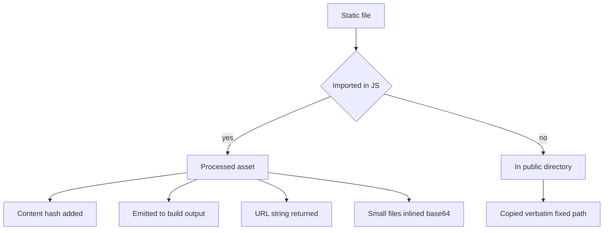

# Static Asset Handling and the public Directory: How Vite Serves Files

## English

Vite draws a sharp line between two kinds of static files, and understanding that line prevents a whole class of confusing bugs. Files you import from JavaScript are processed assets: Vite hashes their contents, emits them into the build output, and gives you back a URL string. Files you drop into the `public` directory are copied verbatim to the root of the build output and referenced by a fixed, unhashed path. The distinction is about whether the file participates in the module graph.

When you write `import logo from './assets/logo.png'`, Vite treats logo.png as a module. In production it copies the file into the output directory with a content hash in the filename (something like `logo.a1b2c3d4.png`) and replaces the import with that URL. The hash is the whole point: it lets you set long cache lifetimes on assets, because a changed file gets a new name and therefore a new cache key. Importing also means the asset is tracked: if you delete the import, the file is no longer emitted, keeping the output lean. Small files below a size threshold (default 4 kilobytes) are inlined as base64 data URLs instead of separate requests, which can reduce round-trips for tiny icons.

Files in `public` behave differently. They are copied as-is, keep their exact names, and are referenced by absolute paths like `/favicon.ico` or `/robots.txt`. There is no hashing and no import. This is the right place for files whose names must be stable and known in advance: robots.txt, favicon, manifest files, or images referenced from raw HTML or external systems. The trade-off is that you manage cache invalidation yourself, and the file is always shipped even if nothing references it.

A common mistake is importing a file from `public` in JavaScript. That bypasses the asset pipeline and produces a path that may not survive the build correctly, because public files are not part of the module graph. The rule of thumb: if the file is referenced from code, import it from a source directory; if it must have a fixed public URL, put it in `public` and reference it by absolute path. Vite also exposes the base URL through a special variable so that deployments under a subpath (like `/app/`) resolve correctly rather than breaking with hardcoded leading slashes.

This design reflects a broader principle in Vite: only things that flow through the module graph can be tracked, hashed, tree-shaken, or hot-reloaded. Assets are no exception. Once you internalize that assets imported in code are modules and files in `public` are just copied, the caching behavior, the URLs you see in the built HTML, and the occasional "file not found after deploy" error all become predictable.

## 中文

Vite 對兩種靜態檔案劃下清晰界線，理解這條界線能避免一整類令人困惑的錯誤。從 JavaScript 匯入的檔案是「已處理資產」：Vite 會對其內容做雜湊、輸出到建置結果，並回傳一個 URL 字串給你。放進 `public` 目錄的檔案則原樣複製到建置輸出的根目錄，並以固定、未雜湊的路徑引用。差別在於該檔案是否參與模組圖（module graph）。

當你寫 `import logo from './assets/logo.png'`，Vite 把 logo.png 當成一個模組。生產建置時它會把檔案複製到輸出目錄，檔名帶內容雜湊（類似 `logo.a1b2c3d4.png`），並把 import 換成該 URL。雜湊正是重點：它讓你對資產設定長快取壽命，因為檔案一改就得到新檔名，也就有新的快取鍵。匯入也代表資產被追蹤：若你刪掉該 import，檔案就不再被輸出，讓結果保持精簡。低於大小門檻（預設 4 KB）的小檔案會被內聯成 base64 data URL 而非獨立請求，可減少細小圖示的往返次數。

`public` 中的檔案行為不同。它們原樣複製、保留確切檔名，並以絕對路徑如 `/favicon.ico` 或 `/robots.txt` 引用。沒有雜湊，也沒有 import。這裡適合那些名稱必須穩定且事先已知的檔案：robots.txt、favicon、manifest 檔，或從原始 HTML 或外部系統引用的圖片。代價是你得自行管理快取失效，而且即使無人引用，檔案也總會被出貨。

常見錯誤是在 JavaScript 中匯入 `public` 裡的檔案。那會繞過資產管線，產生的路徑在建置後可能不正確，因為 public 檔案不屬於模組圖。經驗法則：若檔案從程式碼引用，就從原始碼目錄 import；若它必須有固定的公開 URL，就放進 `public` 並以絕對路徑引用。Vite 亦透過一個特殊變數暴露 base URL，讓部署在子路徑（如 `/app/`）時能正確解析，而不會因寫死的開頭斜線而壞掉。

這個設計反映 Vite 的更大原則：只有流經模組圖的東西才能被追蹤、雜湊、tree-shake 或熱重載。資產也不例外。一旦你內化「程式碼中匯入的資產是模組，`public` 中的檔案只是被複製」，快取行為、建置後 HTML 中看到的 URL，以及偶爾出現的「部署後找不到檔案」錯誤，全都變得可預測。

## Key Takeaway

Imported assets are hashed, tracked modules, while files in public are copied verbatim with stable URLs; choosing the right one determines caching and correctness after deploy.

## Related Concepts
- Content hashing
- Module graph

## Diagram

