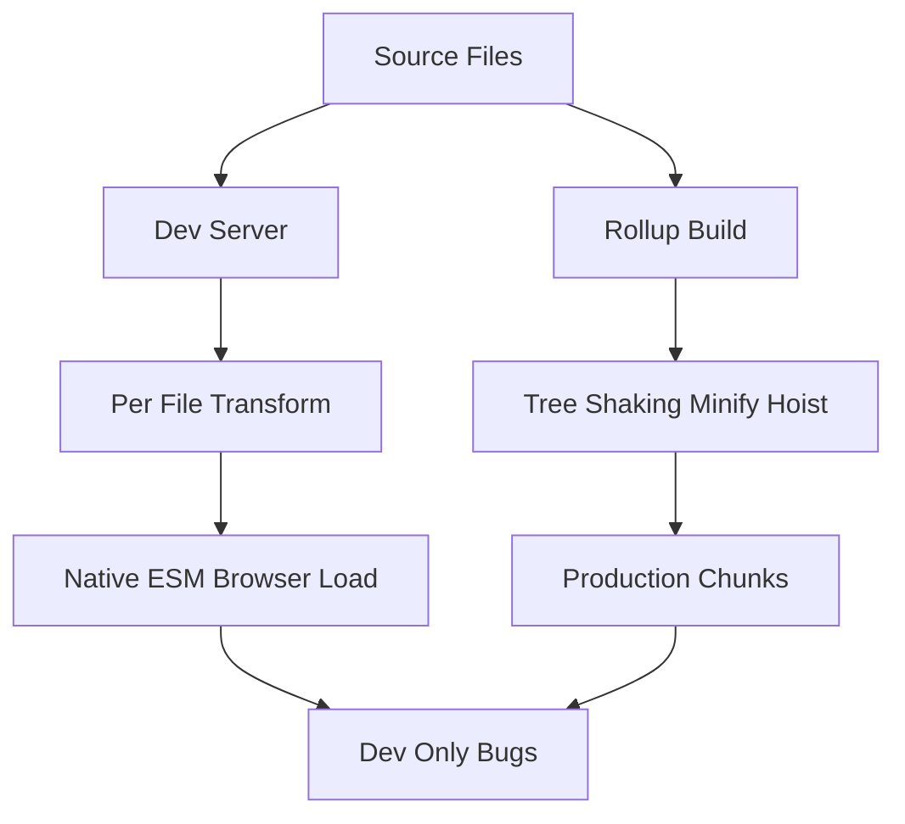

# Why Vite's Dev and Prod Outputs Can Differ (and How to Catch It)

## English

One of the most surprising things about Vite is that the code running in your browser during development is not the same code that ships to production. In dev, Vite serves each source file almost as-is, transforming only what it must (TypeScript stripping, JSX, import rewriting) and letting the browser load modules over native ESM. In production, Rollup takes those modules, performs tree-shaking (removing exports nobody imports), constant-folding, minification, and scope hoisting, then emits a handful of chunk files. These two pipelines are fundamentally different programs, so a class of bugs exists that only appears in one mode.

A classic example is code that depends on module evaluation order or on side effects being preserved. Tree-shaking can drop an import whose only purpose was to register a side effect if the bundler cannot prove the side effect exists — for instance, a module that patches a global or registers a custom element. In dev, that import runs because the browser loads it; in production, Rollup may decide it is unused and remove it. Similarly, `import.meta.env` values are statically replaced at build time, so a branch guarded by `import.meta.env.DEV` is dead-code-eliminated in production — great for size, but it means any code path that only runs in dev is invisible in your production bundle.

Minification introduces another divergence. Property mangling, name shortening, and aggressive inlining can expose reliance on function names (for example `Function.prototype.name` used for reflection or dependency injection) or on `this` binding in ways that dev never surfaces. Dynamic `import()` expressions are also handled differently: in dev they map to a URL the server can resolve on demand, while in production they become chunk-split points, so timing and network behaviour change.

The practical defence is to run the production build locally before shipping. `vite build` followed by `vite preview` serves the real bundled output from a static server, letting you click through the app the way a user would. Treat `vite preview` as a required smoke test rather than an optional convenience. If a bug reproduces only under preview, suspect tree-shaking side effects, environment-variable replacement, or minifier assumptions before suspecting your logic.

Understanding this duality also explains why some libraries ship separate dev and prod entry points, and why `sideEffects` in a package's `package.json` matters: it tells Rollup which files are safe to drop. When you author a library, marking side-effect-free files correctly is what lets downstream apps tree-shake you safely, keeping the dev and prod behaviour aligned.

## 中文

Vite 其中一個最令人意外的地方，是開發時在瀏覽器跑的程式碼，跟實際上線的程式碼並不是同一份。開發模式下，Vite 幾乎原封不動地提供每個原始檔，只做非做不可的轉換（移除 TypeScript 型別、處理 JSX、改寫 import），然後讓瀏覽器透過原生 ESM 載入模組。生產模式下，Rollup 會接手這些模組，做 tree-shaking（移除沒有人 import 的匯出）、常數折疊、壓縮與作用域提升（scope hoisting），最後輸出少量 chunk 檔案。這兩條管線本質上是兩個不同的程式，因此存在一類只在其中一種模式才會出現的 bug。

經典例子是依賴模組求值順序、或依賴副作用被保留的程式碼。如果打包工具無法證明某個副作用存在，tree-shaking 就可能把「唯一目的只是註冊副作用」的 import 砍掉——例如某個模組會修補全域物件、或註冊 custom element。開發時，瀏覽器會載入它所以會執行；生產時，Rollup 可能判定它沒被使用而移除。同樣地，`import.meta.env` 的值會在建置時被靜態替換，所以由 `import.meta.env.DEV` 守衛的分支在生產環境會被 dead-code elimination 整段刪掉——對體積是好事，但也代表只在開發時才會跑的路徑，在生產 bundle 裡完全消失。

壓縮又帶來另一種分歧。屬性改名、識別字縮短、積極的內聯，可能暴露出你對函式名稱的依賴（例如用 `Function.prototype.name` 做反射或依賴注入），或對 `this` 繫結的假設，而這些在開發時從未浮現。動態 `import()` 表示式的處理也不同：開發時它對應到伺服器可按需解析的 URL，生產時則變成 chunk 分割點，載入時機與網路行為都改變。

實務上的防線，是在出貨前先在本機跑一次生產建置。`vite build` 之後用 `vite preview`，會用靜態伺服器提供真正的打包輸出，讓你像使用者一樣點過整個應用。請把 `vite preview` 當成必做的煙霧測試，而不是可有可無的方便工具。如果 bug 只在 preview 下重現，先懷疑 tree-shaking 的副作用、環境變數替換、或壓縮工具的假設，而不是先懷疑你的邏輯。

理解這種雙重性，也解釋了為何有些函式庫會分開提供 dev 與 prod 入口，以及為何套件 `package.json` 裡的 `sideEffects` 欄位很重要：它告訴 Rollup 哪些檔案可以安全丟棄。當你自己寫函式庫時，正確標記無副作用的檔案，正是讓下游應用能安全 tree-shake 你、並讓 dev 與 prod 行為保持一致的關鍵。

## Key Takeaway

Dev and production run through two different pipelines, so always smoke-test with `vite build` plus `vite preview` to catch tree-shaking, env-replacement, and minifier-only bugs.

## Related Concepts
- Tree-shaking and sideEffects
- import.meta.env

## Diagram

