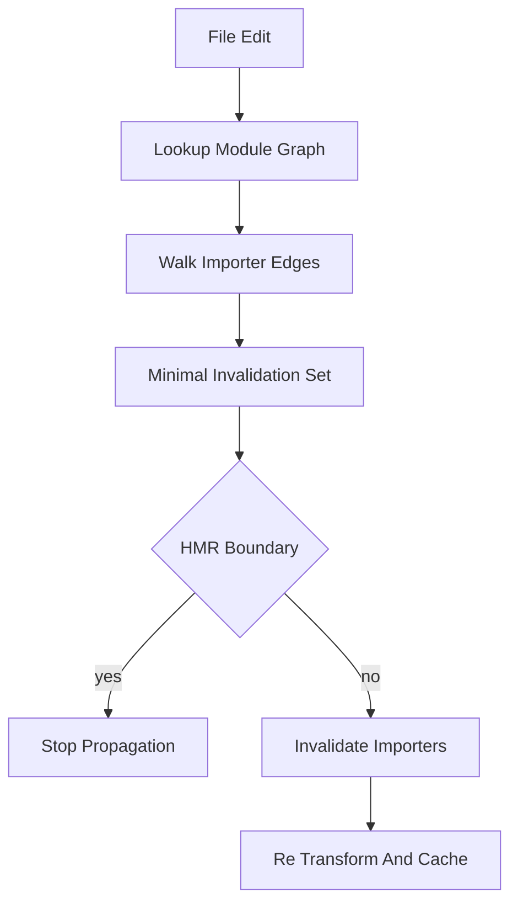

# The Dependency Graph: How Vite Decides What to Invalidate

## English

Behind every file edit, Vite maintains a module graph — a data structure mapping each module to its imports and, crucially, to its importers. When you save a file, the dev server does not rebuild the world. It looks up the changed module in the graph, walks the importer edges, and decides the minimal set of modules whose cached transforms must be thrown away. This is what makes hot updates feel instant: the work scales with the size of the affected subgraph, not with the size of your project.

The graph has two layers worth distinguishing. There is the module graph of your source files, and there is the dependency graph of pre-bundled packages (the optimized chunks Vite produces for things in `node_modules`). Source files are re-transformed on demand and cached in memory; pre-bundled dependencies are cached more aggressively and only invalidated when the lockfile changes or you explicitly trigger a re-optimization. This split is why editing your own component is fast while adding a new dependency may briefly pause the server to rebuild the optimized bundle.

Invalidation propagates along import edges, but not blindly. If module A imports B and you edit B, A must be invalidated because its imported binding may have changed. However, Vite tracks whether the change actually affects the exported surface; an edit that only touches an internal helper still forces re-execution of the importers in many cases, because JavaScript modules cannot be partially patched — the module is re-evaluated as a unit. This is the subtle reason HMR boundaries matter: a module that accepts its own updates (via `import.meta.hot.accept`) stops the propagation at itself, sparing its importers.

You can inspect this machinery. Running the dev server with debug logging enabled (the `DEBUG` environment variable, for example `DEBUG="vite:*"`) prints graph-related activity, and the browser's network panel shows which module URLs get re-requested with cache-busting query strings after an edit. Watching those requests is the most concrete way to understand invalidation: you will literally see the changed module and its dependents reload while untouched branches stay quiet.

Understanding the graph also guides architecture. Deep import chains mean a change near the bottom invalidates a long path upward; shallow, well-factored modules with clear HMR boundaries keep edits local. If a small edit triggers a large cascade, that is a signal your module graph is too tangled, not that Vite is slow.

## 中文

每次你改動檔案，Vite 背後都維護著一張模組圖（module graph）——一個把每個模組對應到它的 import、以及更關鍵地對應到「誰 import 它」（importer）的資料結構。當你存檔，開發伺服器不會把整個世界重建一遍。它會在圖中查出被改動的模組，沿著 importer 的邊走，決定哪一組最小的模組需要丟棄快取的轉換結果。這正是熱更新感覺即時的原因：工作量隨受影響子圖的大小而增長，而不是隨整個專案的大小。

這張圖有兩層值得區分。一層是你原始碼的模組圖，另一層是預先打包依賴（Vite 為 `node_modules` 裡的東西產生的最佳化 chunk）的依賴圖。原始檔按需重新轉換並快取在記憶體中；預先打包的依賴快取得更積極，只有在 lockfile 變動、或你明確觸發重新最佳化時才會失效。這種分工解釋了為何改自己的元件很快，而新增一個依賴可能會讓伺服器短暫停頓去重建最佳化 bundle。

失效會沿著 import 的邊傳播，但不是盲目地傳。若模組 A import 了 B，而你改了 B，A 必須失效，因為它 import 的綁定可能變了。不過，Vite 會追蹤這次改動是否真的影響到匯出的表面；只動到內部 helper 的修改，在許多情況下仍會迫使 importer 重新執行，因為 JavaScript 模組無法被部分修補——模組是以整體為單位重新求值的。這正是 HMR 邊界之所以微妙的理由：一個接受自身更新（透過 `import.meta.hot.accept`）的模組，會把傳播止於自己，讓它的 importer 免於重跑。

你可以實際觀察這套機制。開啟除錯日誌跑開發伺服器（用 `DEBUG` 環境變數，例如 `DEBUG="vite:*"`）會印出與圖相關的活動；瀏覽器的 network 面板則會顯示，改動後哪些模組 URL 帶著破壞快取的查詢字串被重新請求。看這些請求，是理解失效機制最具體的方式：你會親眼看到被改的模組及其依賴者重新載入，而沒被碰到的分支保持安靜。

理解這張圖也能指導架構。很深的 import 鏈意味著底層一改，就會沿著長路徑向上失效；淺而分層良好、HMR 邊界清楚的模組，能把改動留在局部。如果一個小修改引發大規模連鎖，那是你的模組圖太糾纏的訊號，而不是 Vite 太慢。

## Key Takeaway

Vite's module graph tracks importers so it can invalidate the smallest affected subgraph; keeping modules shallow and HMR boundaries explicit keeps edits fast.

## Related Concepts
- HMR boundaries
- Dependency pre-bundling cache

## Diagram

