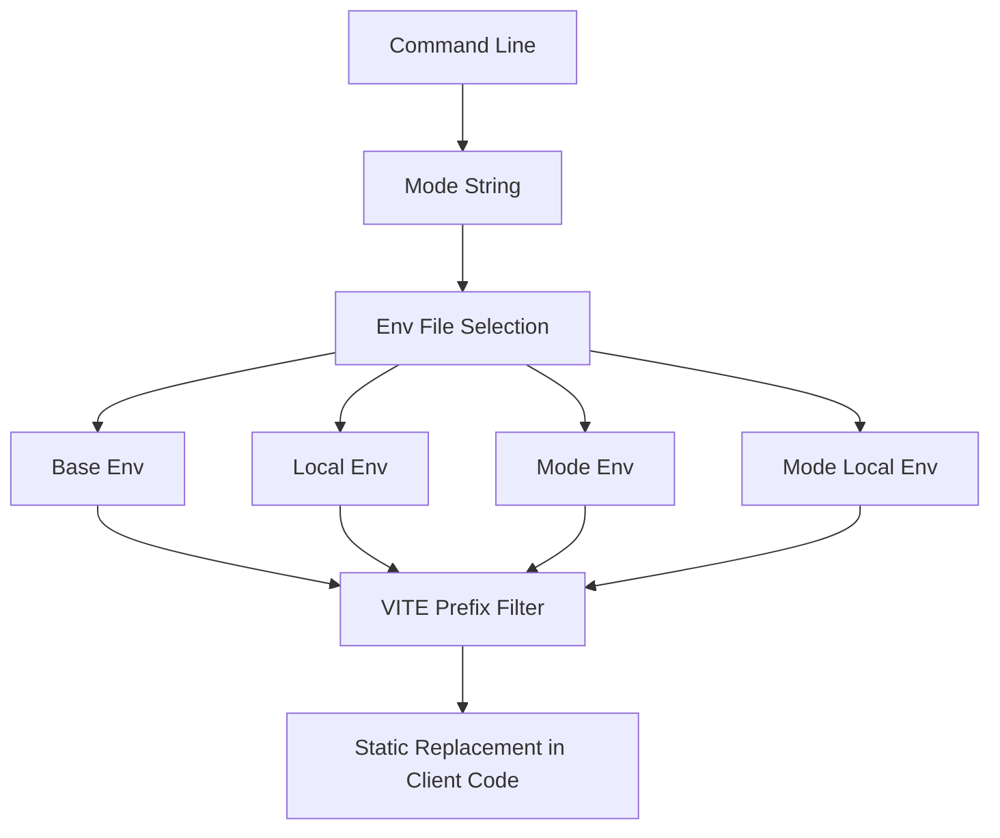

# Environment Modes and .env Files: Same Code, Different Behaviour

## English

Vite borrows the idea of modes from the command line: `vite` runs in development mode, `vite build` runs in production mode, and both accept a `--mode` flag to pick a different named mode. A mode is just a string that selects which `.env` files get loaded and what `import.meta.env.MODE` reports at runtime. This is distinct from the Node.js `NODE_ENV` variable, which Vite also manages but which serves a different purpose (it signals to libraries whether to include development warnings).

Environment files are loaded with a clear precedence. Vite reads `.env`, then `.env.local`, then `.env.[mode]`, then `.env.[mode].local`, with later files overriding earlier ones. The `.local` variants are conventionally git-ignored so developers can keep machine-specific secrets out of version control. Only variables prefixed with `VITE_` are exposed to client code — everything else stays server-side, a deliberate guard so you do not accidentally leak a database password into a browser bundle. This prefix rule is why a variable like `VITE_API_URL` shows up in `import.meta.env` while `DB_PASSWORD` silently does not.

The replacement is static, not dynamic. At transform time, Vite substitutes `import.meta.env.VITE_API_URL` with a literal string, which is why the access must be written exactly that way — destructuring `const { VITE_API_URL } = import.meta.env` defeats the substitution in some configurations, and bracket access like `import.meta.env['VITE_' + name]` cannot be replaced at all because the key is not known until runtime. Treat env access as a compile-time macro, not a runtime object lookup.

Modes also drive conditional configuration. The `defineConfig` helper can receive a function whose argument includes `mode` and `command`, letting you return different config for staging versus production — different base paths, different proxy targets, different output directories. Because this function runs in Node at startup, it is the right place for logic that depends on the environment, keeping the browser code free of branching.

A common pitfall is committing a `.env` file that contains real secrets, or assuming `.env` values are secret just because they live in a file. Anything prefixed `VITE_` is public by definition — it ships in the bundle and is readable by anyone. Use environment variables for configuration and public keys, never for secrets that must stay hidden; those belong on a backend you control.

## 中文

Vite 從命令列借來「模式」（mode）的概念：`vite` 以 development 模式執行，`vite build` 以 production 模式執行，兩者都接受 `--mode` 旗標來指定另一個具名模式。模式只是一個字串，用來決定載入哪些 `.env` 檔案，以及執行時 `import.meta.env.MODE` 回報什麼。這跟 Node.js 的 `NODE_ENV` 變數不同：Vite 也會管理 `NODE_ENV`，但它的用途不一樣（用來告訴函式庫是否要包含開發警告）。

環境檔案的載入有明確的優先順序。Vite 會讀 `.env`，然後 `.env.local`，再來 `.env.[mode]`，最後 `.env.[mode].local`，後面的檔案覆蓋前面的。`.local` 變體慣例上會被 git 忽略，讓開發者把機器專屬的機密留在版本控制之外。只有以 `VITE_` 為前綴的變數會暴露給客戶端程式碼——其餘全部留在伺服器端，這是刻意的防護，避免你不小心把資料庫密碼洩漏進瀏覽器 bundle。這條前綴規則解釋了為何 `VITE_API_URL` 會出現在 `import.meta.env`，而 `DB_PASSWORD` 則悄悄不會。

替換是靜態的，不是動態的。在轉換階段，Vite 會把 `import.meta.env.VITE_API_URL` 換成字面字串，這就是為何存取必須一字不差地那樣寫——在某些設定下，解構寫法 `const { VITE_API_URL } = import.meta.env` 會讓替換失效；而像 `import.meta.env['VITE_' + name]` 這種方括號存取則根本無法替換，因為鍵值要到執行時才知道。請把 env 存取當成編譯期巨集，而不是執行期的物件查找。

模式也會驅動條件式設定。`defineConfig` 輔助函式可以接收一個函式，其參數包含 `mode` 與 `command`，讓你為預備環境與生產環境回傳不同設定——不同的 base 路徑、不同的 proxy 目標、不同的輸出目錄。因為這個函式在啟動時於 Node 中執行，它正是放置依賴環境之邏輯的正確位置，讓瀏覽器程式碼免於分支判斷。

常見的陷阱，是提交了含有真實機密的 `.env` 檔案，或是以為 `.env` 的值因為放在檔案裡就等於機密。任何以 `VITE_` 為前綴的東西，定義上就是公開的——它會被打包進去，任何人都讀得到。環境變數請用來放設定與公開金鑰，絕不要用來放必須隱藏的機密；那些應該放在你能控制的後端。

## Key Takeaway

Modes select which .env files load, but only VITE_-prefixed values reach the browser and they are replaced statically — so treat them as public configuration, never secrets.

## Related Concepts
- import.meta.env
- defineConfig

## Diagram

