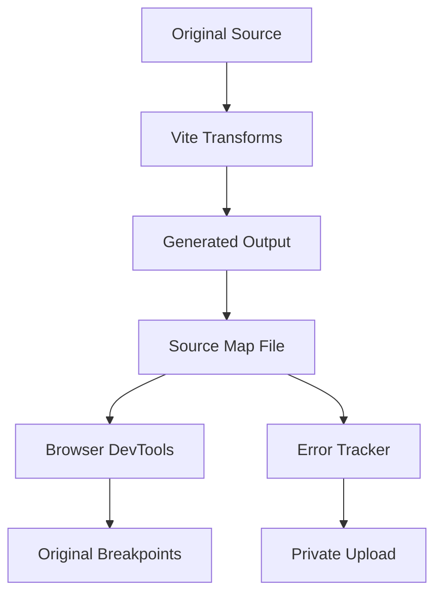

# Source Maps in Vite: Reading Your Code Through the Compiler's Eyes

## English

A source map is a sidecar file that tells a debugger how a line and column in the generated output maps back to the original source file. This matters because Vite transforms almost everything: TypeScript becomes JavaScript, JSX becomes function calls, CSS Modules become mangled class names, and in production Rollup concatenates many modules into a few chunks. Without source maps, a stack trace pointing to chunk-abc123.js line 1 column 48273 is nearly useless.

The map itself is a JSON object with fields like version, sources (original file paths), names (original identifiers), mappings (a compact encoded string), and optionally sourcesContent, which embeds the original text so a browser can show it without fetching the source file. The mappings string uses Base64 VLQ (variable-length quantity) encoding, a scheme where each segment encodes how many lines, columns, and source indices to advance relative to the previous segment. That delta encoding is why maps stay small even for large projects.

In development, Vite generates inline or external maps depending on configuration, and the browser's DevTools uses them transparently, so you breakpoint on your .ts file, not the transformed module. In production, the build.sourcemap option controls this: false (default, no maps), true (separate .map files), 'inline' (data URI embedded in the bundle), or 'hidden' (maps generated but no sourceMappingURL comment). The last one is useful when you want to upload maps to an error-tracking service without exposing source to anyone who opens DevTools.

A subtle trap: if you enable source maps in production and ship the .map files publicly, your original TypeScript, comments, and sometimes secrets accidentally left in code become readable. Many teams use 'hidden' plus a private upload step. Another trap is that some minifiers and transpilers apply their own transforms after Vite's, so a map chain must be composed; Vite and Rollup handle this composition automatically when plugins return proper maps, but a poorly written plugin can silently break the chain and produce maps that point to the wrong lines.

Finally, source maps are not just for humans. Error monitoring tools like Sentry consume them to symbolicate stack traces, and coverage tools use them to attribute coverage back to source files. When debugging why your stack trace looks wrong, checking whether the map chain is intact (open the .map, look at sources and sourcesContent) is often faster than guessing.

## 中文

Source map（原始碼對映）是一個附帶檔案，告訴除錯器生成輸出中的某一行某一列如何對應回原始原始碼檔案。這件事之所以重要，是因為 Vite 幾乎會轉換所有東西：TypeScript 變成 JavaScript、JSX 變成函式呼叫、CSS Modules 變成被改寫的類別名稱，而在生產環境中 Rollup 會把許多模組串接成少數幾個 chunk。沒有 source map，一個指向 chunk-abc123.js 第 1 行第 48273 列的堆疊追蹤幾乎沒有用。

對映檔本身是一個 JSON 物件，欄位包括 version、sources（原始檔案路徑）、names（原始識別字）、mappings（一段緊湊編碼的字串），以及可選的 sourcesContent，後者把原始文字內嵌進去，讓瀏覽器不必再抓原始檔就能顯示。mappings 字串使用 Base64 VLQ（可變長度量）編碼，每個區段編碼的是相對於前一個區段要先進幾行、幾列、幾個來源索引。這種差值編碼正是為什麼即使大型專案的對映檔仍然很小的原因。

在開發環境中，Vite 會依設定產生內嵌或外部對映，瀏覽器的 DevTools 會透明地使用它們，所以你可以直接在 .ts 檔案上設中斷點，而不是在轉換後的模組上。在生產環境中，build.sourcemap 選項控制這件事：false（預設，不產生對映）、true（產生分離的 .map 檔）、'inline'（以 data URI 內嵌在 bundle 中），或 'hidden'（產生對映但不加 sourceMappingURL 註解）。最後一種在你想把對映上傳到錯誤追蹤服務、又不希望任何人打開 DevTools 就看到原始碼時很有用。

一個微妙的陷阱：如果你在生產環境啟用 source map 又公開散布 .map 檔，你的原始 TypeScript、註解，有時還有不小心留在程式碼裡的機密，都會變得可讀。許多團隊會用 'hidden' 加上私密的上傳步驟。另一個陷阱是有些壓縮器與轉譯器會在 Vite 之後套用自己的轉換，因此對映鏈必須被組合起來；當外掛回傳正確的對映時，Vite 與 Rollup 會自動處理這個組合，但寫得不好的外掛可能默默打斷這條鏈，產生指向錯誤行數的對映。

最後，source map 不只是給人看的。像 Sentry 這類錯誤監控工具會消費它們來符號化堆疊追蹤，覆蓋率工具也會用它們把覆蓋率歸回原始檔。當你在除錯為什麼堆疊追蹤看起來不對時，檢查對映鏈是否完整（打開 .map，看 sources 與 sourcesContent）往往比瞎猜更快。

## Key Takeaway

Source maps are a delta-encoded bridge from generated code back to your original files, and whether you ship them publicly is a security decision, not just a debugging convenience.

## Related Concepts
- Base64 VLQ encoding
- Bundler chunking

## Diagram

