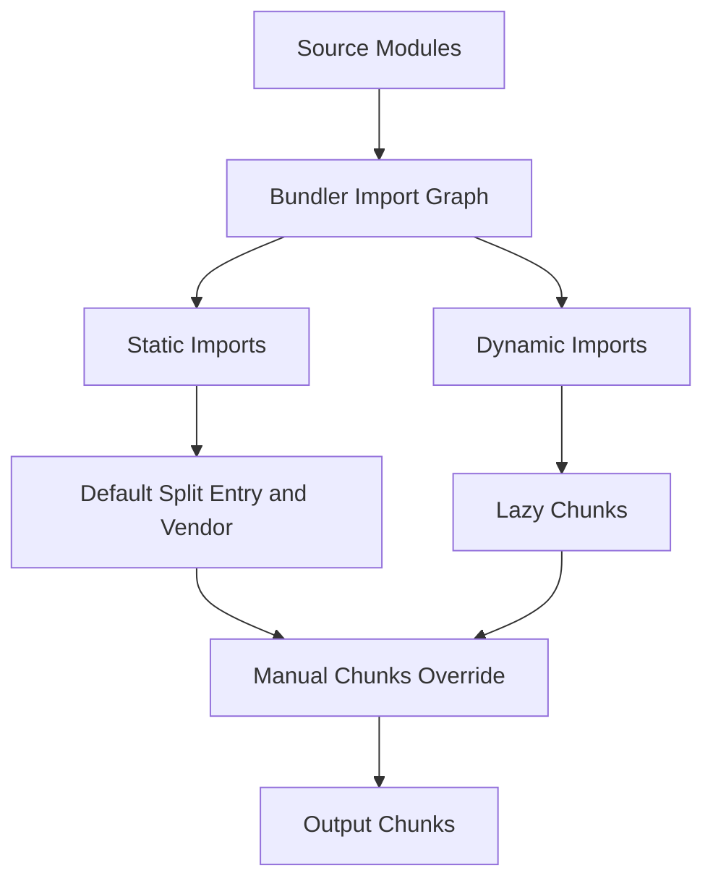

# The Module Graph in Production: Chunk Splitting, Dynamic Imports, and Manual Chunks

## English

In development Vite serves each module as a separate ESM request, but in production the bundler walks the import graph and decides how to group modules into output files called chunks. (In Vite 8 and later that bundler is Rolldown; in Vite 7 and earlier it was Rollup.) The goal is a trade-off: fewer, larger chunks mean fewer network round trips but worse cache granularity and slower time-to-interactive for the first screen; many small chunks mean better caching but more requests. Vite's default heuristic is to split your own code from vendor code (dependencies), because vendor code changes rarely and caches well.

Dynamic import() is the main lever you control. When the bundler sees import('./heavy-feature.js'), it creates a separate chunk that is fetched only when that code path runs. This is how route-level code splitting works in frameworks: each route module becomes its own chunk, so a user landing on the home page never downloads the checkout page's JavaScript. The same applies to conditionally loaded features like a rich text editor or a charting library.

Sometimes the default splitting is wrong. In Vite 7 and earlier, build.rollupOptions.output.manualChunks lets you name groups explicitly; a common pattern is a function that returns 'vendor' for anything in node_modules and undefined otherwise, or finer groups like 'react', 'charting', 'editor'. In Vite 8 the object form of that option was removed and the function form deprecated, in favour of Rolldown's own codeSplitting option. Over-splitting is a real risk: if you create twenty tiny chunks, the browser makes twenty requests and HTTP/2 multiplexing helps but does not eliminate the cost. Under-splitting is also a risk: one giant vendor chunk means any dependency update busts the cache for everything.

There is also the question of chunk loading order and preloading. Vite injects modulepreload hints for chunks that are statically imported by the entry, so the browser can fetch them in parallel before it needs them. Dynamically imported chunks are not preloaded by default because Vite cannot know if the code path will run; you can add hints manually if a route is likely. The build.assetsInlineLimit option is a separate but related knob: small assets below the limit are inlined as base64 data URIs instead of emitted as files, trading bytes for requests.

A practical debugging technique is to run a production build and inspect the generated .vite/manifest.json or the build output summary. If a chunk is unexpectedly large, tools like rolldown-plugin-visualizer render a treemap showing which modules contributed (Vite 8 builds with Rolldown; earlier versions used rollup-plugin-visualizer). That usually reveals a barrel file (an index.js re-exporting everything) pulling in an entire library, or a polyfill that was accidentally bundled for modern browsers.

## 中文

在開發環境中，Vite 把每個模組當成獨立的 ESM 請求來提供，但在生產環境中，打包器會走訪匯入圖，決定如何把模組分組成輸出檔，這些輸出檔稱為 chunk。目標是一個取捨：較少、較大的 chunk 意味著較少的網路往返，但快取粒度較差、首屏達到可互動的時間較慢；許多小 chunk 意味著快取更好，但請求更多。Vite 的預設啟發式是把你自己寫的程式碼與第三方相依（vendor）分開，因為 vendor 程式碼很少變動、快取效果好。

動態 import() 是你主要能控制的槓桿。當打包器看到 import('./heavy-feature.js')，它會建立一個獨立的 chunk，只有在那條程式碼路徑執行時才會被抓取。框架中的路由層級程式碼分割就是這樣運作的：每個路由模組變成自己的 chunk，所以落在首頁的使用者永遠不會下載結帳頁的 JavaScript。同樣的道理也適用於有條件載入的功能，例如富文字編輯器或圖表函式庫。

有時預設的分割方式是錯的。在 Vite 7 及以前，build.rollupOptions.output.manualChunks 讓你明確地為群組命名；到了 Vite 8，該選項的物件形式已被移除、函數形式也被棄用，改用 Rolldown 自己的 codeSplitting 選項。常見的模式是寫一個函式，對 node_modules 裡的東西回傳 'vendor'，其餘回傳 undefined，或者分得更細，例如 'react'、'charting'、'editor'。過度分割是真實的風險：如果你造出二十個很小的 chunk，瀏覽器就要發二十個請求，HTTP/2 多工有幫助但不會消除成本。分割不足也是風險：一個巨大的 vendor chunk 意味著任何相依更新都會讓所有東西的快取失效。

還有 chunk 載入順序與預載的問題。Vite 會為入口靜態匯入的 chunk 注入 modulepreload 提示，讓瀏覽器能在需要它們之前就平行抓取。動態匯入的 chunk 預設不會預載，因為 Vite 無法知道那條程式碼路徑是否會執行；如果某個路由很可能被造訪，你可以手動加上提示。build.assetsInlineLimit 是一個獨立但相關的旋鈕：低於上限的小資源會以 base64 data URI 內嵌，而不是輸出成檔案，用位元組換取請求數。

一個實用的除錯技巧是跑一次生產建置，然後檢查生成的 .vite/manifest.json 或建置輸出摘要。如果某個 chunk 異常地大，像 rolldown-plugin-visualizer 這類工具會畫出樹狀圖，顯示哪些模組貢獻了體積（Vite 8 用的是 Rolldown，較早版本則用 rollup-plugin-visualizer）。這通常會揭露一個 barrel 檔（一個把所有東西重新匯出的 index.js）把整個函式庫都拉了進來，或者一個不小心為現代瀏覽器打包進去的 polyfill。

## Key Takeaway

Production chunking is a cache-versus-requests trade-off you steer with dynamic import() and manualChunks, and the manifest plus a visualizer is how you find out when the default heuristic guessed wrong.

## Related Concepts
- Dynamic import()
- HTTP/2 multiplexing

## Diagram

