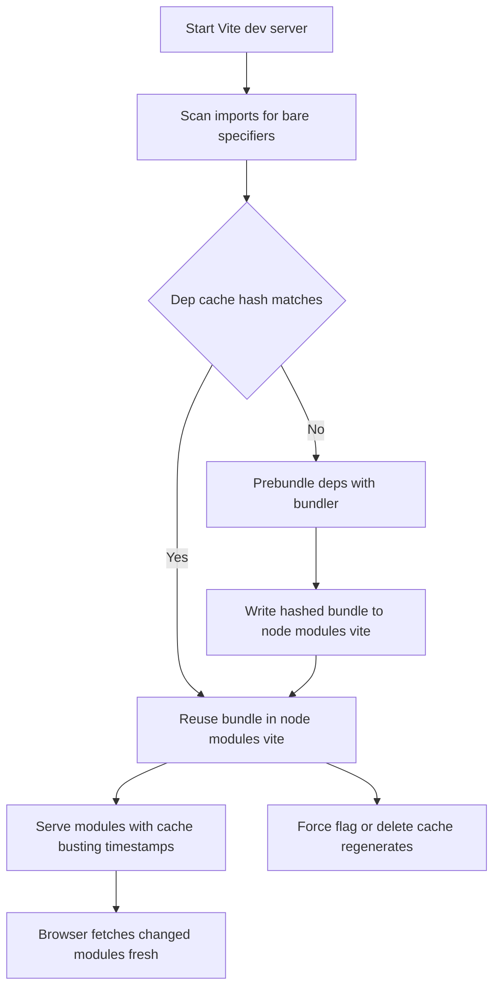

# Vite's Caching Layers: The Dep Cache, node_modules/.vite, and Why Deleting It Fixes Weird Bugs

## English

Vite keeps several caches, and knowing where they live explains a whole class of confusing bugs. The most visible is the dependency pre-bundle cache, stored by default in node_modules/.vite. When Vite first starts, it scans your imports, finds bare specifiers like 'lodash-es' or 'react', and bundles each dependency into a single ESM file using the bundler (esbuild in Vite 7 and earlier, Rolldown in Vite 8 and later). That bundle is then cached on disk with a hash derived from the lockfile, the config, and the dependency versions. On later starts, if the hash matches, Vite skips the pre-bundling step entirely and the server starts almost instantly.

This is why the classic fix for strange errors after upgrading a dependency is to delete node_modules/.vite and restart. If the hash did not change when it should have, or if a stale bundle is being served, you get errors like a missing named export or a duplicate copy of a library. The cache is disposable by design: it is regenerated on demand. You can also force it with the --force flag on the dev command, which tells Vite to re-run pre-bundling regardless of the hash.

A second layer is the browser's own HTTP cache. Vite serves source files with headers that discourage aggressive caching during development, and it appends query strings like ?t=1234567890 to invalidated modules so the browser treats them as new URLs. This is part of how HMR works: when a file changes, its importers are re-fetched with a new timestamp, bypassing the cache without needing a full reload. If you ever see a module that refuses to update, a hard reload or disabling the browser cache in DevTools is the usual remedy.

A third layer is transformation caching inside the dev server. Transforming TypeScript or Vue single-file components takes time, so Vite keeps results in memory keyed by file path and content. This is why the first request to a file is slower than subsequent ones, and why editing a file invalidates only that file and its importers rather than the whole graph. The dependency graph from earlier is what makes this targeted invalidation possible.

Finally, production builds have their own caching story. The bundler's output is deterministic given the same input, and Vite adds content hashes to filenames so browsers can cache them forever. That is why index.html is usually the only file without a hash: it must be re-fetched to learn the new hashed filenames. Understanding these three layers, dependency pre-bundle, browser HTTP cache, and in-memory transform cache, turns 'it works on my machine' moments into quick diagnoses.

## 中文

Vite 有好幾層快取，知道它們在哪裡，就能解釋一整類令人困惑的臭蟲。最明顯的是相依預打包快取，預設存放在 node_modules/.vite。Vite 第一次啟動時會掃描你的匯入，找到像 'lodash-es' 或 'react' 這種裸指定符（bare specifier），然後用打包器把每個相依打包成單一 ESM 檔（Vite 7 及以前是 esbuild，Vite 8 起用 Rolldown）。那個打包結果會以一個由 lockfile、設定與相依版本推導出的雜湊值快取在磁碟上。之後啟動時，如果雜湊值相符，Vite 就完全跳過預打包步驟，伺服器幾乎瞬間啟動。

這就是為什麼升級相依後遇到奇怪錯誤時，經典的解法是刪掉 node_modules/.vite 然後重新啟動。如果雜湊值在該變的時候沒變，或者提供了過期的打包結果，你就會遇到像缺少具名匯出、或某個函式庫出現重複副本這類錯誤。這個快取在設計上就是可丟棄的：它會按需求重新生成。你也可以在 dev 指令加上 --force 旗標強制它，告訴 Vite 不管雜湊值如何都重新執行預打包。

第二層是瀏覽器自己的 HTTP 快取。Vite 在開發時提供的原始檔會帶上抑制積極快取的標頭，並且對失效的模組附加像 ?t=1234567890 這樣的查詢字串，讓瀏覽器把它們當成新網址。這是 HMR 運作方式的一部分：檔案變動時，它的匯入者會用新的時間戳重新抓取，繞過快取而不需要整頁重載。如果你遇到某個模組死不更新，硬重新載入或在 DevTools 停用瀏覽器快取就是慣用的解法。

第三層是開發伺服器內部的轉換快取。轉換 TypeScript 或 Vue 單檔元件需要時間，所以 Vite 會以檔案路徑與內容為鍵，把結果留在記憶體中。這就是為什麼對某個檔案的第一個請求比後續的慢，也是為什麼編輯一個檔案只會讓該檔與它的匯入者失效，而不是整個圖。前面提過的相依圖，正是讓這種針對性失效得以實現的關鍵。

最後，生產建置有它自己的快取故事。給定相同輸入，打包器的輸出是確定性的，而 Vite 會在檔名加上內容雜湊，讓瀏覽器可以永久快取它們。這就是為什麼 index.html 通常是唯一沒有雜湊的檔案：它必須被重新抓取，才能得知新的雜湊檔名。理解這三層（相依預打包、瀏覽器 HTTP 快取、記憶體內轉換快取），就能把「在我機器上可以跑」的時刻變成快速診斷。

## Key Takeaway

Vite's speed comes from three disposable caches, and most 'impossible' dev-server bugs are just a stale layer waiting to be cleared.

## Related Concepts
- Dependency pre-bundling
- Content hashing

## Diagram

