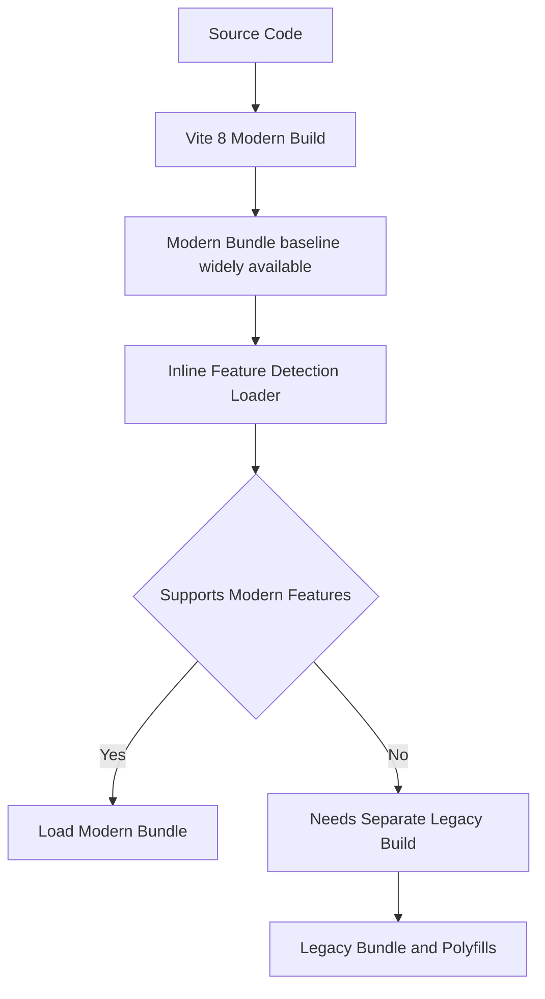

# Legacy Browser Support: Why Modern Output Needs a Second Build

## English

Vite 8's default production build target is `baseline-widely-available`, a modern evergreen baseline rather than the old "anything from 2017 onward" ES-modules-era target that Vite 4 and earlier used. That means the output uses modern syntax like arrow functions, async/await, optional chaining, and native `import` statements, and it does not include polyfills for older engines.

Historically, the answer for an older browser (an embedded WebView in a kiosk, an enterprise intranet stuck on an old engine) was `@vitejs/plugin-legacy`. It ran a second, parallel build using Babel to transpile syntax and inject polyfills, then injected a small loader script that detects the browser's capabilities and loads the right bundle. In Vite 8 the Rolldown-based pipeline can no longer transpile down to ES5 this way, so that legacy path is no longer served in the way it used to be — if you must support ancient browsers, you have to treat it as a separate build concern rather than assuming a plugin handles it.

The clever part of the classic approach was the feature-detection snippet. The plugin emitted a tiny inline script that ran before anything else and checked whether the browser supported the exact set of modern features the main bundle relied on — things like dynamic `import()`, async generators, and specific syntax forms. If the check passed, the modern bundle loaded and the legacy bundle was never downloaded. If it failed, the browser got the transpiled, polyfilled version. This is called a differential build or differential serving: modern browsers pay nothing for the compatibility of old ones.

The cost was real. You built twice, shipped two sets of files, and the legacy chunks were usually much larger because Babel's transpiled output is more verbose and the polyfills added weight. Source maps got more complicated, and build times roughly doubled for the module transformation step. There was also a subtle hazard: code that worked in the modern build could behave differently after Babel rewrote it — class fields, `for...of` over iterables, and generator semantics could shift subtly depending on the Babel targets configured.

A practical rule of thumb: check your analytics before caring about legacy support. If your audience is on evergreen browsers, the whole question is moot and you should be spending your effort on bundle size and build time instead. If you genuinely need old-engine support, pin the narrowest set of browsers you actually must support rather than a broad default, and keep the second build in mind when debugging — a bug that only reproduces in the fallback bundle usually points at a transpilation or polyfill mismatch, not at your source code.

Finally, remember that legacy support interacts with other build features. Dynamic imports, CSS code splitting, and asset inlining all have to be handled consistently across both builds, and some plugins behave differently when they detect the legacy pass. Treat it as a deliberate compatibility layer bolted onto a modern-first toolchain, not as a default safety net.

## 中文

Vite 8 的生產建置預設目標是 `baseline-widely-available`，即一個現代常見瀏覽器的基線，而不再是 Vite 4 及更早版本所講的「大致上就是 2017 年之後」那個原生 ES 模組年代目標。也就是說，輸出會使用箭頭函式、async/await、optional chaining、原生 `import` 陳述式等現代語法，並不會為舊引擎加入 polyfill。

歷來要支援較舊的瀏覽器（例如自助機台內嵌的 WebView、卡在舊引擎的企業內網），做法是 `@vitejs/plugin-legacy`。它會用 Babel 跑一次平行的第二次建置，轉譯語法並注入 polyfill，然後插入一小段載入器腳本，偵測瀏覽器能力並載入正確的 bundle。但在 Vite 8，基於 Rolldown 的管線已經無法再以這種方式轉譯成 ES5，所以那條舊版路徑不再像從前那樣被提供——如果你確實要支援古老瀏覽器，就要把它當作另一條獨立的建置議題，而不要再假設有個外掛會幫你處理。

那個經典做法最巧妙的地方是功能偵測程式碼。外掛會輸出一小段 inline script，在任何其他東西之前執行，檢查瀏覽器是否支援主 bundle 所依賴的那組現代功能——例如動態 `import()`、async generator、特定語法形式。檢查通過就載入現代 bundle，舊版 bundle 根本不會被下載；檢查失敗則取得轉譯並補齊 polyfill 的版本。這叫做差異化建置（differential build）或差異化供應：現代瀏覽器不必為舊瀏覽器的相容性付出任何代價。

代價是真實的。你要建置兩次、發布兩套檔案，而舊版 chunk 通常大得多，因為 Babel 轉譯後的輸出更冗長，polyfill 又增加重量。Source map 變得更複雜，模組轉換階段的建置時間大約翻倍。還有一個隱微的風險：在現代 bundle 中運作正常的程式碼，經過 Babel 改寫後行為可能不同——例如 class field、對 iterable 使用 `for...of`、generator 的語意，都可能隨你設定的 Babel target 而有細微變化。

實用的經驗法則：關心舊版支援之前，先看分析數據。若你的受眾都在 evergreen 瀏覽器上，這條問題根本不存在，你應該把精力花在 bundle 體積與建置時間上。若你確實需要支援舊引擎，請鎖定你真正必須支援的最窄瀏覽器集合，而不是寬鬆的預設值；除錯時也要記得第二次建置的存在——只在 fallback bundle 重現的 bug，通常指向轉譯或 polyfill 的不匹配，而不是你的原始碼。

最後，記得舊版支援會與其他建置功能互動。動態 import、CSS code splitting、資源內聯，都必須在兩次建置間保持一致，有些外掛在偵測到舊版流程時行為也會不同。請把它視為刻意加在現代優先工具鏈上的相容層，而不是預設的安全網。

## Key Takeaway

Legacy support in Vite has always been an opt-in differential build — modern browsers get the fast modern bundle, old ones get a transpiled fallback loaded only after a feature-detection check — but Vite 8's Rolldown pipeline no longer provides the ES5 fallback that `@vitejs/plugin-legacy` used to generate.

## Related Concepts
- Differential builds
- Babel transpilation targets

## Diagram

