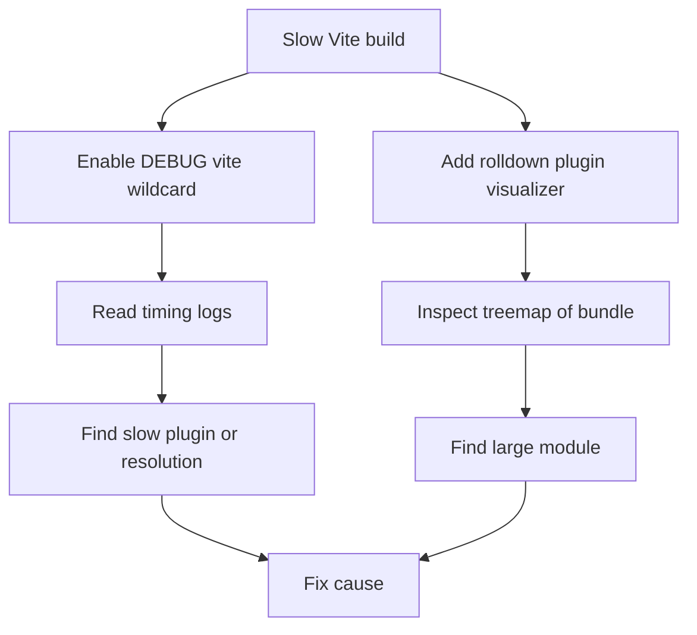

# Why Your Build Is Slow: Profiling Vite with Debug Logs and Visualizers

## English

When a Vite build feels slow, the instinct is to blame Vite itself. In practice the time almost always goes to plugins, transformation, or minification — and the only way to know which is to measure. Vite ships with a debug facility: setting the `DEBUG` environment variable to `vite:*` (or a narrower namespace like `vite:resolve`) makes the tool print detailed timing and resolution logs. Running `DEBUG=vite:* vite build` on a slow project often reveals that a single plugin is spending seconds per module, or that resolution is thrashing on a deep dependency tree.

For the bundle side, the standard tool is `rolldown-plugin-visualizer`. It hooks into the bundler's output (Vite 8 builds with Rolldown, not Rollup) and produces an interactive treemap showing exactly which modules ended up in which chunk and how many bytes each contributes. This answers the question that timing logs cannot: not just where time went, but where size went. A common discovery is that a single convenience library — a date library, an icon set, a utility grab-bag — accounts for a third of the bundle because it was imported without tree-shakeable named imports.

There is also a lower-level option. Since Vite 8's build is driven by Rolldown, you can run the build with Node's CPU profiler or with `--sourcemap` enabled and inspect the resulting maps, but the most accessible first step is simply turning on `build.reportCompressedSize` and watching the console output, then layering in the visualizer. For dev-server slowness, the relevant knobs are different: dependency pre-bundling in Vite 8 runs on the Oxc/Rolldown toolchain rather than esbuild, but a cold start on a large `node_modules` can still take a while, and the debug logs will show which dependencies are being scanned and optimized.

A structured approach helps. First, separate cold start from warm start — the first run after deleting the cache is always slower, so compare like with like. Second, separate dev-server latency from production build time; they stress completely different code paths. Third, when you suspect a plugin, disable plugins one at a time (or use the `enforce` ordering to reason about where each runs) and re-measure. Fourth, look at what your own code does at build time: large numbers of dynamic imports, glob imports, or generated files can dominate.

Finally, remember that build speed is a trade-off, not a pure win. Aggressive minification, deep source maps, and legacy transpilation all cost time and buy something in return. Profile first, decide what you are willing to give up, and change one variable at a time so you can attribute the improvement correctly.

## 中文

當 Vite 建置感覺很慢，直覺會怪罪 Vite 本身。實際上時間幾乎都花在外掛、轉換或壓縮上——而唯一知道是哪一項的方法就是量測。Vite 內建除錯機制：把 `DEBUG` 環境變數設為 `vite:*`（或更窄的命名空間如 `vite:resolve`），工具就會印出詳細的計時與解析日誌。在慢的專案上執行 `DEBUG=vite:* vite build`，往往會發現某個外掛每個模組要花好幾秒，或解析在很深的依賴樹上反覆打轉。

bundle 這邊的標準工具是 `rolldown-plugin-visualizer`。它掛進打包器的輸出（Vite 8 用的是 Rolldown，不是 Rollup），產生互動式 treemap，清楚顯示哪些模組進入了哪個 chunk、各佔多少位元組。這回答了計時日誌答不了的問題：不只是時間花在哪，還有體積花在哪。常見的發現是某個方便用的函式庫——日期庫、圖示集、雜物工具箱——佔了 bundle 三分之一，因為它被整包 import，而不是用可 tree-shake 的具名 import。

還有更底層的選項。既然 Vite 8 的建置由 Rolldown 驅動，你可以用 Node 的 CPU profiler 跑建置，或開啟 `--sourcemap` 後檢視產生的 map；但最容易上手的第一步，是先打開 `build.reportCompressedSize` 觀察主控台輸出，再疊上 visualizer。若是 dev server 慢，相關旋鈕不同：Vite 8 的依賴預打包跑喺 Oxc/Rolldown 工具鏈上而非 esbuild，但大型 `node_modules` 的冷啟動仍可能耗時，除錯日誌會顯示正在掃描與最佳化哪些依賴。

有條理的做法有幫助。第一，把冷啟動與暖啟動分開——刪掉快取後的第一次執行一定較慢，所以要同類相比。第二，把 dev server 延遲與生產建置時間分開；兩者壓力測試的是完全不同的程式路徑。第三，懷疑某外掛時，一次停用一個（或用 `enforce` 順序推斷各自何時執行）再重新量測。第四，看看你自己的程式碼在建置時做了什麼：大量動態 import、glob import 或產生的檔案都可能主導時間。

最後，記得建置速度是取捨，不是純賺。激進壓縮、深度 source map、舊版轉譯都花時間，也都換到某些東西。先量測，決定你願意放棄什麼，一次只改一個變數，才能正確歸因改善。

## Key Takeaway

Diagnose slow Vite builds by measuring first: DEBUG=vite:* for timing and resolution, rolldown-plugin-visualizer for bundle composition, and change one variable at a time.

## Related Concepts
- Rolldown plugin visualizer
- Oxc/Rolldown dependency pre-bundling

## Diagram

