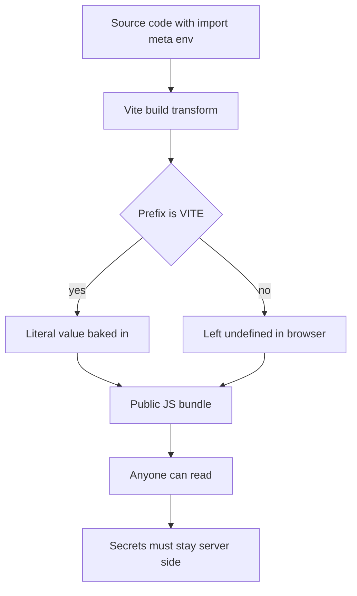

# The Client Boundary: import.meta.env, define, and What Actually Reaches the Browser

## English

One of the most important mental models in Vite is the client boundary: everything in your source that ends up in the browser bundle is public, no matter how it is written. Vite exposes environment variables through `import.meta.env`, but only variables prefixed with `VITE_` are injected by default. This prefix is not cosmetic — it is a deliberate safety mechanism. When Vite replaces `import.meta.env.VITE_API_URL` with a literal string at build time, that string is baked into the JavaScript file anyone can download and read.

This is a static replacement, not a runtime lookup. There is no environment object living in the browser that reads values when the page loads; the values are substituted during transformation, which is why they must be known at build time and why changing them requires a rebuild. It also means you cannot construct variable names dynamically — `import.meta.env['VITE_' + name]` will not work, because the replacement happens textually before any code runs. The same mechanism underlies the `define` config option, which lets you replace arbitrary identifiers with literal values (commonly used for feature flags or for injecting a build version).

The boundary cuts both ways. Secrets — API keys with write access, database credentials, signing keys — must never cross it. A common mistake is putting a secret in a `VITE_`-prefixed variable because it is convenient, then discovering it in the shipped bundle. Server-side secrets belong in server code, whether that is a Node process, a serverless function, or a backend API that the frontend calls. The frontend should hold only values that are safe to publish, like a public analytics ID or a public API base URL.

There is a second, subtler boundary: what happens in development versus production. In dev, `import.meta.env.DEV` is true and `import.meta.env.PROD` is false; in a production build the reverse. Code inside an `if (import.meta.env.DEV)` block is typically eliminated by tree-shaking in the production build, so debug logging or dev-only assertions cost nothing when shipped. But this also means code that only runs in dev can hide bugs — a branch that never executes in production is a branch you have not tested in production.

Finally, remember that `import.meta` itself is a language feature, not a Vite invention. Vite extends it with `env`, `hot` (for HMR), and `glob` (for glob imports), but the underlying object is standard. Understanding that these are compile-time conveniences rather than runtime APIs is the key to reasoning about what your users can actually see.

## 中文

Vite 中最重要的心智模型之一，是客戶端邊界：原始碼中任何最終進入瀏覽器 bundle 的東西都是公開的，無論你怎麼寫。Vite 透過 `import.meta.env` 暴露環境變數，但預設只注入以 `VITE_` 為前綴的變數。這個前綴不是裝飾——它是刻意的安全機制。當 Vite 在建置時把 `import.meta.env.VITE_API_URL` 替換成字面字串，那個字串就被烘焙進任何人都能下載閱讀的 JavaScript 檔案裡。

這是靜態替換，不是執行期查詢。瀏覽器中沒有什麼環境物件會在頁面載入時讀取值；值是在轉換階段被代入的，所以它們必須在建置時已知，也所以改變它們需要重新建置。這也意味著你不能動態構造變數名稱——`import.meta.env['VITE_' + name]` 不會運作，因為替換是在任何程式碼執行之前以文字方式發生的。同樣的機制支撐 `define` 設定選項，讓你把任意識別字替換成字面值（常用於功能旗標或注入建置版本）。

這道邊界是雙向的。機密——有寫入權限的 API key、資料庫憑證、簽章金鑰——絕不能跨越它。常見錯誤是把機密放進 `VITE_` 前綴的變數只因為方便，然後在出貨的 bundle 裡發現它。伺服器端機密屬於伺服器程式碼，無論是 Node 程序、serverless function，或前端呼叫的後端 API。前端只應持有可安全公開的值，例如公開的分析 ID 或公開的 API base URL。

還有第二道更細微的邊界：開發與生產的差異。開發時 `import.meta.env.DEV` 為 true、`import.meta.env.PROD` 為 false；生產建置則相反。`if (import.meta.env.DEV)` 區塊內的程式碼，在生產建置中通常會被 tree-shaking 消除，所以除錯日誌或僅開發用的斷言出貨時不佔成本。但這也意味著只在開發時執行的程式碼可能藏 bug——在生產從不執行的分支，就是你在生產沒測過的分支。

最後，記得 `import.meta` 本身是語言特性，不是 Vite 發明的。Vite 擴充了 `env`、`hot`（供 HMR）、`glob`（供 glob import），但底層物件是標準的。理解這些是編譯期便利而非執行期 API，是推斷使用者實際能看到什麼的關鍵。

## Key Takeaway

Anything in the client bundle is public: VITE_-prefixed variables and define replacements are baked in at build time, so secrets must stay on the server.

## Related Concepts
- import.meta.env
- Tree-shaking dead code elimination

## Diagram

