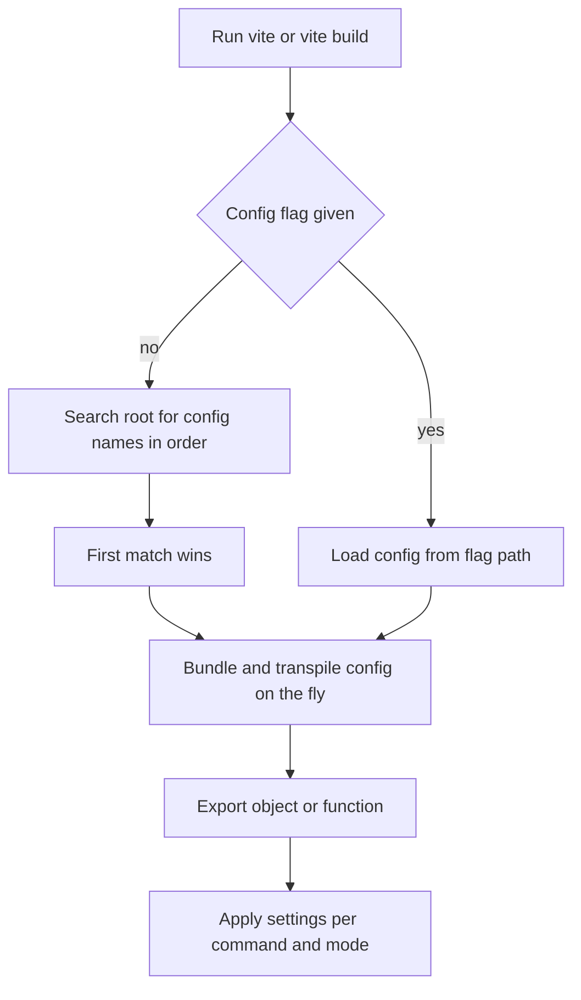

# Vite's CLI and Config File Resolution: How Vite Finds Your Settings

## English

Every time you type `vite` or `vite build`, a small piece of software has to answer a boring but crucial question: which configuration file do I load, and in what form? Vite looks for a config file by name in the project root, trying a fixed list of extensions in order — `vite.config.js`, `vite.config.mjs`, `vite.config.ts`, `vite.config.cjs`, `vite.config.mts`, and `vite.config.cts`. The first one it finds wins, so having both a `.js` and a `.ts` config lying around is a subtle trap: one of them is silently ignored. You can override this with the `--config` flag (or `-c`) on the command line, which is handy in monorepos where a shared config lives in a package rather than at the root.

Loading a TypeScript config is its own small magic trick. Node cannot execute `.ts` directly in most setups, so Vite bundles the config file on the fly — historically with esbuild, and in newer versions using a dedicated config loader that understands TypeScript syntax, ESM imports, and even imports of other local files. This means your config can `import` helper modules, read from `process.env`, and use top-level `await`. The cost is that the config is a build artifact: it is transpiled and cached, so a config that depends on mutable external state can behave surprisingly.

A config file can export either a plain object or a function. The function form receives a context object with `command` (either `'serve'` or `'build'`) and `mode` (the mode string, defaulting to `'development'` for serve and `'production'` for build). Returning different settings per command is the idiomatic way to, say, enable a bundle visualizer only during builds. The function can also be async, which is useful when you need to read a file or query something before deciding on aliases.

There is also a conditional-loading mechanism: `defineConfig` accepts an array of config objects, and Vite filters them. Each entry can include an `apply` property set to `'serve'` or `'build'`, and only matching entries are merged. This lets you keep dev-only plugins and build-only plugins in one file without a big `if` statement. Merging follows Vite's own rules — arrays like `plugins` are concatenated, while most scalar values are replaced — which is worth knowing before you assume two configs will combine the way you expect.

Finally, config files are not the only source of truth. Command-line flags such as `--port`, `--host`, `--base`, and `--mode` are merged on top, and inline config passed programmatically through the JavaScript API wins over the file. Understanding this precedence order — defaults, then config file, then CLI, then programmatic — saves hours when a setting you clearly wrote seems to have no effect.

## 中文

每次你輸入 `vite` 或 `vite build`，背後都有一件看似沉悶但關鍵的事：究竟要載入哪個設定檔，以及用甚麼形式載入？Vite 會在專案根目錄按固定次序尋找設定檔名稱，依次嘗試 `vite.config.js`、`vite.config.mjs`、`vite.config.ts`、`vite.config.cjs`、`vite.config.mts`、`vite.config.cts`。第一個找到的就勝出，所以同時放著 `.js` 和 `.ts` 兩個設定檔是個隱蔽陷阱：其中一個會被靜靜忽略。你可以用命令列的 `--config`（或 `-c`）旗標覆寫，這在 monorepo 中特別有用，因為共用設定可能放在某個套件裡而非根目錄。

載入 TypeScript 設定檔本身就是一個小魔法。在大多數環境下 Node 不能直接執行 `.ts`，所以 Vite 會即時把設定檔打包 —— 歷史上用 esbuild，較新版本則用專門的設定載入器，能理解 TypeScript 語法、ESM import，甚至 import 其他本地檔案。這意味著你的設定可以 `import` 輔助模組、讀取 `process.env`、使用 top-level `await`。代價是設定檔本身也是建置產物：它會被轉譯並快取，所以依賴可變外部狀態的設定可能出現意外行為。

設定檔可以匯出普通物件，也可以匯出函數。函數形式會收到一個 context 物件，內含 `command`（`'serve'` 或 `'build'`）和 `mode`（模式字串，serve 預設 `'development'`，build 預設 `'production'`）。按命令回傳不同設定，是「只在建置時啟用打包視覺化工具」這類需求的慣用做法。函數也可以是 async，當你需要先讀檔或查詢某些東西才決定 alias 時很有用。

還有一種條件載入機制：`defineConfig` 接受一個設定物件陣列，Vite 會篩選它們。每個項目可包含 `apply` 屬性，設為 `'serve'` 或 `'build'`，只有符合的項目會被合併。這樣你就能在同一個檔案裡放開發專用和建置專用的外掛，而不必寫一大段 `if`。合併依 Vite 自己的規則 —— 像 `plugins` 這類陣列會被串接，而多數純量值會被取代 —— 在假設兩份設定會如你所願地結合之前，這點值得先弄清楚。

最後，設定檔並非唯一真相來源。`--port`、`--host`、`--base`、`--mode` 等命令列旗標會疊加在上，而以程式方式透過 JavaScript API 傳入的 inline 設定又優先於檔案。理解這個優先次序 —— 預設值、設定檔、CLI、程式化設定 —— 可以省下大量時間，尤其是當你明明寫了的設定似乎毫無作用的時候。

## Key Takeaway

Vite resolves config through a fixed filename order, transpiles TypeScript configs on the fly, and merges settings in a strict precedence: defaults, config file, CLI flags, then programmatic API.

## Related Concepts
- defineConfig and apply
- Command-line flags precedence

## Diagram

