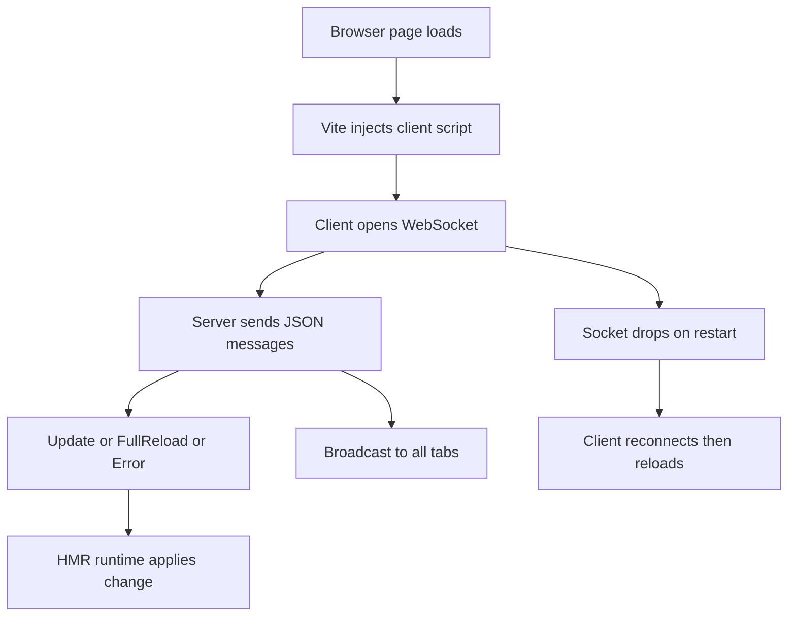

# The Dev Server's WebSocket Channel: How Vite Talks to the Browser

## English

Hot Module Replacement is the visible magic of Vite's dev server, but the invisible part is the channel that carries it: a WebSocket connection. When the browser loads the page, Vite injects a small client script into the HTML. That script opens a WebSocket back to the dev server, usually on the same port, and keeps it open for the lifetime of the page. Everything the server wants to tell the browser — "this file changed", "reload the page", "show this error overlay" — travels over that single socket.

The protocol is deliberately simple. The server sends JSON messages with a `type` field. Common types include `connected` (handshake confirmation), `update` (a list of modules to replace, each with its path and new code), `full-reload` (discard everything and reload), `prune` (drop these modules from the client's tracking), and `error` (render the overlay). The client script receives each message and dispatches it to the HMR runtime, which decides whether it can hot-swap a module or must fall back to a full reload.

A subtle and important detail is that the WebSocket connection is also a liveness signal. If the dev server restarts — say you edited the config file — the socket drops and the client notices. Vite's client will then attempt to reconnect with a backoff, and once reconnected it typically triggers a full page reload because the server's module graph may have changed completely. This is why editing `vite.config.ts` usually causes your browser to refresh even though no source file changed.

The channel is also how Vite coordinates multiple tabs. Each open tab holds its own WebSocket, and the server broadcasts updates to all of them. That means saving a file updates every tab at once, which is usually what you want but can be surprising when one tab is on a different route with different loaded modules. Modules that were pruned are removed from that tab's tracking so stale code does not linger.

Because it is just a WebSocket, the channel is inspectable. Opening your browser's network panel and filtering for the WebSocket connection lets you watch the actual messages flowing during an edit. This is an underrated debugging technique: if HMR is not working, watching whether an `update` message arrives tells you immediately whether the problem is on the server side (no message) or the client side (message arrives but the module rejects the update). Some setups — proxies, certain container networking — can break the WebSocket while leaving HTTP working, producing a page that loads fine but never hot-updates.

## 中文

熱模塊替換是 Vite 開發伺服器看得見的魔法，但看不見的部分是承載它的通道：WebSocket 連線。當瀏覽器載入頁面時，Vite 會把一段小型客戶端腳本注入 HTML。該腳本會向開發伺服器開啟 WebSocket，通常在同一個埠，並在頁面生命週期內保持開啟。伺服器想告訴瀏覽器的一切 ——「這個檔案改了」、「重新載入頁面」、「顯示這個錯誤覆蓋層」—— 都經由這條單一 socket 傳送。

協定刻意保持簡單。伺服器傳送帶有 `type` 欄位的 JSON 訊息。常見類型包括 `connected`（握手確認）、`update`（要替換的模組清單，每個含路徑和新程式碼）、`full-reload`（丟棄一切並重新載入）、`prune`（從客戶端追蹤中移除這些模組）、`error`（顯示覆蓋層）。客戶端腳本收到每條訊息後分派給 HMR runtime，由它決定能否熱替換模組，還是必須退回整頁重新載入。

一個微妙而重要的細節是：WebSocket 連線同時也是存活訊號。如果開發伺服器重啟 —— 例如你改了設定檔 —— socket 會斷開，客戶端會察覺。Vite 客戶端接著會以遞增間隔嘗試重連，重連成功後通常會觸發整頁重新載入，因為伺服器的模組圖可能已徹底改變。這就是為何編輯 `vite.config.ts` 通常會令瀏覽器重新整理，即使沒有任何原始碼檔案改動。

這條通道也是 Vite 協調多個分頁的方式。每個開啟的分頁各自持有 WebSocket，伺服器向全部廣播更新。這意味著儲存一個檔案會同時更新所有分頁 —— 通常正是你要的，但當某個分頁處於不同路由、載入不同模組時就可能出人意表。被 prune 的模組會從該分頁的追蹤中移除，避免殘留過時程式碼。

正因為它只是 WebSocket，這條通道是可觀察的。打開瀏覽器的網絡面板，篩選 WebSocket 連線，你就能在編輯時看到實際流動的訊息。這是被低估的除錯技巧：若 HMR 失效，觀察是否有 `update` 訊息到達，可即時告訴你問題在伺服器端（沒有訊息）還是客戶端（訊息到了但模組拒絕更新）。某些環境 —— 代理、某些容器網絡 —— 會令 WebSocket 中斷而 HTTP 仍正常，結果頁面載入正常但永遠不會熱更新。

## Key Takeaway

Vite's HMR runs over a single WebSocket per tab, carrying typed JSON messages for updates, reloads, pruning, and errors — and watching that socket is the fastest way to diagnose broken hot reloading.

## Related Concepts
- Hot Module Replacement runtime
- Error overlay

## Diagram

