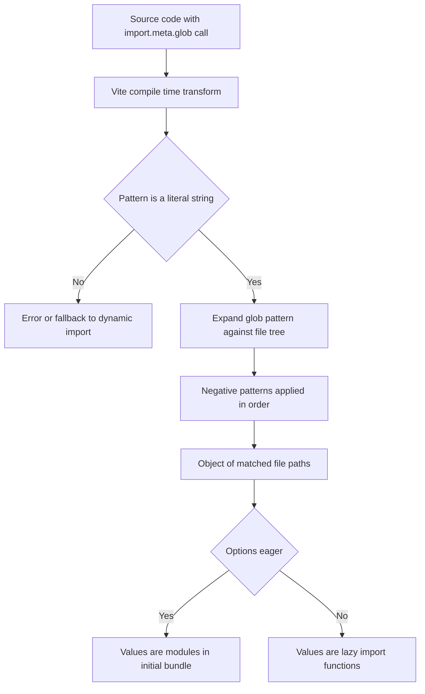

# Glob Imports and the import.meta.glob API: Turning File Trees into Modules

## English

Most imports name one file. But some of the most common frontend patterns need to import many files whose names you do not know at build time: every Markdown post in a blog folder, every icon in an assets directory, every locale JSON file. Writing those imports by hand is tedious and breaks whenever a file is added. Vite solves this with `import.meta.glob`, a compile-time macro that expands a glob pattern into an object of dynamic imports.

The basic form is `const modules = import.meta.glob('./posts/*.md')`. This returns an object whose keys are the matched file paths and whose values are functions that return a promise resolving to the module. Crucially, this is lazy: the modules are not loaded until you call the function. To load them eagerly, pass `{ eager: true }`, and the values become the modules themselves rather than functions. Choosing between lazy and eager is a real design decision: eager imports are simpler to use but push everything into the initial bundle, while lazy imports let you code-split naturally.

The pattern is not limited to a single folder. You can use `**` for recursive matching and pass multiple patterns as an array, for example `['./pages/**/*.vue', '!./pages/**/__tests__/**']` where a leading `!` excludes matches. Negative patterns are evaluated in order, so you can include broadly and then carve out exceptions. The resulting keys are always relative paths as written in the pattern, which matters when you use them to build routes or look up metadata.

Because `import.meta.glob` is a compile-time transform, it only works with literal string arguments. You cannot compute the pattern at runtime, and you cannot pass a variable. If you need that flexibility, you must fall back to a real dynamic `import()` with a runtime-computed path, which Vite cannot statically analyse and will warn you about. This is a deliberate trade: static patterns let the bundler know exactly which files exist, so it can generate precise chunks and avoid shipping dead code.

There is also a companion API, `import.meta.globEager`, which was the older eager-only form. It was deprecated in Vite 3 and then removed outright in Vite 5, so on any modern Vite it no longer exists. When migrating old code, replace `import.meta.globEager('./x/*.js')` with `import.meta.glob('./x/*.js', { eager: true })`. Understanding this API is a gateway to a whole class of file-system-driven patterns — auto-registering components, building route tables from a directory, or assembling a search index — without any runtime file-system access, which browsers do not have anyway.

## 中文

大多數 import 都指名一個檔案。但一些最常見的前端模式需要匯入許多在建置時未知名稱的檔案：部落格資料夾裡每一篇 Markdown 文章、資源目錄裡每一個圖示、每一個語言 JSON 檔。手寫這些 import 既沉悶，又會在新增檔案時失效。Vite 用 `import.meta.glob` 解決 —— 一個在編譯期把 glob 模式展開成動態 import 物件的巨集。

基本形式是 `const modules = import.meta.glob('./posts/*.md')`。它回傳一個物件，鍵是符合的檔案路徑，值是回傳 promise、解析為模組的函數。關鍵是這是惰性的：在你呼叫函數之前，模組不會載入。要立即載入，傳入 `{ eager: true }`，值就變成模組本身而非函數。在惰性與立即之間選擇是真正的設計決定：立即匯入較易用，但會把所有東西推進初始 bundle；惰性匯入則讓你自然做到程式碼分割。

這模式不限於單一資料夾。你可以用 `**` 做遞迴匹配，並以陣列傳入多個模式，例如 `['./pages/**/*.vue', '!./pages/**/__tests__/**']`，前導 `!` 表示排除。否定模式按次序評估，所以你可以先廣泛包含再挖走例外。產生的鍵永遠是模式中所寫的相對路徑，當你用它們建立路由或查閱元資料時這點很重要。

因為 `import.meta.glob` 是編譯期轉換，它只接受字面字串參數。你不能在執行期計算模式，也不能傳變數。若需要那種彈性，必須退回真正以執行期計算路徑的動態 `import()`，Vite 無法靜態分析它並會警告你。這是刻意的取捨：靜態模式讓打包器確切知道哪些檔案存在，因而能產生精確的 chunk 並避免送出無用程式碼。

還有一個配套 API `import.meta.globEager`，是舊有的只支援立即載入形式。它在 Vite 3 被棄用，並在 Vite 5 完全移除，所以在新版 Vite 上已不存在。遷移舊程式碼時，把 `import.meta.globEager('./x/*.js')` 換成 `import.meta.glob('./x/*.js', { eager: true })`。理解這個 API 是通往一整類檔案系統驅動模式的入口 —— 自動註冊元件、從目錄建立路由表、組裝搜尋索引 —— 而且完全不需要執行期檔案系統存取，瀏覽器本來也沒有這能力。

## Key Takeaway

import.meta.glob is a compile-time macro that turns a file glob into a map of lazy or eager module imports, enabling directory-driven patterns without any runtime filesystem access.

## Related Concepts
- Dynamic import and code splitting
- Compile-time macros

## Diagram

