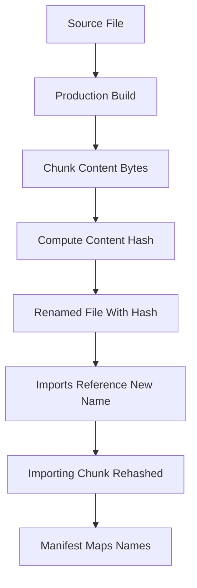

# Content Hashing and Long-Term Caching: Why Vite Renames Your Files

## English

Open a Vite production build and you will see filenames like index-a1b2c3d4.js instead of index.js. That suffix is a content hash: a short fingerprint computed from the file's bytes. The rule it enables is simple and powerful. A file whose content never changes keeps the same name forever, so a browser can cache it for a year and never re-download it. A file whose content changes gets a brand-new name, which the browser has never seen, so it must fetch it. This is how Vite lets you tell users' browsers 'cache this forever' without the classic fear that they will be stuck on a stale copy.

The hard part is not hashing a file; it is making sure the hash only changes when it should. Imagine a shared chunk containing a helper function. If that function's code is unchanged, its hash should stay stable even when you edit a completely unrelated component. Vite's production bundler is careful to keep chunk contents deterministic, and Vite configures hashing so that a chunk's name derives from what is actually inside it. (Which bundler you are talking about depends on your version: Vite 7 and earlier built with Rollup, while Vite 8, released in March 2026, unified dev and build onto a single Rust-based bundler called Rolldown.) This is why you sometimes see a tiny chunk whose hash changes after an unrelated edit: a dependency chain pulled in a new export, so the chunk's bytes really did change.

Hashes also propagate through imports. If chunk B imports chunk A and A's hash changes, B's source code now contains a different import path, so B's hash changes too, and so on up the chain. This cascade is expected, but it explains a common surprise: editing one leaf file can rename several chunks. Vite exposes this through the manifest file (enabled with build.manifest in the config), a JSON map from source entry names to their hashed output files. Server-side rendering setups and backend templates read that manifest to know which hashed file to reference, because the HTML cannot hard-code a name that changes every build.

Static assets follow the same idea. Files imported from JavaScript or referenced in CSS get hashed names by default, while anything you place in the public directory is copied verbatim with its original name, because Vite assumes you want to reference those paths directly. That trade-off is worth remembering: public files are easy to link but you must handle their caching yourself, usually by adding a query string or version segment. The assetsInlineLimit setting also matters here, since very small assets are inlined as base64 data URLs and therefore never get a filename at all.

Finally, the caching strategy only works if your server cooperates. The usual recipe is to serve hashed files under a long max-age with the immutable directive, and to serve the HTML entry with no-cache so users always get the latest references. Get that pairing right and deploys become cheap: most users download only the handful of chunks that actually changed. Get it wrong, for example by caching index.html for a year, and users may never see your new build no matter how clever the hashes are.

## 中文

打開任何一個 Vite 生產建置的輸出，你會看到 index-a1b2c3d4.js 這類檔名，而不是單純的 index.js。那個後綴就是內容雜湊（content hash）：根據檔案位元組算出來的短指紋。它實現的規則簡單而強大：內容永不改變的檔案，名字永遠不變，瀏覽器可以快取一整年而無需重新下載；內容改變的檔案會得到全新的名字，瀏覽器從未見過，因此必須重新抓取。這就是 Vite 讓你能夠告訴使用者瀏覽器「永遠快取這個檔案」，又不必擔心他們卡在舊版本的關鍵。

困難的地方不在於對檔案做雜湊，而在於確保雜湊只在應該改變時才改變。想像一個包含輔助函式的共用 chunk。如果該函式的程式碼沒變，它的雜湊就應該保持穩定，即使你改了完全無關的元件。Vite 的生產打包器會小心保持 chunk 內容的確定性，而 Vite 設定雜湊的方式，是讓 chunk 的名字源自它實際包含的內容。（說到哪一個打包器，要視乎你的版本而定：Vite 7 及更早版本用 Rollup，而 2026 年 3 月發布的 Vite 8 就把開發與建置統一到單一的 Rust 打包器 Rolldown 上。）這就是為什麼有時你會看到某個小 chunk 在無關的編輯後雜湊也變了：某條依賴鏈引入了新的匯出，chunk 的位元組真的變了。

雜湊也會沿著 import 傳播。如果 chunk B 匯入 chunk A，而 A 的雜湊變了，B 的原始碼裡就出現不同的匯入路徑，於是 B 的雜湊也跟著變，一路往上連鎖。這種連鎖是預期之中的，卻解釋了一個常見的驚訝：改一個末端檔案，可能讓好幾個 chunk 改名。Vite 透過 manifest 檔（在設定中以 build.manifest 啟用）把這件事攤在陽光下：那是一份 JSON 對照表，把原始入口名稱對應到帶雜湊的輸出檔案。伺服器端渲染的設定與後端模板會讀這份 manifest，才知道該引用哪個帶雜湊的檔案，因為 HTML 不可能硬編碼一個每次建置都變的名字。

靜態資源也遵循同樣的邏輯。從 JavaScript 匯入或在 CSS 中引用的檔案，預設會得到帶雜湊的名字；而你放進 public 目錄的任何東西，則會原封不動以原名複製，因為 Vite 假設你想直接引用那些路徑。這個取捨值得記住：public 裡的檔案容易連結，但快取要自己處理，通常是在查詢字串或路徑加上版本片段。assetsInlineLimit 設定在這裡也有關係，因為非常小的資源會被內嵌成 base64 data URL，根本不會有檔名。

最後，這套快取策略只有在伺服器配合時才成立。常見的做法是：帶雜湊的檔案用很長的 max-age 加上 immutable 指令來提供，而 HTML 入口則用 no-cache，讓使用者永遠拿到最新的引用。這個配對做對了，部署就變得很便宜：大多數使用者只會下載真正改變的那幾個 chunk。做錯了，例如把 index.html 快取一年，那麼無論雜湊多麼巧妙，使用者可能永遠看不到你的新建置。

## Key Takeaway

Content hashes let you cache hashed files forever while the unhashed HTML entry always points at the current build.

## Related Concepts
- Rolldown chunk naming
- The build manifest file

## Diagram

