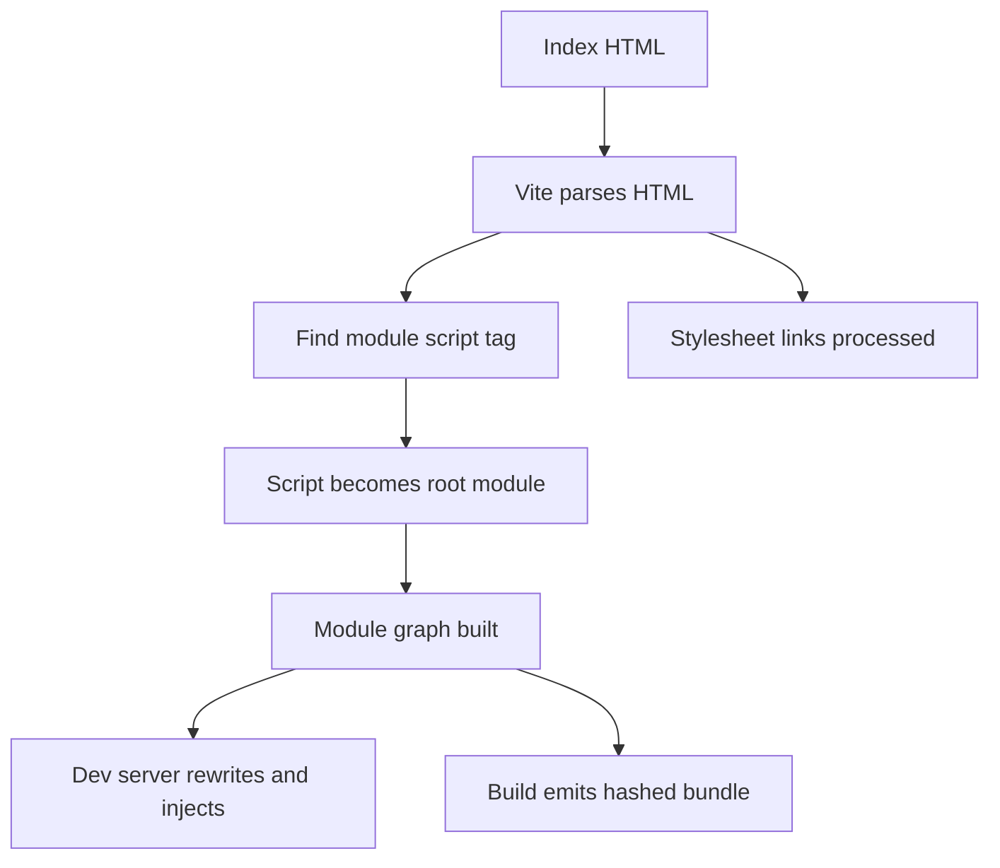

# The HTML Entry Point: Vite's Hidden Root Module

## English

Most bundlers treat JavaScript as the entry point and generate HTML as an afterthought. Vite flips this: in a typical app, index.html is the real entry. You run vite build and Vite parses the HTML, follows the <script type="module" src="/src/main.js"> tag, and treats that script as the root of the module graph. This is why the script tag must have type="module"; a classic script tag is not treated as an entry and will not be bundled the way you expect. Understanding this inversion explains a lot of Vite behaviour that otherwise looks like magic.

Because the HTML is the entry, Vite can transform it like any other module. During development, it rewrites asset URLs, injects the client script that powers hot module replacement, and serves the file through the dev server so that relative paths resolve correctly. During a production build, it processes the HTML, replaces the script tag with a reference to the hashed output bundle, and can inject tags for CSS that was extracted from your modules. Any <link rel="stylesheet"> pointing at a local file is also picked up and processed, so styles referenced from HTML go through the same pipeline as styles imported from JavaScript.

This design has practical consequences. If you have several HTML pages, you can tell Vite about them with the top-level `input` option, passing an object that maps page names to HTML file paths. Each page becomes its own entry and gets its own bundle, which is how multi-page apps are built without a separate framework. (The older `build.rollupOptions.input` spelling still works in Vite 8, but it is now an alias of `build.rolldownOptions.input`, and the docs recommend the top-level `input` option because it is used in dev as well as build.) If you use a framework like React or Vue, its Vite plugin usually hooks into this HTML processing step to inject framework-specific scripts or to transform the template, which is why the plugin often needs to see your index.html.

There are limits worth knowing. Vite does not do full templating in HTML: it handles the tags it understands, such as scripts, stylesheets and asset references, but it will not evaluate arbitrary template syntax for you. Some directives exist for special cases, like marking a script to be inlined rather than emitted as a separate file, but the general rule is that the HTML is processed, not programmed. If you need server-side templating, that happens outside Vite, typically in your backend or a framework's own build step.

A useful mental model: think of index.html as the trunk of a tree and your JavaScript modules as branches growing from the script tag. Everything Vite does, from dev server transforms to production bundling, starts at that trunk. Once you internalise this, questions like 'why is my script not being bundled?' or 'why does my CSS end up in a separate file?' usually answer themselves: check whether the HTML actually references the file in a way Vite recognises.

## 中文

大多數打包器把 JavaScript 當作入口，HTML 只是事後產生的附屬品。Vite 反過來：在典型的應用裡，index.html 才是真正的入口。你執行 vite build，Vite 會解析 HTML，沿著 <script type="module" src="/src/main.js"> 這個標籤走，把該腳本當作模組圖的根。這就是為什麼 script 標籤必須有 type="module"；傳統的 script 標籤不會被當成入口，也不會以你預期的方式被打包。理解這個反轉，就能解釋許多原本看起來像魔法的 Vite 行為。

因為 HTML 是入口，Vite 可以像對待任何模組一樣轉換它。在開發期間，它會改寫資源 URL、注入驅動熱模組替換的客戶端腳本，並透過開發伺服器提供該檔案，讓相對路徑正確解析。在生產建置期間，它會處理 HTML、把 script 標籤換成指向帶雜湊輸出 bundle 的引用，並且可以注入標籤來載入從你的模組抽取出來的 CSS。任何指向本機檔案的 <link rel="stylesheet"> 也會被拾取並處理，所以從 HTML 引用的樣式與從 JavaScript 匯入的樣式走的是同一條管線。

這個設計有實際後果。如果你有多個 HTML 頁面，可以用頂層的 `input` 選項告訴 Vite，傳入一個把頁面名稱對應到 HTML 檔路徑的物件。每個頁面成為自己的入口，得到自己的 bundle，這就是多頁應用不必依賴特定框架的建置方式。（舊的 `build.rollupOptions.input` 寫法喺 Vite 8 仍然可用，但佢已經係 `build.rolldownOptions.input` 嘅別名，而官方文件建議使用頂層 `input`，因為佢喺開發同建置都會生效。）如果你用 React 或 Vue 這類框架，它的 Vite 外掛通常會掛進這個 HTML 處理步驟，注入框架專屬的腳本或轉換模板，這也是為什麼外掛往往需要看到你的 index.html。

有些限制值得知道。Vite 不會在 HTML 裡做完整的模板處理：它會處理它看得懂的標籤，例如腳本、樣式表與資源引用，但不會替你求值任意的模板語法。確實有一些指令用於特殊情況，例如把某個腳本標記為要內嵌而非輸出成獨立檔案，但一般原則是：HTML 是被處理的，不是被編程的。如果你需要伺服器端模板，那發生在 Vite 之外，通常在你的後端或框架自己的建置步驟裡。

一個有用的心智模型：把 index.html 想成樹幹，你的 JavaScript 模組則是從 script 標籤長出來的枝葉。Vite 所做的一切，從開發伺服器的轉換到生產打包，都從那根樹幹開始。一旦你內化這一點，「為什麼我的腳本沒被打包？」或「為什麼我的 CSS 跑到獨立檔案？」這類問題通常會自己回答：檢查 HTML 是否真的以 Vite 認得的方式引用了該檔案。

## Key Takeaway

In a Vite app the HTML file is the real entry point, so the script tag inside it decides what gets bundled.

## Related Concepts
- build.rollupOptions.input
- Multi-page application builds

## Diagram

